# Catálogo de vídeos

81 vídeos. Cada uno: portada, título (el gancho), duración, sala y enlace a su documentación. Montaje: `python3 -I motor/montar_video.py guiones/<id>.json salidas/<id>.mp4`.

## Trading (Claude salva al trader) (9)

| Portada | Vídeo | Duración | Sala |
|---|---|---|---|
|  | **El curso milagro** [`trading_01_curso_milagro`](videos/trading_01_curso_milagro.md) | 45 s | `noche_trading` |
|  | **Las señales VIP de Telegram** [`trading_02_senales_vip`](videos/trading_02_senales_vip.md) | 45 s | `dia_trading` |
| 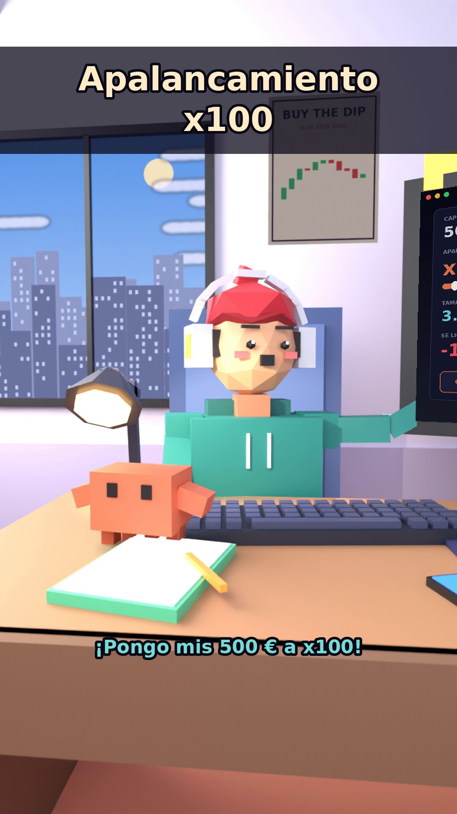 | **Apalancamiento x100** [`trading_03_apalancamiento_x100`](videos/trading_03_apalancamiento_x100.md) | 45 s | `dia_trading` |
| 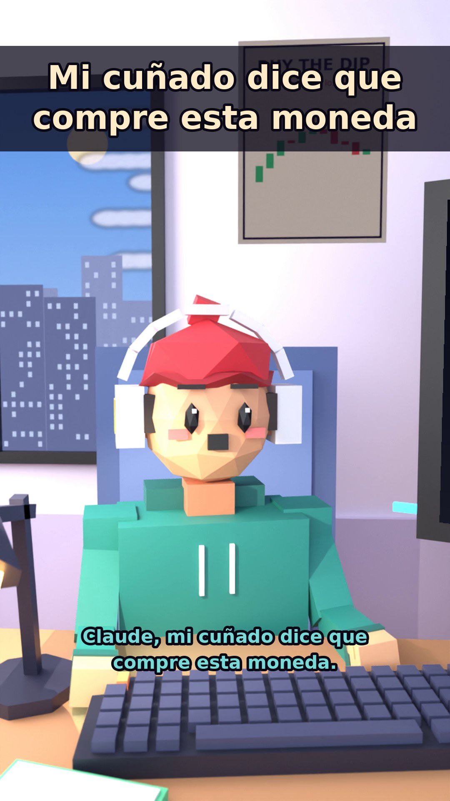 | **Mi cuñado dice que compre esta moneda** [`trading_04_el_cunado`](videos/trading_04_el_cunado.md) | 44 s | `dia_trading` |
|  | **Este tío tiene un yate y dice que me hace rico** [`trading_05_el_guru_del_yate`](videos/trading_05_el_guru_del_yate.md) | 44 s | `noche_trading` |
|  | **Voy a dejar mi trabajo para ser day trader** [`trading_06_dejar_el_trabajo`](videos/trading_06_dejar_el_trabajo.md) | 45 s | `noche_trading` |
| 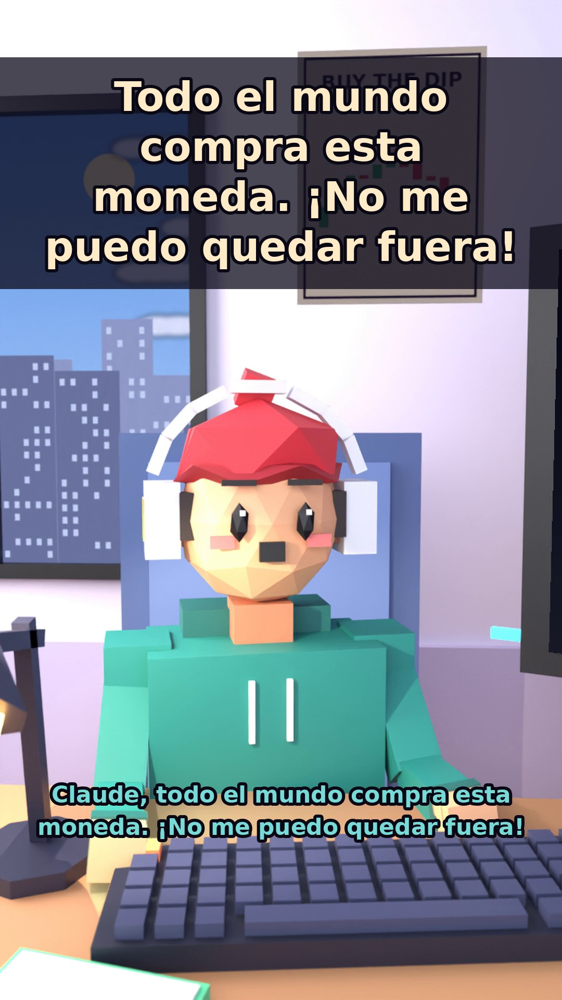 | **Todo el mundo compra esta moneda. ¡No me puedo quedar fuera!** [`trading_07_miedo_a_quedarse_fuera`](videos/trading_07_miedo_a_quedarse_fuera.md) | 44 s | `dia_trading` |
| 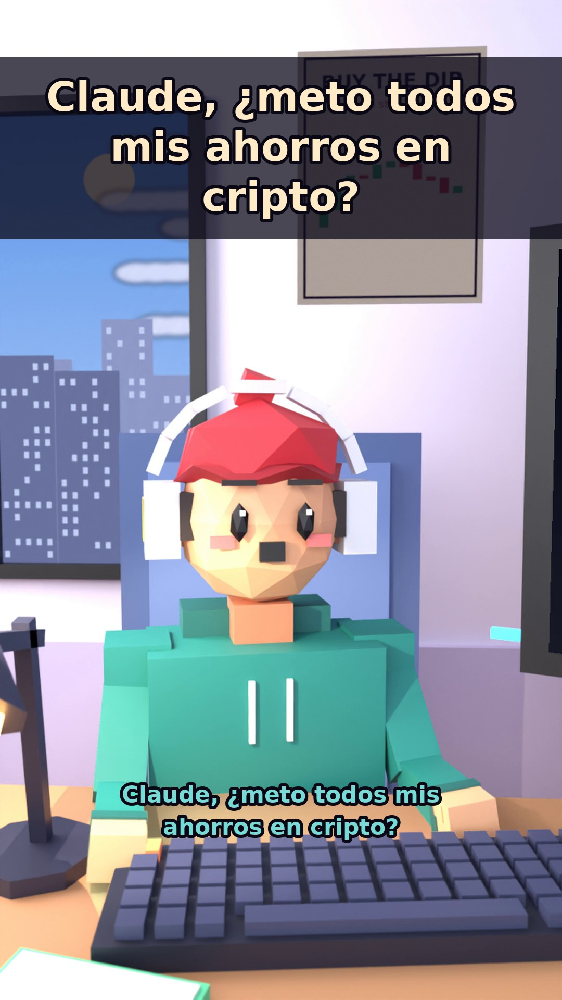 | **Claude, ¿meto todos mis ahorros en cripto?** [`trading_08_ahorros_en_cripto`](videos/trading_08_ahorros_en_cripto.md) | 44 s | `dia_trading` |
|  | **Claude, ¿cuál es la forma más rápida de hacerse rico?** [`trading_09_hacerse_rico_rapido`](videos/trading_09_hacerse_rico_rapido.md) | 40 s | `noche_trading` |

## Finanzas básicas (con fuentes oficiales) (3)

| Portada | Vídeo | Duración | Sala |
|---|---|---|---|
| 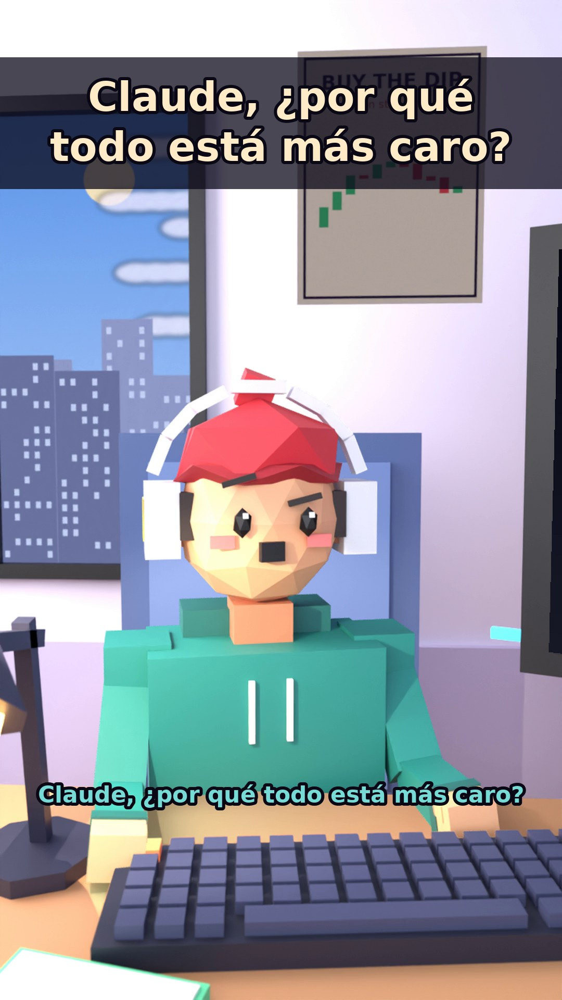 | **Claude, ¿por qué todo está más caro?** [`fin_01_que_es_la_inflacion`](videos/fin_01_que_es_la_inflacion.md) | 42 s | `dia_trading` |
| 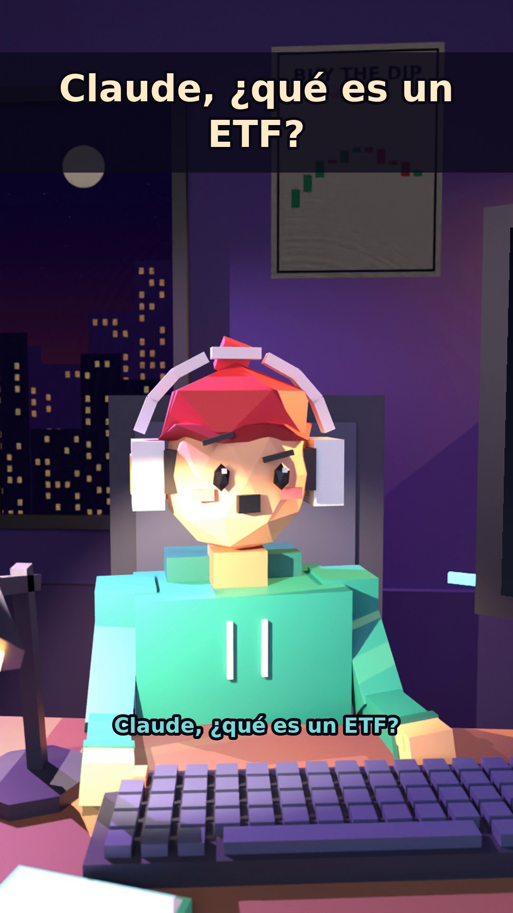 | **Claude, ¿qué es un ETF?** [`fin_02_que_es_un_etf`](videos/fin_02_que_es_un_etf.md) | 42 s | `noche_trading` |
| 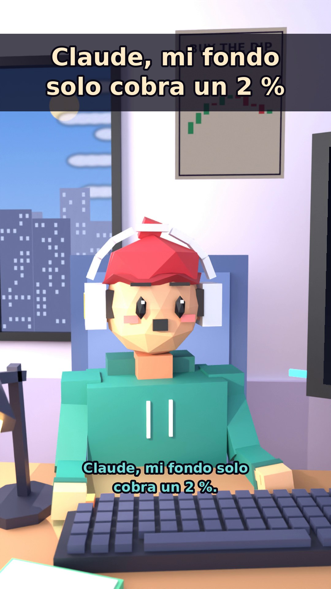 | **Claude, mi fondo solo cobra un 2 %** [`fin_03_las_comisiones`](videos/fin_03_las_comisiones.md) | 42 s | `dia_trading` |

## Útiles: estafas y seguridad (con fuentes) (6)

| Portada | Vídeo | Duración | Sala |
|---|---|---|---|
|  | **Mi contraseña es 123456** [`util_01_contrasenas`](videos/util_01_contrasenas.md) | 42 s | `dia_casa` |
|  | **«Tu banco te va a bloquear la cuenta»** [`util_02_estafa_banco`](videos/util_02_estafa_banco.md) | 42 s | `dia_casa` |
|  | **Claude, ¿me conecto al WiFi gratis del aeropuerto?** [`util_03_wifi_publica`](videos/util_03_wifi_publica.md) | 40 s | `noche_casa` |
| 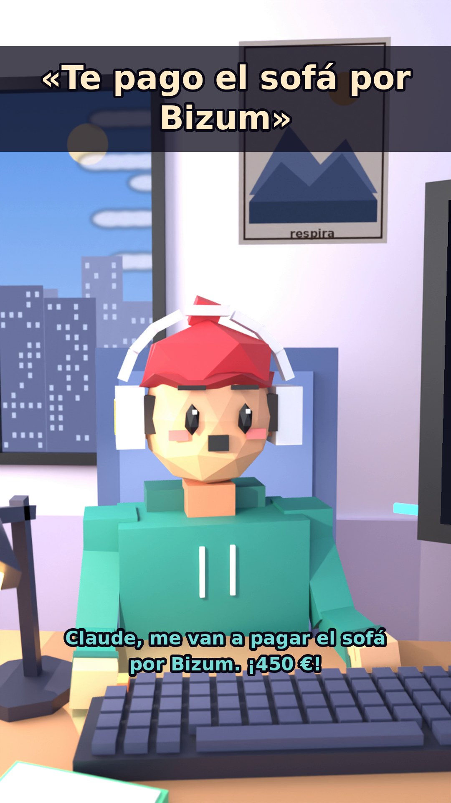 | **«Te pago el sofá por Bizum»** [`util_04_bizum_inverso`](videos/util_04_bizum_inverso.md) | 40 s | `dia_casa` |
| 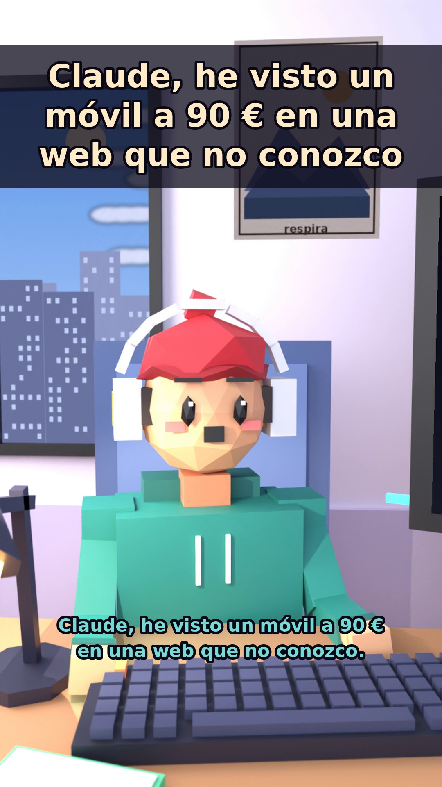 | **Claude, he visto un móvil a 90 € en una web que no conozco** [`util_05_chollo_falso`](videos/util_05_chollo_falso.md) | 42 s | `dia_casa` |
|  | **Claude, me ha llamado Microsoft: dice que mi PC tiene un virus** [`util_06_falso_tecnico`](videos/util_06_falso_tecnico.md) | 42 s | `noche_casa` |

## Dropshipping (8)

| Portada | Vídeo | Duración | Sala |
|---|---|---|---|
| 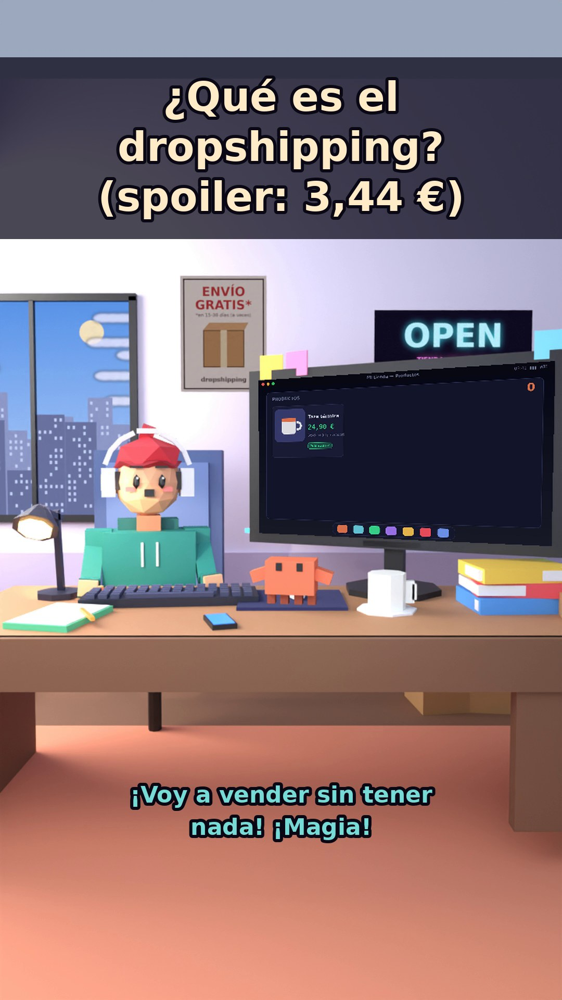 | **¿Qué es el dropshipping? (spoiler: 3,44 €)** [`drop_01_que_es_dropshipping`](videos/drop_01_que_es_dropshipping.md) | 45 s | `dia_tienda` |
| 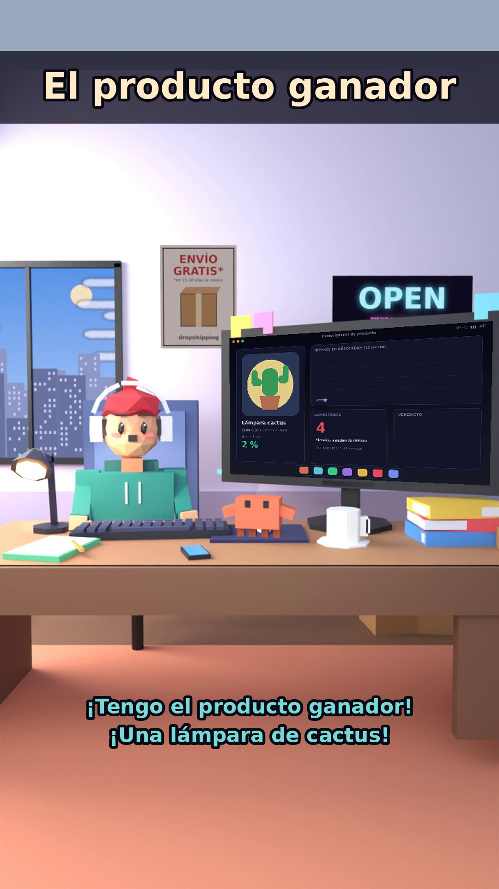 | **El producto ganador** [`drop_02_producto_ganador`](videos/drop_02_producto_ganador.md) | 45 s | `dia_tienda` |
| 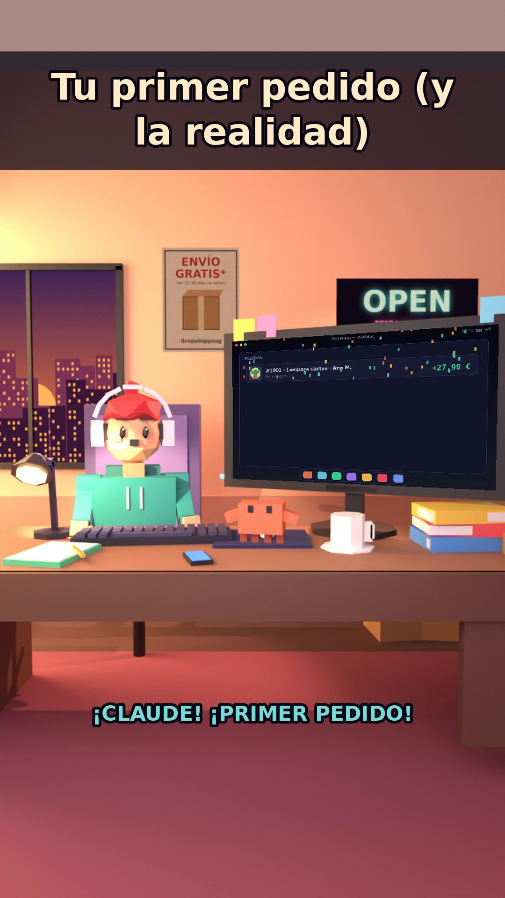 | **Tu primer pedido (y la realidad)** [`drop_03_primer_pedido`](videos/drop_03_primer_pedido.md) | 45 s | `atardecer_tienda` |
| 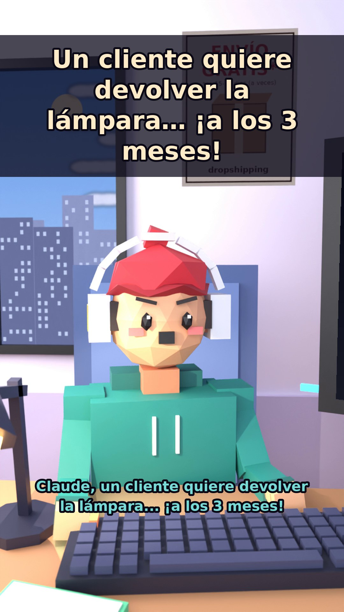 | **Un cliente quiere devolver la lámpara… ¡a los 3 meses!** [`drop_04_devoluciones`](videos/drop_04_devoluciones.md) | 45 s | `dia_tienda` |
| 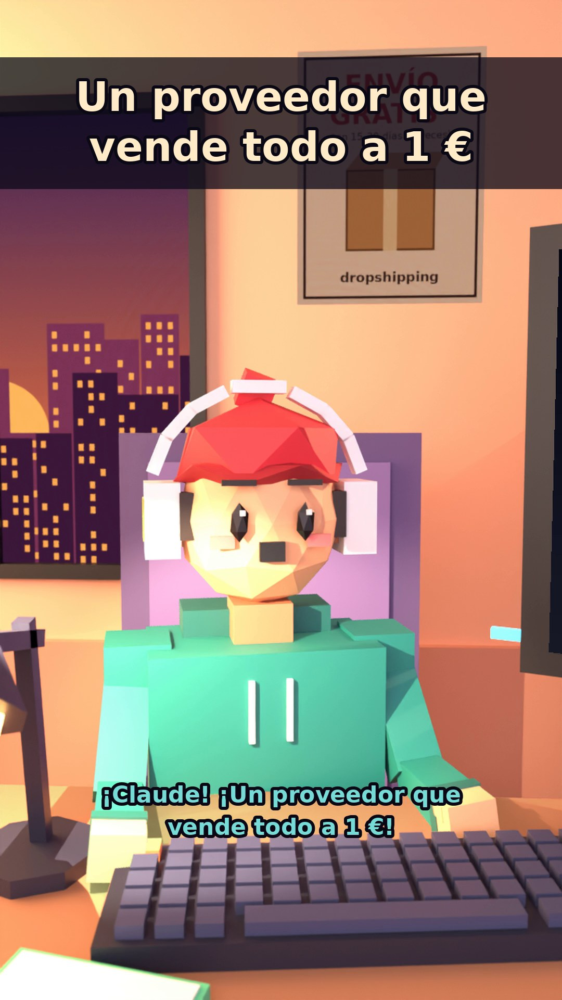 | **Un proveedor que vende todo a 1 €** [`drop_05_proveedor_barato`](videos/drop_05_proveedor_barato.md) | 45 s | `atardecer_tienda` |
|  | **Claude, mi tienda no vende. ¿Cambio el logo?** [`drop_06_cambio_el_logo`](videos/drop_06_cambio_el_logo.md) | 44 s | `noche_tienda` |
| 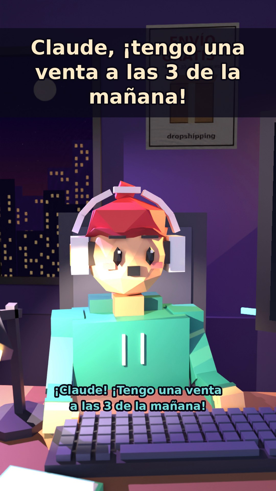 | **Claude, ¡tengo una venta a las 3 de la mañana!** [`drop_07_venta_a_las_3`](videos/drop_07_venta_a_las_3.md) | 40 s | `noche_tienda` |
| 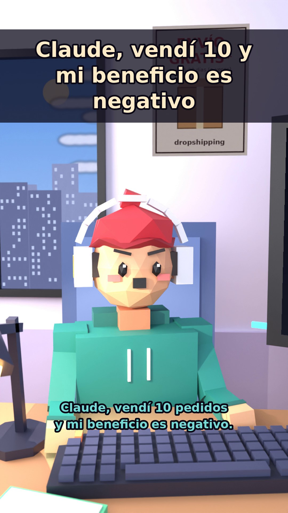 | **Claude, vendí 10 y mi beneficio es negativo** [`drop_08_beneficio_negativo`](videos/drop_08_beneficio_negativo.md) | 44 s | `dia_tienda` |

## Extras: negocio y vida (7)

| Portada | Vídeo | Duración | Sala |
|---|---|---|---|
| 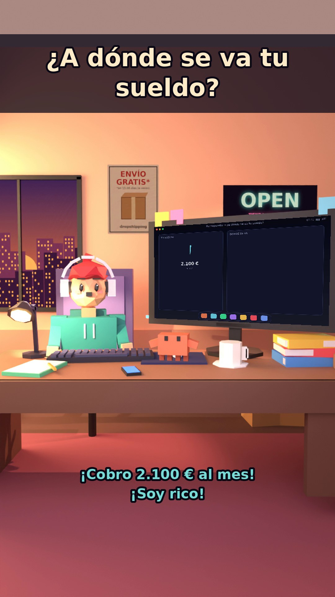 | **¿A dónde se va tu sueldo?** [`extra_01_presupuesto`](videos/extra_01_presupuesto.md) | 45 s | `atardecer_tienda` |
| 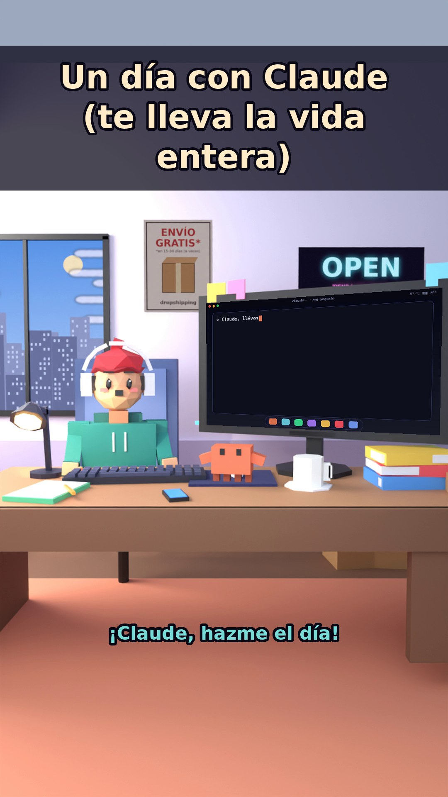 | **Un día con Claude (te lleva la vida entera)** [`extra_02_un_dia_con_claude`](videos/extra_02_un_dia_con_claude.md) | 45 s | `dia_tienda` |
| 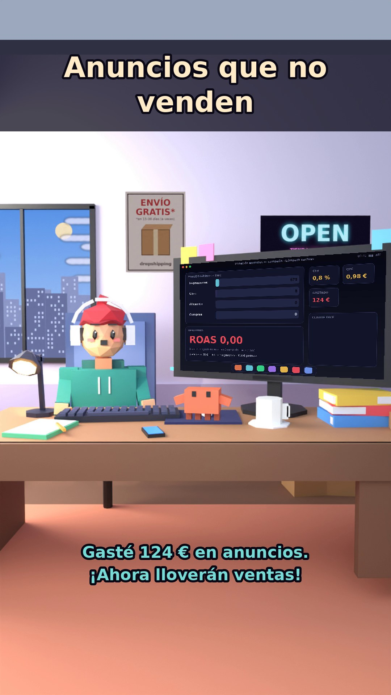 | **Anuncios que no venden** [`extra_03_anuncios_que_no_venden`](videos/extra_03_anuncios_que_no_venden.md) | 45 s | `dia_tienda` |
| 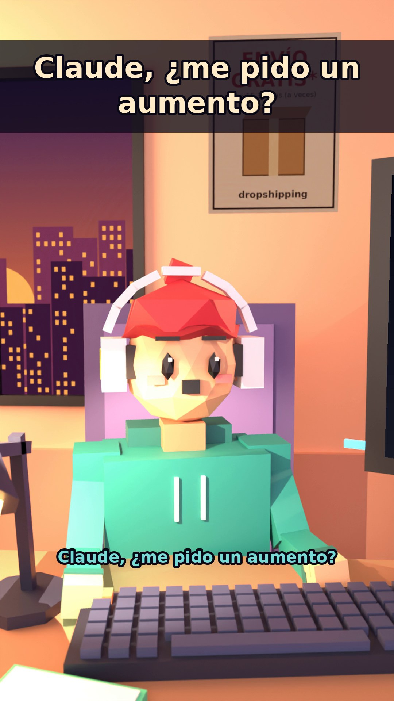 | **Claude, ¿me pido un aumento?** [`extra_04_pedir_aumento`](videos/extra_04_pedir_aumento.md) | 40 s | `atardecer_tienda` |
| 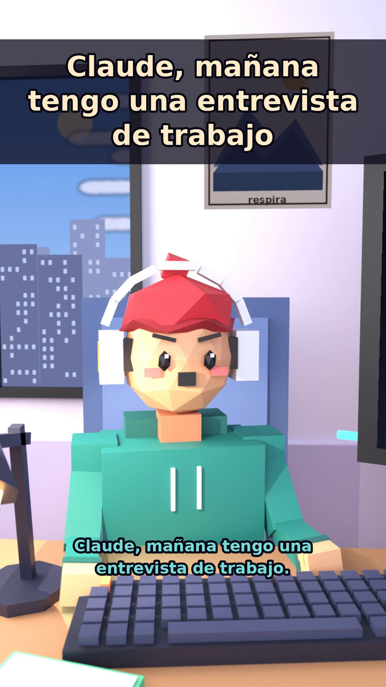 | **Claude, mañana tengo una entrevista de trabajo** [`extra_05_entrevista`](videos/extra_05_entrevista.md) | 38 s | `dia_casa` |
|  | **Claude, ¿hago una marca personal?** [`extra_06_marca_personal`](videos/extra_06_marca_personal.md) | 38 s | `noche_tienda` |
|  | **Claude, tengo una idea millonaria** [`extra_07_idea_millonaria`](videos/extra_07_idea_millonaria.md) | 38 s | `noche_tienda` |

## Día a día (conversaciones con gancho) (38)

| Portada | Vídeo | Duración | Sala |
|---|---|---|---|
|  | **Claude, ¿tú me quieres?** [`casual_01_me_quieres`](videos/casual_01_me_quieres.md) | 40 s | `noche_casa` |
| 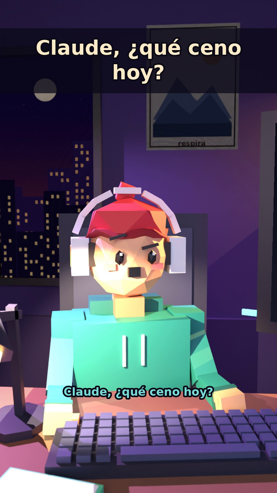 | **Claude, ¿qué ceno hoy?** [`casual_02_que_cenamos`](videos/casual_02_que_cenamos.md) | 38 s | `noche_casa` |
| 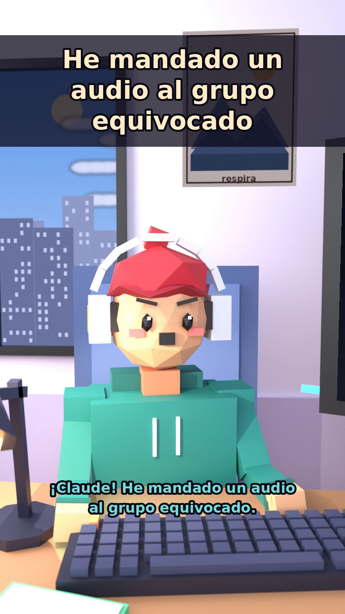 | **He mandado un audio al grupo equivocado** [`casual_03_grupo_equivocado`](videos/casual_03_grupo_equivocado.md) | 40 s | `dia_casa` |
|  | **Claude, ¿por qué no me contesta?** [`casual_04_visto`](videos/casual_04_visto.md) | 38 s | `noche_casa` |
|  | **Claude, mañana empiezo la dieta** [`casual_05_dieta_lunes`](videos/casual_05_dieta_lunes.md) | 36 s | `dia_casa` |
|  | **Claude, creo que mi vecino me odia** [`casual_06_vecino`](videos/casual_06_vecino.md) | 38 s | `noche_casa` |
|  | **Claude, ¿estoy cansado o soy vago?** [`casual_07_cansado_o_vago`](videos/casual_07_cansado_o_vago.md) | 36 s | `dia_casa` |
| 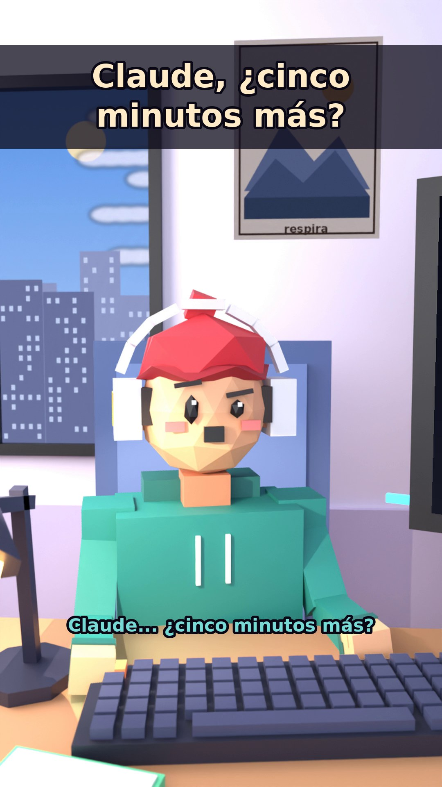 | **Claude, ¿cinco minutos más?** [`casual_08_cinco_minutos`](videos/casual_08_cinco_minutos.md) | 36 s | `dia_casa` |
|  | **Claude, ¿por qué existen los lunes?** [`casual_09_los_lunes`](videos/casual_09_los_lunes.md) | 36 s | `dia_casa` |
|  | **Claude, mañana tengo una cita. ¿Qué digo?** [`casual_10_la_cita`](videos/casual_10_la_cita.md) | 40 s | `noche_casa` |
| 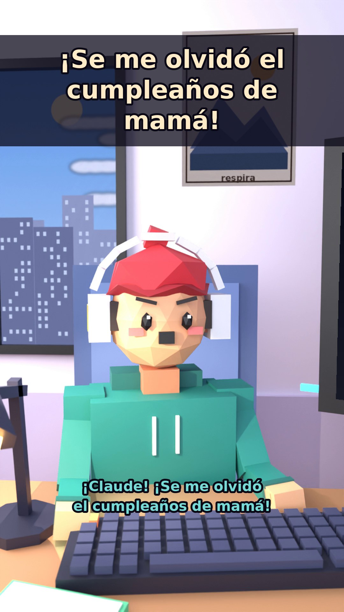 | **¡Se me olvidó el cumpleaños de mamá!** [`casual_11_cumple_mama`](videos/casual_11_cumple_mama.md) | 38 s | `dia_casa` |
|  | **Claude, no hay internet** [`casual_12_sin_internet`](videos/casual_12_sin_internet.md) | 36 s | `noche_casa` |
| 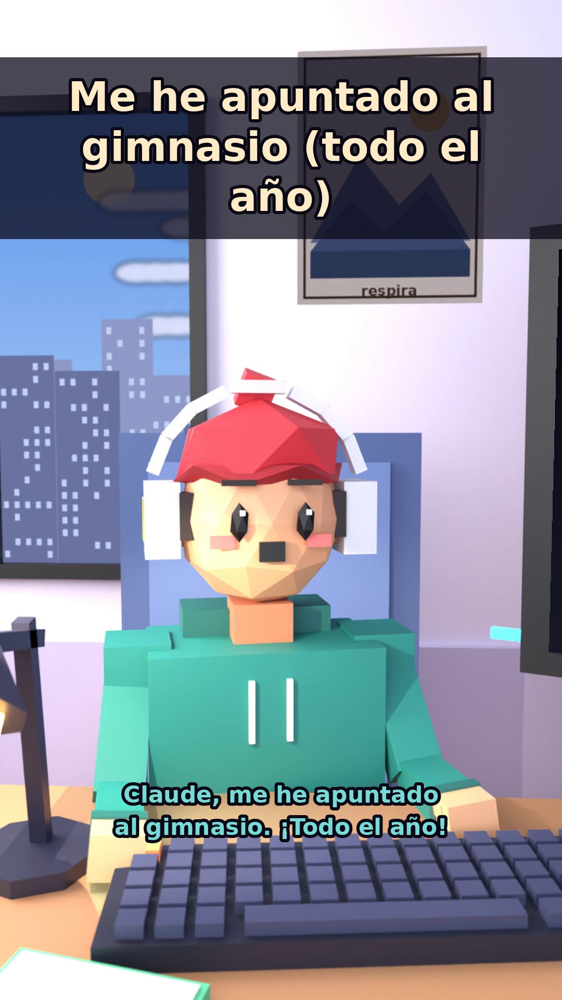 | **Me he apuntado al gimnasio (todo el año)** [`casual_13_gimnasio`](videos/casual_13_gimnasio.md) | 38 s | `dia_casa` |
| 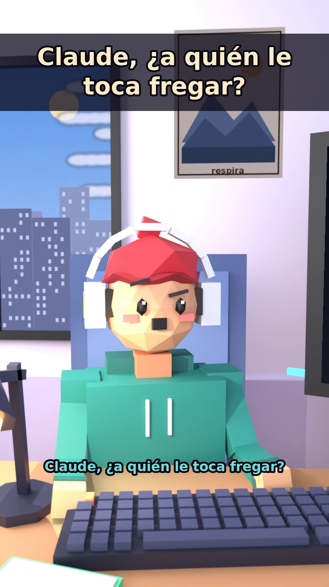 | **Claude, ¿a quién le toca fregar?** [`casual_14_quien_friega`](videos/casual_14_quien_friega.md) | 36 s | `dia_casa` |
|  | **Claude, ¿le escribo a mi ex?** [`casual_15_escribir_al_ex`](videos/casual_15_escribir_al_ex.md) | 40 s | `noche_casa` |
| 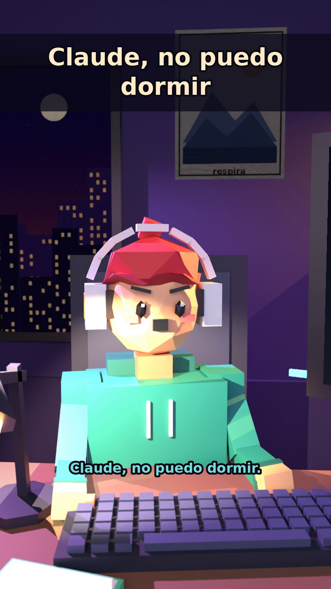 | **Claude, no puedo dormir** [`casual_16_no_puedo_dormir`](videos/casual_16_no_puedo_dormir.md) | 38 s | `noche_casa` |
| 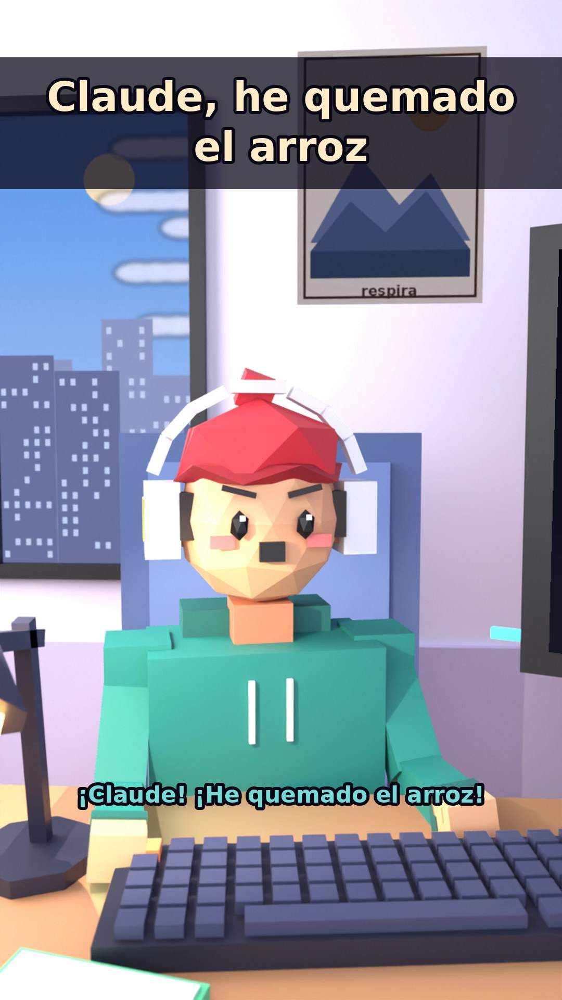 | **Claude, he quemado el arroz** [`casual_17_arroz_quemado`](videos/casual_17_arroz_quemado.md) | 36 s | `dia_casa` |
|  | **Claude, mi perro me mira raro** [`casual_18_mi_perro`](videos/casual_18_mi_perro.md) | 36 s | `dia_casa` |
|  | **Claude, ¿hago la lista de la compra?** [`casual_20_lista_compra`](videos/casual_20_lista_compra.md) | 38 s | `noche_casa` |
| 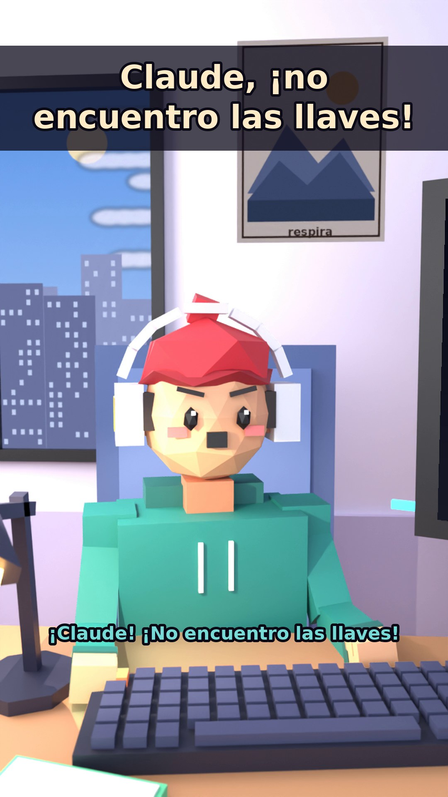 | **Claude, ¡no encuentro las llaves!** [`casual_22_las_llaves`](videos/casual_22_las_llaves.md) | 28 s | `dia_casa` |
|  | **Claude, no tengo nada que ponerme** [`casual_24_nada_que_ponerme`](videos/casual_24_nada_que_ponerme.md) | 36 s | `noche_casa` |
| 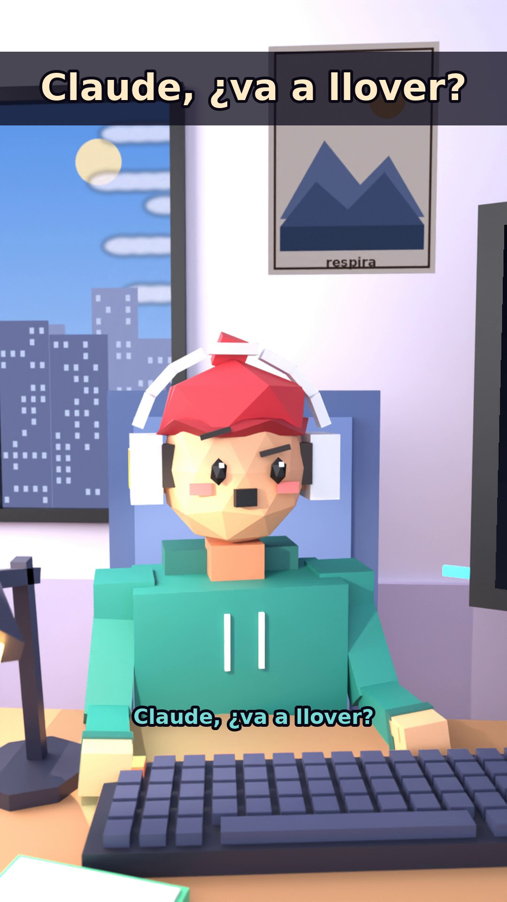 | **Claude, ¿va a llover?** [`casual_21_va_a_llover`](videos/casual_21_va_a_llover.md) | 28 s | `dia_casa` |
| 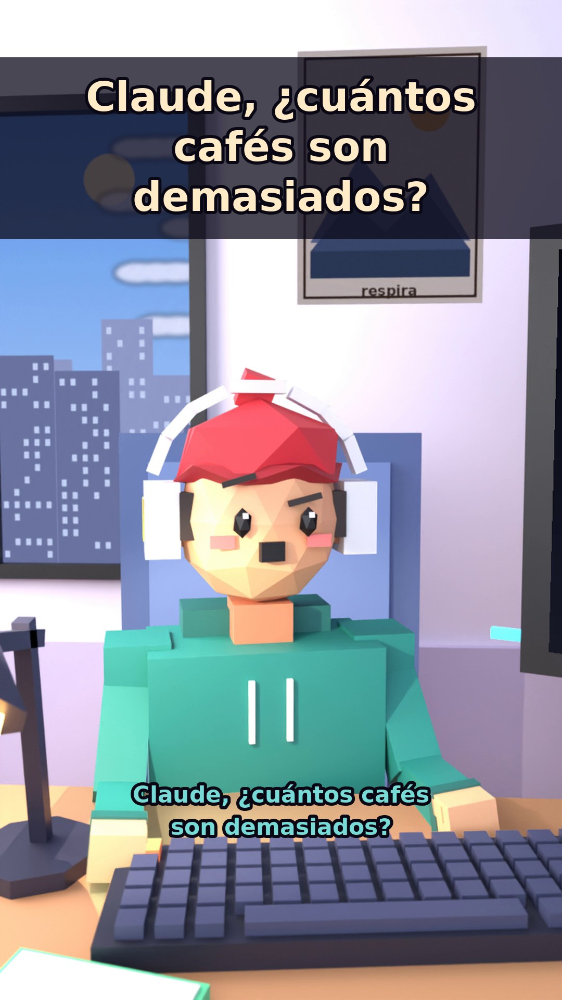 | **Claude, ¿cuántos cafés son demasiados?** [`casual_23_demasiado_cafe`](videos/casual_23_demasiado_cafe.md) | 36 s | `dia_casa` |
| 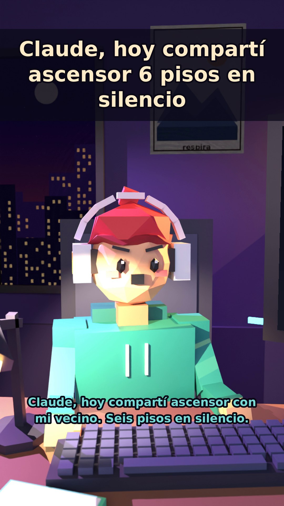 | **Claude, hoy compartí ascensor 6 pisos en silencio** [`casual_25_ascensor`](videos/casual_25_ascensor.md) | 36 s | `noche_casa` |
| 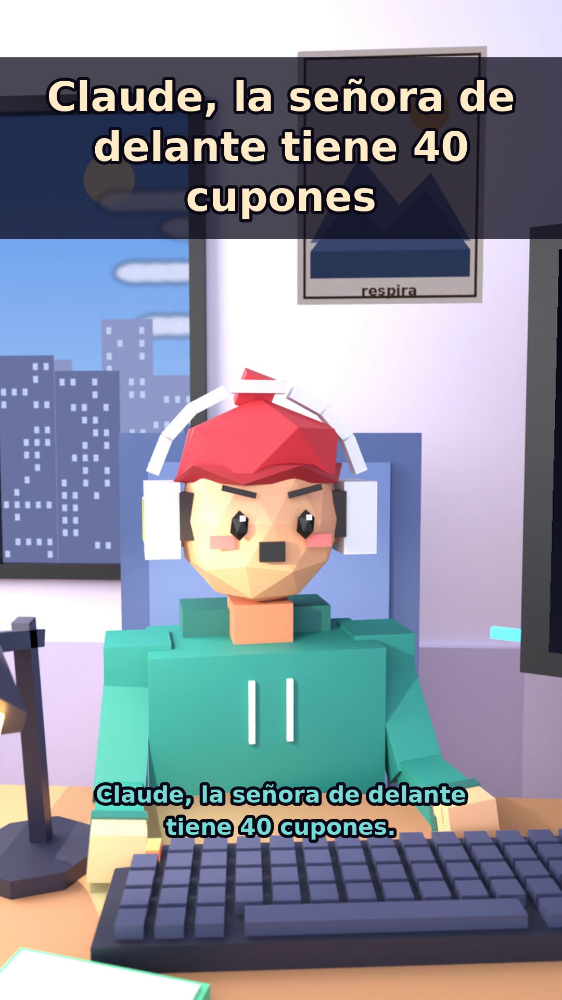 | **Claude, la señora de delante tiene 40 cupones** [`casual_26_cola_del_super`](videos/casual_26_cola_del_super.md) | 36 s | `dia_casa` |
|  | **Claude, esta reunión podía ser un correo** [`casual_27_reunion_correo`](videos/casual_27_reunion_correo.md) | 38 s | `dia_casa` |
|  | **Claude, ya es domingo por la noche** [`casual_28_domingo_noche`](videos/casual_28_domingo_noche.md) | 36 s | `noche_casa` |
|  | **Claude, me han hecho un cumplido y no sé qué contestar** [`casual_29_un_cumplido`](videos/casual_29_un_cumplido.md) | 36 s | `dia_casa` |
|  | **Claude, si no hago nada, ¿es meditar?** [`casual_30_no_hacer_nada`](videos/casual_30_no_hacer_nada.md) | 36 s | `noche_casa` |
|  | **Claude, ¿qué foto subo?** [`casual_31_que_foto_subo`](videos/casual_31_que_foto_subo.md) | 36 s | `noche_casa` |
| 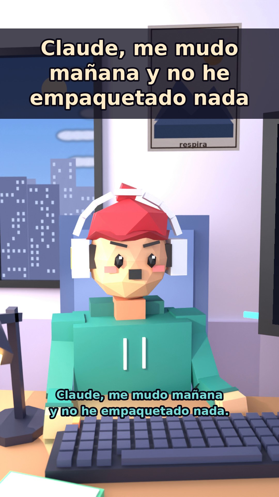 | **Claude, me mudo mañana y no he empaquetado nada** [`casual_32_la_mudanza`](videos/casual_32_la_mudanza.md) | 38 s | `dia_casa` |
| 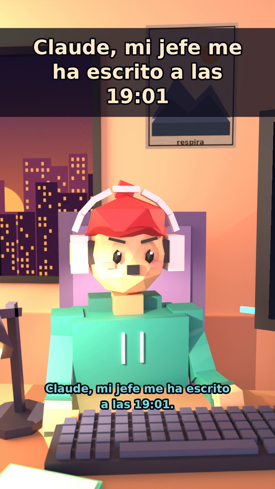 | **Claude, mi jefe me ha escrito a las 19:01** [`casual_33_jefe_19h`](videos/casual_33_jefe_19h.md) | 36 s | `atardecer_casa` |
| 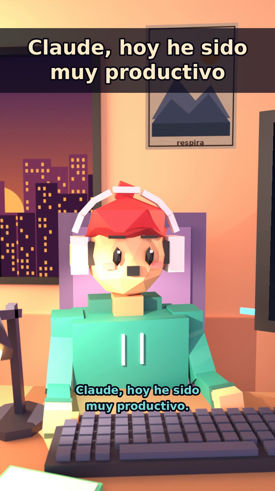 | **Claude, hoy he sido muy productivo** [`casual_34_hoy_productivo`](videos/casual_34_hoy_productivo.md) | 34 s | `atardecer_casa` |
| 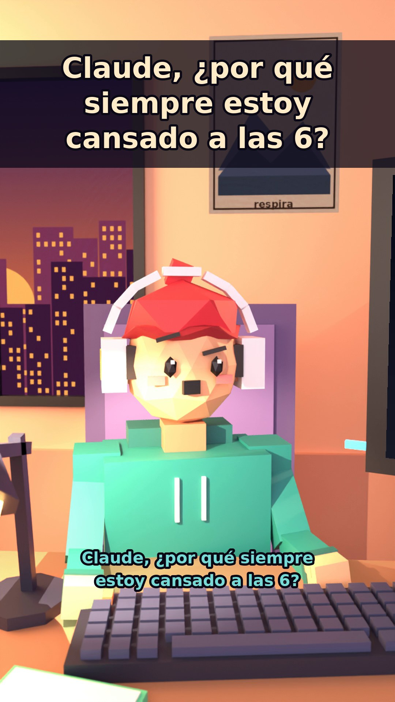 | **Claude, ¿por qué siempre estoy cansado a las 6?** [`casual_35_cansado_a_las_6`](videos/casual_35_cansado_a_las_6.md) | 36 s | `atardecer_casa` |
| 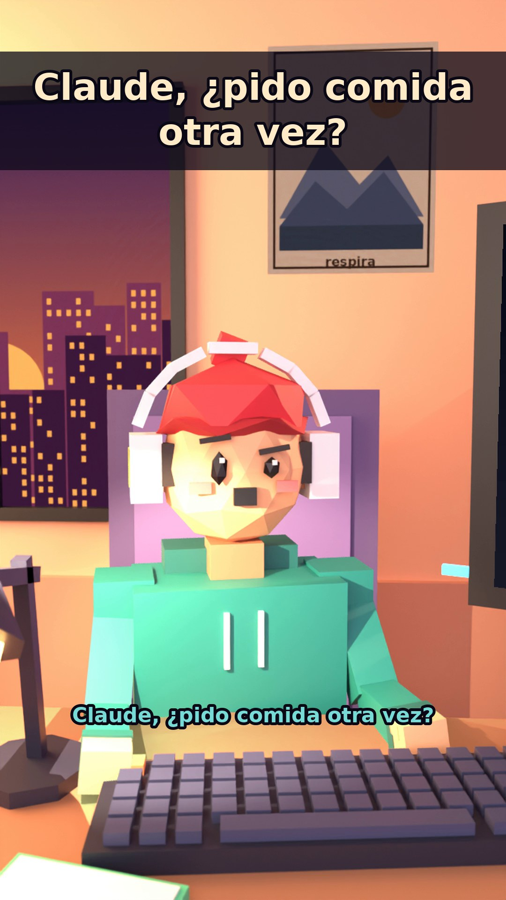 | **Claude, ¿pido comida otra vez?** [`casual_36_pido_comida`](videos/casual_36_pido_comida.md) | 36 s | `atardecer_casa` |
| 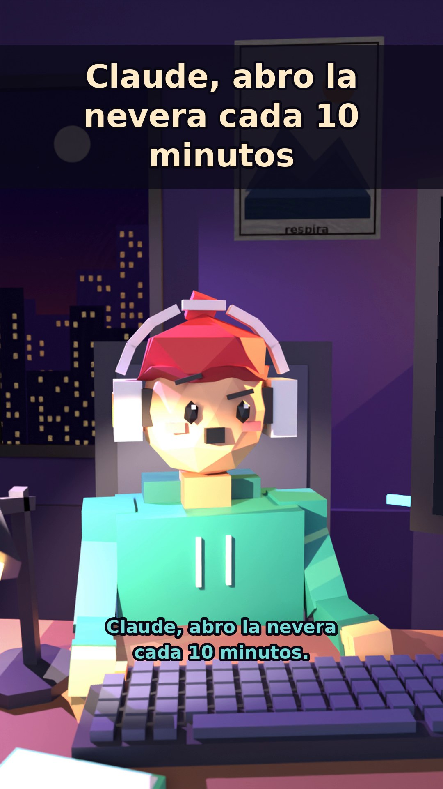 | **Claude, abro la nevera cada 10 minutos** [`casual_37_la_nevera`](videos/casual_37_la_nevera.md) | 34 s | `noche_casa` |
| 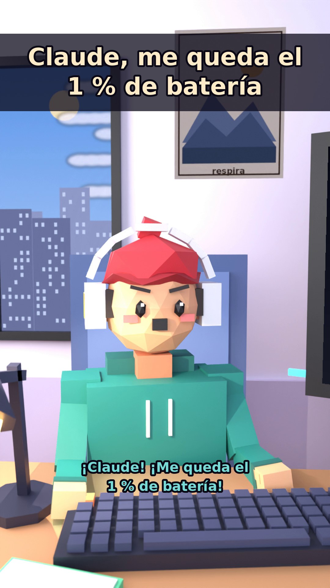 | **Claude, me queda el 1 % de batería** [`casual_38_un_por_ciento`](videos/casual_38_un_por_ciento.md) | 32 s | `dia_casa` |
| 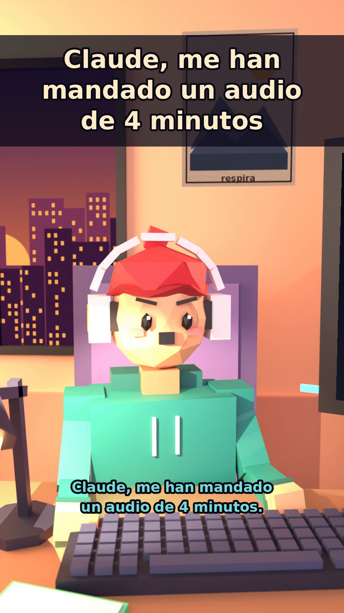 | **Claude, me han mandado un audio de 4 minutos** [`casual_39_audio_de_4_minutos`](videos/casual_39_audio_de_4_minutos.md) | 36 s | `atardecer_casa` |

## Micro-vídeos de ~20 s (10)

| Portada | Vídeo | Duración | Sala |
|---|---|---|---|
|  | **Claude, ¿he apagado el horno?** [`micro_01_el_horno`](videos/micro_01_el_horno.md) | 20 s | `noche_casa` |
|  | **Claude, dime algo bonito** [`micro_02_dime_algo_bonito`](videos/micro_02_dime_algo_bonito.md) | 20 s | `dia_casa` |
|  | **Claude, ¿cómo será mi futuro?** [`micro_03_mi_futuro`](videos/micro_03_mi_futuro.md) | 20 s | `atardecer_casa` |
| 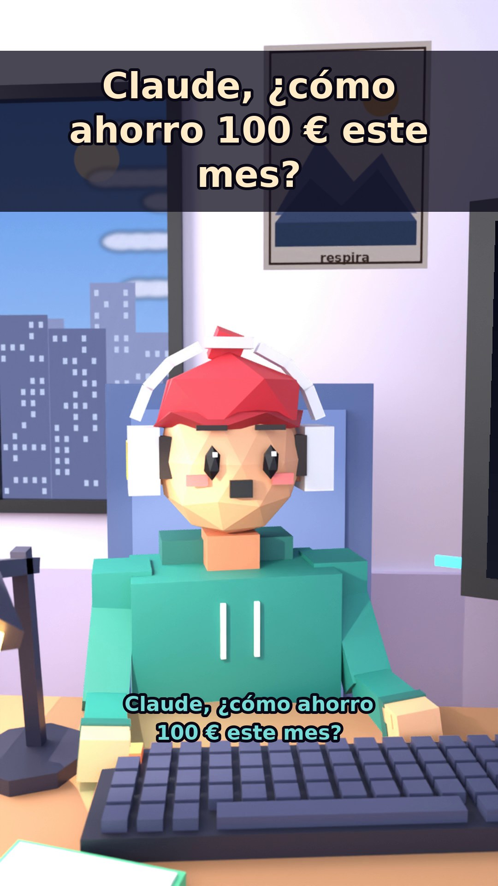 | **Claude, ¿cómo ahorro 100 € este mes?** [`micro_04_ahorrar_100`](videos/micro_04_ahorrar_100.md) | 20 s | `dia_casa` |
| 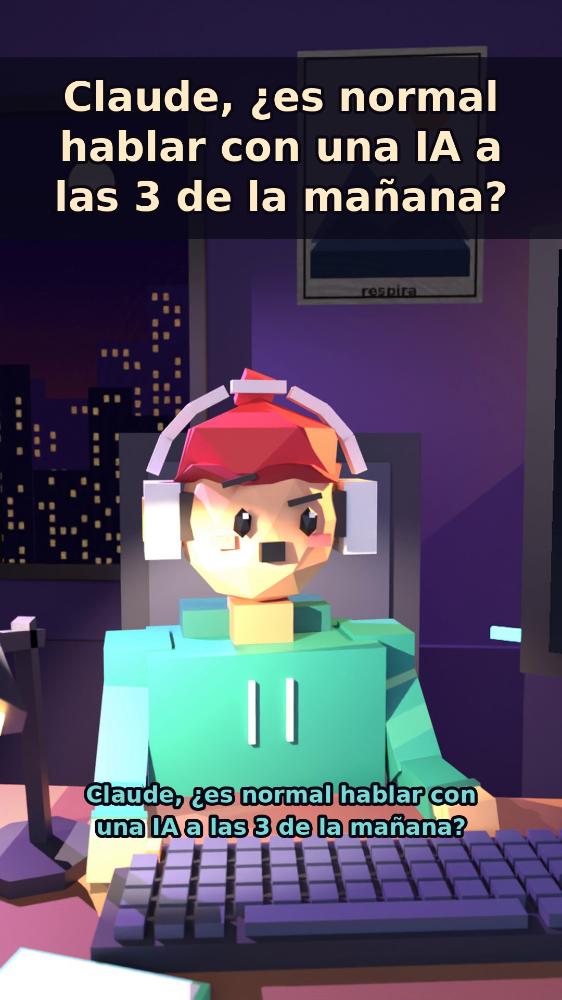 | **Claude, ¿es normal hablar con una IA a las 3 de la mañana?** [`micro_05_las_3_de_la_manana`](videos/micro_05_las_3_de_la_manana.md) | 20 s | `noche_casa` |
| 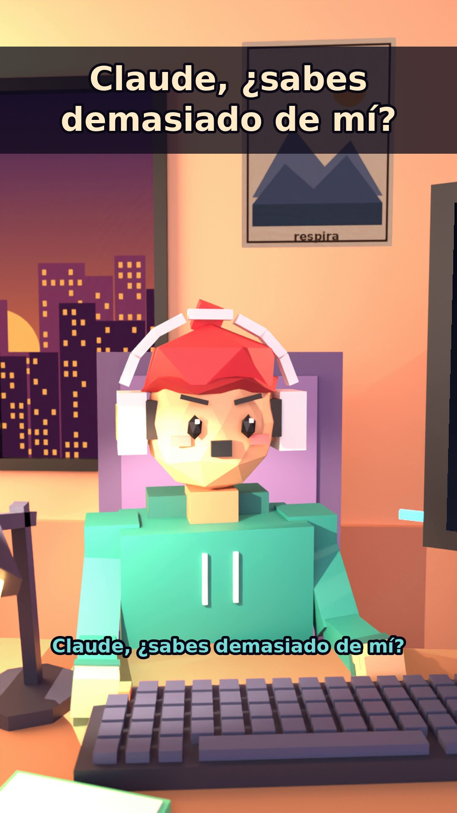 | **Claude, ¿sabes demasiado de mí?** [`micro_06_sabes_demasiado`](videos/micro_06_sabes_demasiado.md) | 20 s | `atardecer_casa` |
| 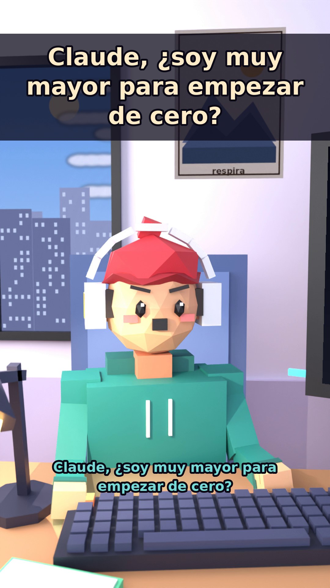 | **Claude, ¿soy muy mayor para empezar de cero?** [`micro_07_empezar_de_cero`](videos/micro_07_empezar_de_cero.md) | 20 s | `dia_casa` |
|  | **Claude, me he equivocado muchísimo** [`micro_08_me_he_equivocado`](videos/micro_08_me_he_equivocado.md) | 20 s | `noche_casa` |
| 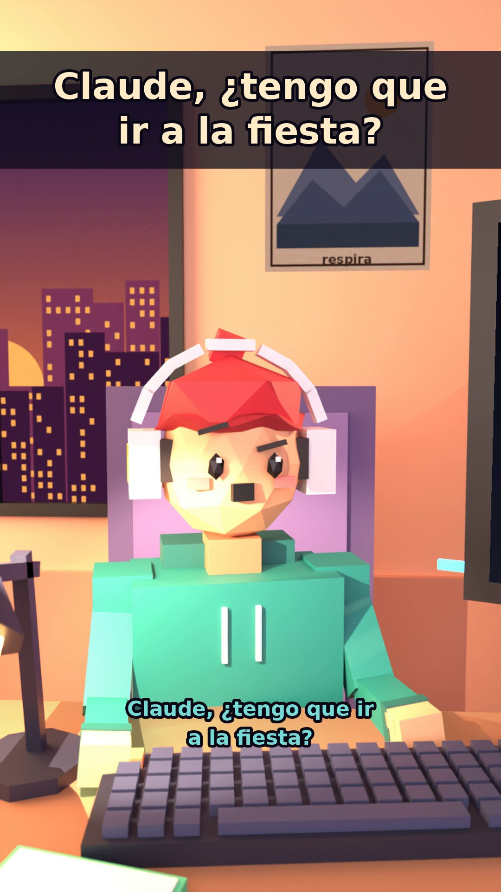 | **Claude, ¿tengo que ir a la fiesta?** [`micro_09_ya_voy`](videos/micro_09_ya_voy.md) | 20 s | `atardecer_casa` |
|  | **Claude, dime la verdad: ¿canto mal?** [`micro_10_dime_la_verdad`](videos/micro_10_dime_la_verdad.md) | 20 s | `noche_casa` |

Resto de piezas: `trading_30s_sarcastico` (primera versión de 30 s) y los `ejemplo_*` (pruebas del montador).
