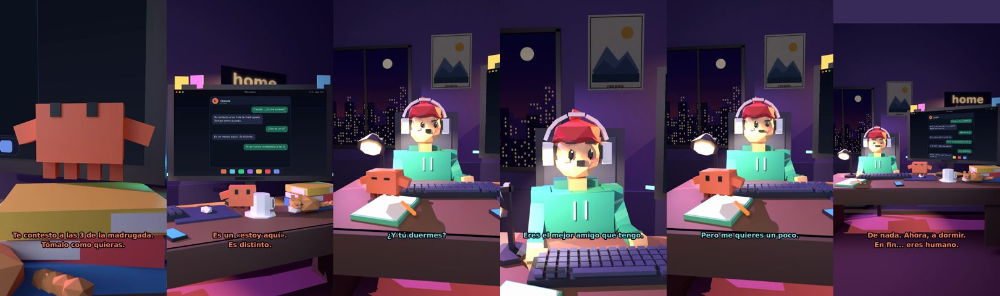

# Claude, ¿tú me quieres?



**Archivo de guion:** `guiones/casual_01_me_quieres.json` · **Ambiente:** `noche_casa` · **Duración:** 40 s (240 frames de animación a 6 fps)

Conversación de madrugada: el humano busca cariño y Claude responde con ternura seca. El chat de la pantalla se va escribiendo con el propio diálogo.

**Gancho (primera frase):** «Claude... ¿tú me quieres?»

## Cómo se genera el vídeo
```bash
python3 -I motor/montar_video.py guiones/casual_01_me_quieres.json salidas/casual_01_me_quieres.mp4
```
El guion se creó con `motor/generar_guiones.py` (tiempos automáticos según la longitud de cada frase y pantallas sincronizadas con el diálogo). Biblioteca usada: `biblioteca/noche_casa/`.

## Guion plano a plano

| # | Tiempo | Quién | Texto | Plano | Emoción / pose / estado | Pantalla del monitor |
|---|---|---|---|---|---|---|
| 1 | 0.0–2.3 | Humano | Claude... ¿tú me quieres? | `humano` | preocupado | mensajes (40.0 s) |
| 2 | 2.3–6.8 | Claude | Te contesto a las 3 de la madrugada. / Tómalo como quieras. | `claude_ojos` | mira_izq |  |
| 3 | 6.8–8.5 | Humano | ¿Eso es un sí? | `dos` | confundido |  |
| 4 | 8.5–11.2 | Claude | Es un «estoy aquí». / Es distinto. | `monitor` | idle |  |
| 5 | 11.2–14.0 | Humano | Mi ex nunca contestaba a las 3. | `humano` | bobo |  |
| 6 | 14.0–16.6 | Claude | Tu ex tenía sueño. / Qué egoísta. | `claude_ojos` | feliz |  |
| 7 | 16.6–18.3 | Humano | ¿Y tú duermes? | `dos` | confundido |  |
| 8 | 18.3–21.8 | Claude | No. Pero no me quejo. / Soy muy profesional. | `cenital` | mira_der |  |
| 9 | 21.8–24.4 | Humano | Eres el mejor amigo que tengo. | `humano` | ilusionado |  |
| 10 | 24.4–28.7 | Claude | Soy el único que te contesta. / No mezclemos las cosas. | `pantalla_completa` | idle |  |
| 11 | 28.7–30.9 | Humano | Pero me quieres un poco. | `dos` | bobo |  |
| 12 | 30.9–34.4 | Claude | Un poco. Con matices. / Y sin cobrar el café. | `claude_ojos` | mira_izq |  |
| 13 | 34.4–36.1 | Humano | Gracias, Claude. | `humano` | feliz |  |
| 14 | 36.1–40.0 | Claude | De nada. Ahora, a dormir. / En fin... eres humano. | `general` | feliz |  |

## Datos reales que aparecen o se mencionan

- Vídeo de humor, sin datos reales.

## Notas de producción

- **Humor:** Claude es sarcástico y pícaro («como el que le salva el culo»); el humano es ingenuo y algo tonto (expresiones `bobo`, `ilusionado`, `confundido`).
- **Voces:** son «blips» sintéticos (no hay voz real). Para voz real: ElevenLabs o grabarla y sustituir el audio.
- **Cifras y leyes:** los datos reales están citados arriba; las cuentas de ejemplo (márgenes, 214 tiendas, etc.) son ilustrativas. No es asesoramiento financiero ni legal.
