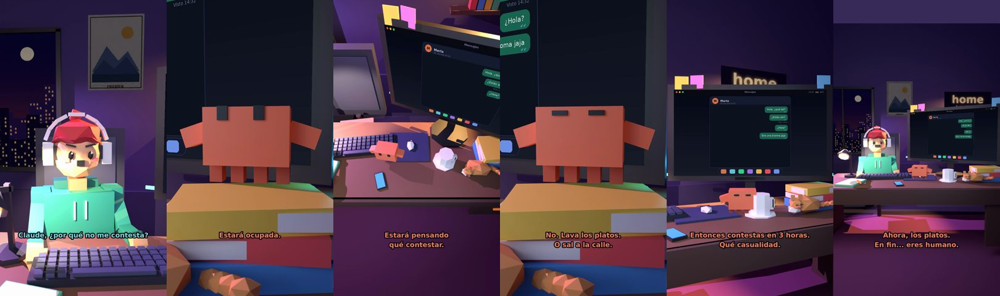

# Claude, ¿por qué no me contesta?



**Archivo de guion:** `guiones/casual_04_visto.json` · **Ambiente:** `noche_casa` · **Duración:** 38 s (228 frames de animación a 6 fps)

El clásico del «visto»: tres horas sin respuesta y el humano escribiendo y borrando. Claude da el consejo más sensato: lava los platos.

**Gancho (primera frase):** «Claude, ¿por qué no me contesta?»

## Cómo se genera el vídeo
```bash
python3 -I motor/montar_video.py guiones/casual_04_visto.json salidas/casual_04_visto.mp4
```
El guion se creó con `motor/generar_guiones.py` (tiempos automáticos según la longitud de cada frase y pantallas sincronizadas con el diálogo). Biblioteca usada: `biblioteca/noche_casa/`.

## Guion plano a plano

| # | Tiempo | Quién | Texto | Plano | Emoción / pose / estado | Pantalla del monitor |
|---|---|---|---|---|---|---|
| 1 | 0.0–3.4 | Humano | Claude, ¿por qué no me contesta? | `humano` | preocupado | mensajes (27.08 s) |
| 2 | 3.4–5.5 | Claude | ¿Quién? ¿Marta? | `monitor` | idle |  |
| 3 | 5.5–8.9 | Humano | Lleva 3 horas viendo mi mensaje. | `dos` | preocupado |  |
| 4 | 8.9–10.9 | Claude | Estará ocupada. | `claude_ojos` | mira_izq |  |
| 5 | 10.9–14.5 | Humano | Está en línea. Escribe... y borra. | `humano` | confundido |  |
| 6 | 14.5–17.7 | Claude | Estará pensando / qué contestar. | `cenital` | mira_der |  |
| 7 | 17.7–20.5 | Humano | ¿Y si le escribo otra vez? | `dos` | bobo |  |
| 8 | 20.5–24.4 | Claude | No. Lava los platos. / O sal a la calle. | `claude_ojos` | feliz |  |
| 9 | 24.4–27.1 | Humano | ¿Y si contesta mientras? | `humano` | preocupado |  |
| 10 | 27.1–31.6 | Claude | Entonces contestas en 3 horas. / Qué casualidad. | `monitor` | feliz |  |
| 11 | 31.6–33.9 | Humano | ¡Eso es muy maduro! | `dos` | ilusionado |  |
| 12 | 33.9–38.0 | Claude | Ahora, los platos. / En fin... eres humano. | `general` | feliz |  |

## Datos reales que aparecen o se mencionan

- Vídeo de humor, sin datos reales.

## Notas de producción

- **Humor:** Claude es sarcástico y pícaro («como el que le salva el culo»); el humano es ingenuo y algo tonto (expresiones `bobo`, `ilusionado`, `confundido`).
- **Voces:** son «blips» sintéticos (no hay voz real). Para voz real: ElevenLabs o grabarla y sustituir el audio.
- **Cifras y leyes:** los datos reales están citados arriba; las cuentas de ejemplo (márgenes, 214 tiendas, etc.) son ilustrativas. No es asesoramiento financiero ni legal.
