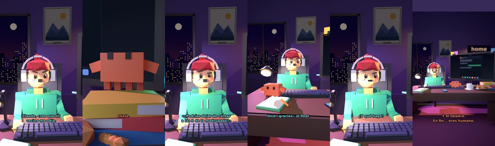

# Claude, creo que mi vecino me odia



**Archivo de guion:** `guiones/casual_06_vecino.json` · **Ambiente:** `noche_casa` · **Duración:** 38 s (228 frames de animación a 6 fps)

El humano cree que su vecino le odia; la nota del vecino lo desmiente: es el humano quien canta y taladra a las 3 de la madrugada. Giro de guion cotidiano.

**Gancho (primera frase):** «Claude, creo que mi vecino me odia.»

## Cómo se genera el vídeo
```bash
python3 -I motor/montar_video.py guiones/casual_06_vecino.json salidas/casual_06_vecino.mp4
```
El guion se creó con `motor/generar_guiones.py` (tiempos automáticos según la longitud de cada frase y pantallas sincronizadas con el diálogo). Biblioteca usada: `biblioteca/noche_casa/`.

## Guion plano a plano

| # | Tiempo | Quién | Texto | Plano | Emoción / pose / estado | Pantalla del monitor |
|---|---|---|---|---|---|---|
| 1 | 0.0–3.7 | Humano | Claude, creo que mi / vecino me odia. | `humano` | preocupado | mensajes (28.71 s) |
| 2 | 3.7–6.0 | Claude | ¿Por qué lo crees? | `monitor` | idle |  |
| 3 | 6.0–8.6 | Humano | Me ha dejado una nota. | `dos` | confundido |  |
| 4 | 8.6–10.7 | Claude | Léela. | `claude_ojos` | mira_izq |  |
| 5 | 10.7–15.9 | Humano | «¿Podrías dejar de cantar / a las 3 de la madrugada?» | `humano` | bobo |  |
| 6 | 15.9–20.1 | Claude | Eso es una petición educada. / No es odio. | `cenital` | mira_der |  |
| 7 | 20.1–22.9 | Humano | Dice «gracias» al final. | `dos` | preocupado |  |
| 8 | 22.9–26.6 | Claude | Qué amable. Tienes un / vecino santo. | `monitor` | feliz |  |
| 9 | 26.6–28.7 | Humano | ¿Y qué hago? | `humano` | confundido |  |
| 10 | 28.7–32.0 | Claude | Dejar de cantar. / O cantar bien. | `claude_ojos` | mira_arriba |  |
| 11 | 32.0–34.2 | Humano | ¡Cantaré bajito! | `dos` | ilusionado |  |
| 12 | 34.2–38.0 | Claude | Y el taladro. / En fin... eres humano. | `general` | feliz |  |

## Datos reales que aparecen o se mencionan

- Vídeo de humor, sin datos reales.

## Notas de producción

- **Humor:** Claude es sarcástico y pícaro («como el que le salva el culo»); el humano es ingenuo y algo tonto (expresiones `bobo`, `ilusionado`, `confundido`).
- **Voces:** son «blips» sintéticos (no hay voz real). Para voz real: ElevenLabs o grabarla y sustituir el audio.
- **Cifras y leyes:** los datos reales están citados arriba; las cuentas de ejemplo (márgenes, 214 tiendas, etc.) son ilustrativas. No es asesoramiento financiero ni legal.
