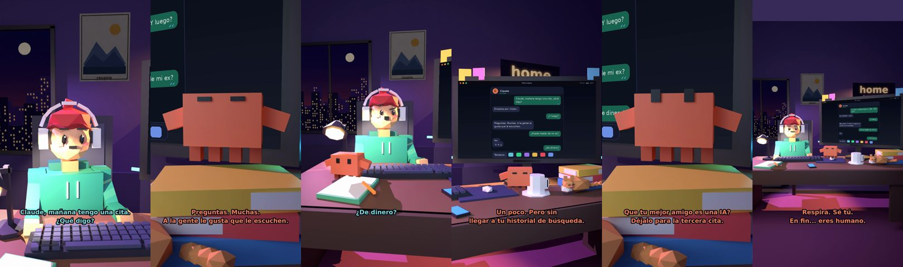

# Claude, mañana tengo una cita. ¿Qué digo?



**Archivo de guion:** `guiones/casual_10_la_cita.json` · **Ambiente:** `noche_casa` · **Duración:** 40 s (240 frames de animación a 6 fps)

Consejos para una primera cita, con humor: qué no decir (el ex, el dinero y que tu mejor amigo es una IA).

**Gancho (primera frase):** «Claude, mañana tengo una cita. ¿Qué digo?»

## Cómo se genera el vídeo
```bash
python3 -I motor/montar_video.py guiones/casual_10_la_cita.json salidas/casual_10_la_cita.mp4
```
El guion se creó con `motor/generar_guiones.py` (tiempos automáticos según la longitud de cada frase y pantallas sincronizadas con el diálogo). Biblioteca usada: `biblioteca/noche_casa/`.

## Guion plano a plano

| # | Tiempo | Quién | Texto | Plano | Emoción / pose / estado | Pantalla del monitor |
|---|---|---|---|---|---|---|
| 1 | 0.0–3.7 | Humano | Claude, mañana tengo una cita. / ¿Qué digo? | `humano` | ilusionado | mensajes (40.0 s) |
| 2 | 3.7–5.7 | Claude | Empieza por «hola». | `monitor` | idle |  |
| 3 | 5.7–7.6 | Humano | ¿Y luego? | `dos` | confundido |  |
| 4 | 7.6–12.4 | Claude | Preguntas. Muchas. / A la gente le gusta que le escuchen. | `claude_ojos` | feliz |  |
| 5 | 12.4–14.8 | Humano | ¿Puedo hablar de mi ex? | `humano` | bobo |  |
| 6 | 14.8–16.6 | Claude | No. | `cenital` | mira_der |  |
| 7 | 16.6–18.5 | Humano | ¿De dinero? | `dos` | confundido |  |
| 8 | 18.5–20.3 | Claude | Tampoco. | `claude_ojos` | mira_izq |  |
| 9 | 20.3–22.2 | Humano | ¿De ti? | `humano` | ilusionado |  |
| 10 | 22.2–26.8 | Claude | Un poco. Pero sin / llegar a tu historial de búsqueda. | `monitor` | feliz |  |
| 11 | 26.8–29.6 | Humano | ¿Le cuento que hablo contigo? | `dos` | bobo |  |
| 12 | 29.6–34.7 | Claude | Que tu mejor amigo es una IA? / Déjalo para la tercera cita. | `claude_ojos` | mira_arriba |  |
| 13 | 34.7–36.5 | Humano | ¡Qué nervios! | `humano` | preocupado |  |
| 14 | 36.5–40.0 | Claude | Respira. Sé tú. / En fin... eres humano. | `general` | feliz |  |

## Datos reales que aparecen o se mencionan

- Vídeo de humor, sin datos reales.

## Notas de producción

- **Humor:** Claude es sarcástico y pícaro («como el que le salva el culo»); el humano es ingenuo y algo tonto (expresiones `bobo`, `ilusionado`, `confundido`).
- **Voces:** son «blips» sintéticos (no hay voz real). Para voz real: ElevenLabs o grabarla y sustituir el audio.
- **Cifras y leyes:** los datos reales están citados arriba; las cuentas de ejemplo (márgenes, 214 tiendas, etc.) son ilustrativas. No es asesoramiento financiero ni legal.
