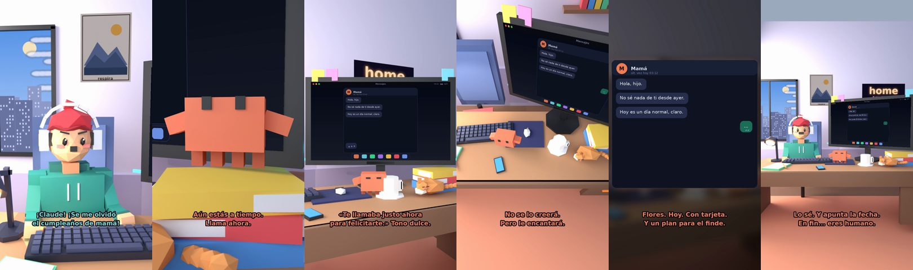

# ¡Se me olvidó el cumpleaños de mamá!



**Archivo de guion:** `guiones/casual_11_cumple_mama.json` · **Ambiente:** `dia_casa` · **Duración:** 38 s (228 frames de animación a 6 fps)

El olvido del cumpleaños: Claude organiza el control de daños con una llamada, una excusa digna y un regalo.

**Gancho (primera frase):** «¡Claude! ¡Se me olvidó el cumpleaños de mamá!»

## Cómo se genera el vídeo
```bash
python3 -I motor/montar_video.py guiones/casual_11_cumple_mama.json salidas/casual_11_cumple_mama.mp4
```
El guion se creó con `motor/generar_guiones.py` (tiempos automáticos según la longitud de cada frase y pantallas sincronizadas con el diálogo). Biblioteca usada: `biblioteca/dia_casa/`.

## Guion plano a plano

| # | Tiempo | Quién | Texto | Plano | Emoción / pose / estado | Pantalla del monitor |
|---|---|---|---|---|---|---|
| 1 | 0.0–4.2 | Humano | ¡Claude! ¡Se me olvidó / el cumpleaños de mamá! | `humano` | preocupado | mensajes (31.36 s) |
| 2 | 4.2–6.6 | Claude | Respira. ¿Qué hora es? | `monitor` | mira_izq |  |
| 3 | 6.6–8.9 | Humano | Las seis de la tarde. | `dos` | preocupado, pose hombros |  |
| 4 | 8.9–12.1 | Claude | Aún estás a tiempo. / Llama ahora. | `claude_ojos` | idle |  |
| 5 | 12.1–14.1 | Humano | ¿Y qué le digo? | `humano` | confundido |  |
| 6 | 14.1–19.1 | Claude | «Te llamaba justo ahora / para felicitarte.» Tono dulce. | `monitor` | feliz |  |
| 7 | 19.1–21.3 | Humano | ¿Y si no se lo cree? | `dos` | bobo |  |
| 8 | 21.3–24.7 | Claude | No se lo creerá. / Pero le encantará. | `cenital` | mira_der |  |
| 9 | 24.7–26.7 | Humano | ¿Y el regalo? | `humano` | preocupado |  |
| 10 | 26.7–31.4 | Claude | Flores. Hoy. Con tarjeta. / Y un plan para el finde. | `pantalla_completa` | idle |  |
| 11 | 31.4–33.5 | Humano | ¡Eres mi salvación! | `dos` | ilusionado |  |
| 12 | 33.5–38.0 | Claude | Lo sé. Y apunta la fecha. / En fin... eres humano. | `general` | feliz |  |

## Datos reales que aparecen o se mencionan

- Vídeo de humor, sin datos reales.

## Notas de producción

- **Humor:** Claude es sarcástico y pícaro («como el que le salva el culo»); el humano es ingenuo y algo tonto (expresiones `bobo`, `ilusionado`, `confundido`).
- **Voces:** son «blips» sintéticos (no hay voz real). Para voz real: ElevenLabs o grabarla y sustituir el audio.
- **Cifras y leyes:** los datos reales están citados arriba; las cuentas de ejemplo (márgenes, 214 tiendas, etc.) son ilustrativas. No es asesoramiento financiero ni legal.
