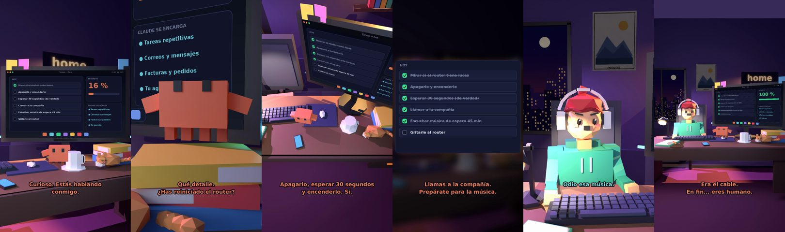

# Claude, no hay internet



**Archivo de guion:** `guiones/casual_12_sin_internet.json` · **Ambiente:** `noche_casa` · **Duración:** 36 s (216 frames de animación a 6 fps)

La paradoja de preguntarle a Claude cómo arreglar internet sin internet. Tareas de «soporte técnico» con humor.

**Gancho (primera frase):** «Claude, no hay internet.»

## Cómo se genera el vídeo
```bash
python3 -I motor/montar_video.py guiones/casual_12_sin_internet.json salidas/casual_12_sin_internet.mp4
```
El guion se creó con `motor/generar_guiones.py` (tiempos automáticos según la longitud de cada frase y pantallas sincronizadas con el diálogo). Biblioteca usada: `biblioteca/noche_casa/`.

## Guion plano a plano

| # | Tiempo | Quién | Texto | Plano | Emoción / pose / estado | Pantalla del monitor |
|---|---|---|---|---|---|---|
| 1 | 0.0–2.6 | Humano | Claude, no hay internet. | `humano` | preocupado | tareas (34.21 s) |
| 2 | 2.6–5.7 | Claude | Curioso. Estás hablando / conmigo. | `monitor` | mira_izq |  |
| 3 | 5.7–8.5 | Humano | Es el internet del vecino. | `dos` | bobo |  |
| 4 | 8.5–12.2 | Claude | Qué detalle. / ¿Has reiniciado el router? | `claude_ojos` | idle |  |
| 5 | 12.2–14.4 | Humano | ¿Se puede reiniciar? | `humano` | confundido |  |
| 6 | 14.4–18.9 | Claude | Apagarlo, esperar 30 segundos / y encenderlo. Sí. | `cenital` | mira_der |  |
| 7 | 18.9–20.9 | Humano | ¿Y si no funciona? | `dos` | preocupado |  |
| 8 | 20.9–25.4 | Claude | Llamas a la compañía. / Prepárate para la música. | `pantalla_completa` | idle |  |
| 9 | 25.4–27.4 | Humano | Odio esa música. | `humano` | preocupado |  |
| 10 | 27.4–30.5 | Claude | Todos la odiamos. / Por eso suena. | `claude_ojos` | feliz |  |
| 11 | 30.5–32.5 | Humano | ¡Ya funciona! | `dos` | ilusionado |  |
| 12 | 32.5–36.0 | Claude | Era el cable. / En fin... eres humano. | `general` | feliz |  |

## Datos reales que aparecen o se mencionan

- Vídeo de humor, sin datos reales.

## Notas de producción

- **Humor:** Claude es sarcástico y pícaro («como el que le salva el culo»); el humano es ingenuo y algo tonto (expresiones `bobo`, `ilusionado`, `confundido`).
- **Voces:** son «blips» sintéticos (no hay voz real). Para voz real: ElevenLabs o grabarla y sustituir el audio.
- **Cifras y leyes:** los datos reales están citados arriba; las cuentas de ejemplo (márgenes, 214 tiendas, etc.) son ilustrativas. No es asesoramiento financiero ni legal.
