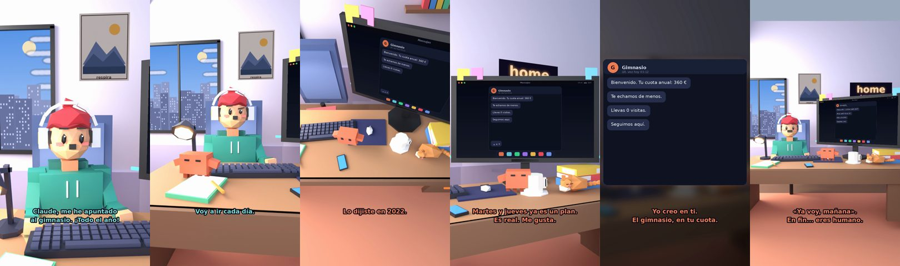

# Me he apuntado al gimnasio (todo el año)



**Archivo de guion:** `guiones/casual_13_gimnasio.json` · **Ambiente:** `dia_casa` · **Duración:** 38 s (228 frames de animación a 6 fps)

La matrícula anual del gimnasio y el plan de ir «mañana». Claude propone un trato realista.

**Gancho (primera frase):** «Claude, me he apuntado al gimnasio. ¡Todo el año!»

## Cómo se genera el vídeo
```bash
python3 -I motor/montar_video.py guiones/casual_13_gimnasio.json salidas/casual_13_gimnasio.mp4
```
El guion se creó con `motor/generar_guiones.py` (tiempos automáticos según la longitud de cada frase y pantallas sincronizadas con el diálogo). Biblioteca usada: `biblioteca/dia_casa/`.

## Guion plano a plano

| # | Tiempo | Quién | Texto | Plano | Emoción / pose / estado | Pantalla del monitor |
|---|---|---|---|---|---|---|
| 1 | 0.0–4.8 | Humano | Claude, me he apuntado / al gimnasio. ¡Todo el año! | `humano` | ilusionado | mensajes (31.92 s) |
| 2 | 4.8–8.0 | Claude | Pagado por adelantado. / Qué fe. | `monitor` | feliz |  |
| 3 | 8.0–10.1 | Humano | Voy a ir cada día. | `dos` | bobo |  |
| 4 | 10.1–12.7 | Claude | Cada día. Como / la dieta. | `claude_ojos` | mira_izq |  |
| 5 | 12.7–14.8 | Humano | Esto es distinto. | `humano` | confundido |  |
| 6 | 14.8–17.0 | Claude | Lo dijiste en 2022. | `cenital` | mira_der |  |
| 7 | 17.0–20.3 | Humano | ¿Y si voy solo martes y jueves? | `dos` | bobo |  |
| 8 | 20.3–25.1 | Claude | Martes y jueves ya es un plan. / Es real. Me gusta. | `monitor` | feliz |  |
| 9 | 25.1–27.9 | Humano | ¿De verdad crees que iré? | `humano` | preocupado |  |
| 10 | 27.9–31.9 | Claude | Yo creo en ti. / El gimnasio, en tu cuota. | `pantalla_completa` | idle |  |
| 11 | 31.9–34.0 | Humano | ¡Ya voy! ¡Mañana! | `dos` | ilusionado |  |
| 12 | 34.0–38.0 | Claude | «Ya voy, mañana». / En fin... eres humano. | `general` | feliz |  |

## Datos reales que aparecen o se mencionan

- Vídeo de humor, sin datos reales.

## Notas de producción

- **Humor:** Claude es sarcástico y pícaro («como el que le salva el culo»); el humano es ingenuo y algo tonto (expresiones `bobo`, `ilusionado`, `confundido`).
- **Voces:** son «blips» sintéticos (no hay voz real). Para voz real: ElevenLabs o grabarla y sustituir el audio.
- **Cifras y leyes:** los datos reales están citados arriba; las cuentas de ejemplo (márgenes, 214 tiendas, etc.) son ilustrativas. No es asesoramiento financiero ni legal.
