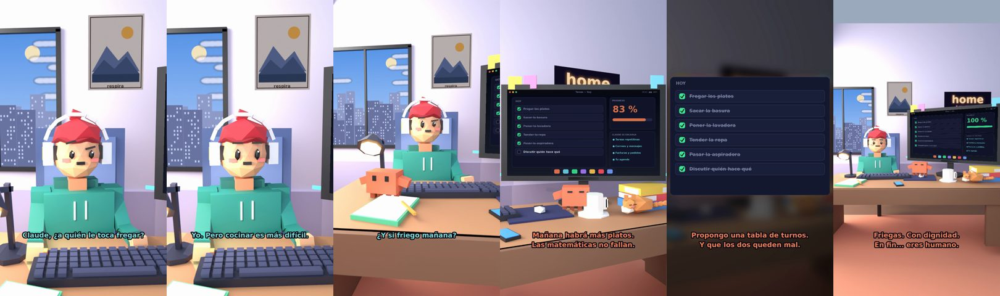

# Claude, ¿a quién le toca fregar?



**Archivo de guion:** `guiones/casual_14_quien_friega.json` · **Ambiente:** `dia_casa` · **Duración:** 36 s (216 frames de animación a 6 fps)

La discusión doméstica de siempre. Claude hace de árbitro con una tabla de turnos y mucha ironía.

**Gancho (primera frase):** «Claude, ¿a quién le toca fregar?»

## Cómo se genera el vídeo
```bash
python3 -I motor/montar_video.py guiones/casual_14_quien_friega.json salidas/casual_14_quien_friega.mp4
```
El guion se creó con `motor/generar_guiones.py` (tiempos automáticos según la longitud de cada frase y pantallas sincronizadas con el diálogo). Biblioteca usada: `biblioteca/dia_casa/`.

## Guion plano a plano

| # | Tiempo | Quién | Texto | Plano | Emoción / pose / estado | Pantalla del monitor |
|---|---|---|---|---|---|---|
| 1 | 0.0–3.2 | Humano | Claude, ¿a quién le toca fregar? | `humano` | confundido | tareas (31.44 s) |
| 2 | 3.2–5.1 | Claude | ¿Quién los usó? | `monitor` | mira_izq |  |
| 3 | 5.1–7.1 | Humano | Los dos. | `dos` | bobo |  |
| 4 | 7.1–9.0 | Claude | ¿Y quién cocinó? | `claude_ojos` | idle |  |
| 5 | 9.0–12.2 | Humano | Yo. Pero cocinar es más difícil. | `humano` | ilusionado |  |
| 6 | 12.2–14.8 | Claude | Eso lo dice quien cocinó. | `cenital` | mira_der |  |
| 7 | 14.8–17.0 | Humano | ¿Y si friego mañana? | `dos` | bobo |  |
| 8 | 17.0–21.7 | Claude | Mañana habrá más platos. / Las matemáticas no fallan. | `monitor` | feliz |  |
| 9 | 21.7–24.9 | Humano | Propongo piedra, papel o tijera. | `humano` | ilusionado |  |
| 10 | 24.9–29.9 | Claude | Propongo una tabla de turnos. / Y que los dos queden mal. | `pantalla_completa` | idle |  |
| 11 | 29.9–31.8 | Humano | ¿Y si pierdo yo? | `dos` | preocupado |  |
| 12 | 31.8–36.0 | Claude | Friegas. Con dignidad. / En fin... eres humano. | `general` | feliz |  |

## Datos reales que aparecen o se mencionan

- Vídeo de humor, sin datos reales.

## Notas de producción

- **Humor:** Claude es sarcástico y pícaro («como el que le salva el culo»); el humano es ingenuo y algo tonto (expresiones `bobo`, `ilusionado`, `confundido`).
- **Voces:** son «blips» sintéticos (no hay voz real). Para voz real: ElevenLabs o grabarla y sustituir el audio.
- **Cifras y leyes:** los datos reales están citados arriba; las cuentas de ejemplo (márgenes, 214 tiendas, etc.) son ilustrativas. No es asesoramiento financiero ni legal.
