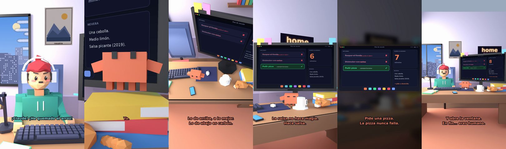

# Claude, he quemado el arroz



**Archivo de guion:** `guiones/casual_17_arroz_quemado.json` · **Ambiente:** `dia_casa` · **Duración:** 36 s (216 frames de animación a 6 fps)

Un desastre culinario cotidiano: arroz quemado, olor a humo y Claude como chef de emergencia.

**Gancho (primera frase):** «¡Claude! ¡He quemado el arroz!»

## Cómo se genera el vídeo
```bash
python3 -I motor/montar_video.py guiones/casual_17_arroz_quemado.json salidas/casual_17_arroz_quemado.mp4
```
El guion se creó con `motor/generar_guiones.py` (tiempos automáticos según la longitud de cada frase y pantallas sincronizadas con el diálogo). Biblioteca usada: `biblioteca/dia_casa/`.

## Guion plano a plano

| # | Tiempo | Quién | Texto | Plano | Emoción / pose / estado | Pantalla del monitor |
|---|---|---|---|---|---|---|
| 1 | 0.0–3.3 | Humano | ¡Claude! ¡He quemado el arroz! | `humano` | preocupado | menu (31.16 s) |
| 2 | 3.3–5.5 | Claude | ¿Cuánto? | `monitor` | mira_izq |  |
| 3 | 5.5–8.3 | Humano | Un poco. Bastante. Todo. | `dos` | bobo |  |
| 4 | 8.3–10.4 | Claude | Ya. | `claude_ojos` | idle |  |
| 5 | 10.4–12.6 | Humano | ¿Se puede salvar? | `humano` | confundido |  |
| 6 | 12.6–17.4 | Claude | Lo de arriba, a lo mejor. / Lo de abajo es carbón. | `cenital` | mira_der |  |
| 7 | 17.4–19.9 | Humano | ¿Y si le echo salsa? | `dos` | ilusionado |  |
| 8 | 19.9–23.6 | Claude | La salsa no hace magia. / Hace salsa. | `monitor` | feliz |  |
| 9 | 23.6–25.7 | Humano | Tengo hambre. | `humano` | preocupado |  |
| 10 | 25.7–29.6 | Claude | Pide una pizza. / La pizza nunca falla. | `pantalla_completa` | idle |  |
| 11 | 29.6–31.7 | Humano | ¡Ya sabía yo! | `dos` | ilusionado |  |
| 12 | 31.7–36.0 | Claude | Y abre la ventana. / En fin... eres humano. | `general` | feliz |  |

## Datos reales que aparecen o se mencionan

- Vídeo de humor, sin datos reales.

## Notas de producción

- **Humor:** Claude es sarcástico y pícaro («como el que le salva el culo»); el humano es ingenuo y algo tonto (expresiones `bobo`, `ilusionado`, `confundido`).
- **Voces:** son «blips» sintéticos (no hay voz real). Para voz real: ElevenLabs o grabarla y sustituir el audio.
- **Cifras y leyes:** los datos reales están citados arriba; las cuentas de ejemplo (márgenes, 214 tiendas, etc.) son ilustrativas. No es asesoramiento financiero ni legal.
