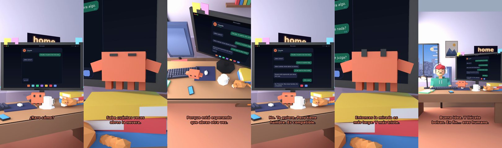

# Claude, mi perro me mira raro



**Archivo de guion:** `guiones/casual_18_mi_perro.json` · **Ambiente:** `dia_casa` · **Duración:** 36 s (216 frames de animación a 6 fps)

El perro que te mira «como si supiera algo». Claude interpreta la mirada con cero rigor y mucho cariño.

**Gancho (primera frase):** «Claude, mi perro me mira raro.»

## Cómo se genera el vídeo
```bash
python3 -I motor/montar_video.py guiones/casual_18_mi_perro.json salidas/casual_18_mi_perro.mp4
```
El guion se creó con `motor/generar_guiones.py` (tiempos automáticos según la longitud de cada frase y pantallas sincronizadas con el diálogo). Biblioteca usada: `biblioteca/dia_casa/`.

## Guion plano a plano

| # | Tiempo | Quién | Texto | Plano | Emoción / pose / estado | Pantalla del monitor |
|---|---|---|---|---|---|---|
| 1 | 0.0–3.0 | Humano | Claude, mi perro me mira raro. | `humano` | confundido | mensajes (36.0 s) |
| 2 | 3.0–4.9 | Claude | ¿Raro cómo? | `monitor` | mira_izq |  |
| 3 | 4.9–7.1 | Humano | Como si supiera algo. | `dos` | bobo |  |
| 4 | 7.1–10.4 | Claude | Sabe cuántas veces / abres la nevera. | `claude_ojos` | feliz |  |
| 5 | 10.4–12.9 | Humano | ¿Y por qué no dice nada? | `humano` | confundido |  |
| 6 | 12.9–16.7 | Claude | Porque está esperando / que abras otra vez. | `cenital` | mira_der |  |
| 7 | 16.7–18.6 | Humano | ¿Me juzga? | `dos` | preocupado |  |
| 8 | 18.6–23.0 | Claude | No. Te quiere. Pero tiene / hambre. Es compatible. | `monitor` | feliz |  |
| 9 | 23.0–25.2 | Humano | ¿Y si quiere pasear? | `humano` | ilusionado |  |
| 10 | 25.2–29.4 | Claude | Entonces la mirada es / más larga. Y más triste. | `claude_ojos` | mira_arriba, empuje de cámara |  |
| 11 | 29.4–31.3 | Humano | Voy a sacarlo. | `dos` | feliz |  |
| 12 | 31.3–36.0 | Claude | Buena idea. Y llévate / bolsas. En fin... eres humano. | `general` | feliz |  |

## Datos reales que aparecen o se mencionan

- Vídeo de humor, sin datos reales.

## Notas de producción

- **Humor:** Claude es sarcástico y pícaro («como el que le salva el culo»); el humano es ingenuo y algo tonto (expresiones `bobo`, `ilusionado`, `confundido`).
- **Voces:** son «blips» sintéticos (no hay voz real). Para voz real: ElevenLabs o grabarla y sustituir el audio.
- **Cifras y leyes:** los datos reales están citados arriba; las cuentas de ejemplo (márgenes, 214 tiendas, etc.) son ilustrativas. No es asesoramiento financiero ni legal.
