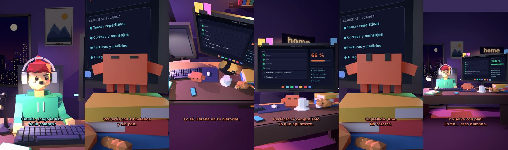

# Claude, ¿hago la lista de la compra?



**Archivo de guion:** `guiones/casual_20_lista_compra.json` · **Ambiente:** `noche_casa` · **Duración:** 38 s (228 frames de animación a 6 fps)

La lista de la compra y el consejo clásico: no vayas con hambre. Resultado: 14 helados y sin pan.

**Gancho (primera frase):** «Claude, ¿hago la lista de la compra?»

## Cómo se genera el vídeo
```bash
python3 -I motor/montar_video.py guiones/casual_20_lista_compra.json salidas/casual_20_lista_compra.mp4
```
El guion se creó con `motor/generar_guiones.py` (tiempos automáticos según la longitud de cada frase y pantallas sincronizadas con el diálogo). Biblioteca usada: `biblioteca/noche_casa/`.

## Guion plano a plano

| # | Tiempo | Quién | Texto | Plano | Emoción / pose / estado | Pantalla del monitor |
|---|---|---|---|---|---|---|
| 1 | 0.0–4.0 | Humano | Claude, ¿hago la lista / de la compra? | `humano` | confundido | tareas (40.0 s) |
| 2 | 4.0–7.1 | Claude | Sí. Y no vayas con hambre. | `monitor` | mira_izq |  |
| 3 | 7.1–9.3 | Humano | ¿Por qué? | `dos` | bobo |  |
| 4 | 9.3–13.2 | Claude | Volverás con 14 helados / y sin pan. | `claude_ojos` | feliz |  |
| 5 | 13.2–15.4 | Humano | Eso me ha pasado. | `humano` | preocupado |  |
| 6 | 15.4–18.9 | Claude | Lo sé. Estaba en tu historial. | `cenital` | mira_der |  |
| 7 | 18.9–21.5 | Humano | ¿Y si lo apunto todo? | `dos` | ilusionado |  |
| 8 | 21.5–26.0 | Claude | Perfecto. Y compra solo / lo que apuntaste. | `monitor` | feliz |  |
| 9 | 26.0–28.3 | Humano | ¿Y los helados? | `humano` | bobo |  |
| 10 | 28.3–31.4 | Claude | Un helado. Uno. / No catorce. | `claude_ojos` | idle, empuje de cámara |  |
| 11 | 31.4–33.6 | Humano | Trato hecho. | `dos` | feliz |  |
| 12 | 33.6–38.0 | Claude | Y vuelve con pan. / En fin... eres humano. | `general` | feliz |  |

## Datos reales que aparecen o se mencionan

- Vídeo de humor, sin datos reales.

## Notas de producción

- **Humor:** Claude es sarcástico y pícaro («como el que le salva el culo»); el humano es ingenuo y algo tonto (expresiones `bobo`, `ilusionado`, `confundido`).
- **Voces:** son «blips» sintéticos (no hay voz real). Para voz real: ElevenLabs o grabarla y sustituir el audio.
- **Cifras y leyes:** los datos reales están citados arriba; las cuentas de ejemplo (márgenes, 214 tiendas, etc.) son ilustrativas. No es asesoramiento financiero ni legal.
