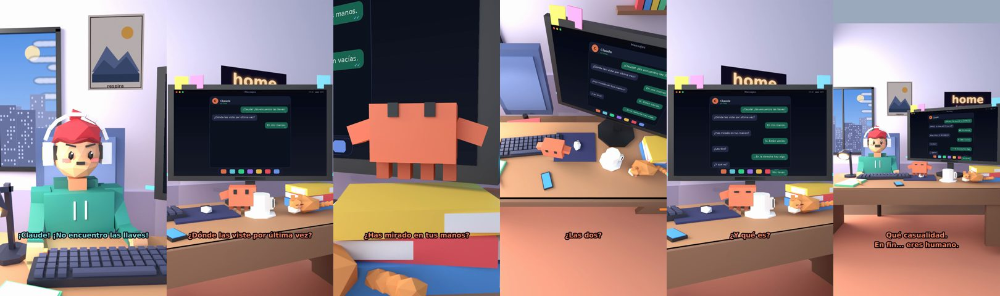

# Claude, ¡no encuentro las llaves!



**Archivo de guion:** `guiones/casual_22_las_llaves.json` · **Ambiente:** `dia_casa` · **Duración:** 28 s (168 frames de animación a 6 fps)

La búsqueda desesperada de las llaves… que están en la mano.

**Gancho (primera frase):** «¡Claude! ¡No encuentro las llaves!»

## Cómo se genera el vídeo
```bash
python3 -I motor/montar_video.py guiones/casual_22_las_llaves.json salidas/casual_22_las_llaves.mp4
```
El guion se creó con `motor/generar_guiones.py` (tiempos automáticos según la longitud de cada frase y pantallas sincronizadas con el diálogo). Biblioteca usada: `biblioteca/dia_casa/`.

## Guion plano a plano

| # | Tiempo | Quién | Texto | Plano | Emoción / pose / estado | Pantalla del monitor |
|---|---|---|---|---|---|---|
| 1 | 0.0–3.7 | Humano | ¡Claude! ¡No encuentro las llaves! | `humano` | preocupado | mensajes (28.0 s) |
| 2 | 3.7–7.3 | Claude | ¿Dónde las viste por última vez? | `monitor` | mira_izq |  |
| 3 | 7.3–9.4 | Humano | En mis manos. | `dos` | bobo |  |
| 4 | 9.4–12.3 | Claude | ¿Has mirado en tus manos? | `claude_ojos` | idle |  |
| 5 | 12.3–14.5 | Humano | Sí. Están vacías. | `humano` | confundido |  |
| 6 | 14.5–16.7 | Claude | ¿Las dos? | `cenital` | mira_der |  |
| 7 | 16.7–19.7 | Humano | ...En la derecha hay algo. | `dos` | confundido |  |
| 8 | 19.7–21.8 | Claude | ¿Y qué es? | `monitor` | feliz |  |
| 9 | 21.8–24.0 | Humano | Mis llaves. | `humano` | ilusionado |  |
| 10 | 24.0–28.0 | Claude | Qué casualidad. / En fin... eres humano. | `general` | feliz |  |

## Datos reales que aparecen o se mencionan

- Vídeo de humor, sin datos reales.

## Notas de producción

- **Humor:** Claude es sarcástico y pícaro («como el que le salva el culo»); el humano es ingenuo y algo tonto (expresiones `bobo`, `ilusionado`, `confundido`).
- **Voces:** son «blips» sintéticos (no hay voz real). Para voz real: ElevenLabs o grabarla y sustituir el audio.
- **Cifras y leyes:** los datos reales están citados arriba; las cuentas de ejemplo (márgenes, 214 tiendas, etc.) son ilustrativas. No es asesoramiento financiero ni legal.
