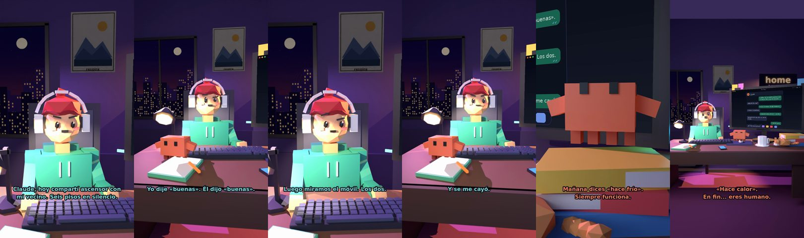

# Claude, hoy compartí ascensor 6 pisos en silencio



**Archivo de guion:** `guiones/casual_25_ascensor.json` · **Ambiente:** `noche_casa` · **Duración:** 36 s (216 frames de animación a 6 fps)

La incomodidad del ascensor con el vecino: seis pisos sin decir nada. Claude analiza el protocolo social.

**Gancho (primera frase):** «Claude, hoy compartí ascensor con mi vecino. Seis pisos en silencio.»

## Cómo se genera el vídeo
```bash
python3 -I motor/montar_video.py guiones/casual_25_ascensor.json salidas/casual_25_ascensor.mp4
```
El guion se creó con `motor/generar_guiones.py` (tiempos automáticos según la longitud de cada frase y pantallas sincronizadas con el diálogo). Biblioteca usada: `biblioteca/noche_casa/`.

## Guion plano a plano

| # | Tiempo | Quién | Texto | Plano | Emoción / pose / estado | Pantalla del monitor |
|---|---|---|---|---|---|---|
| 1 | 0.0–6.0 | Humano | Claude, hoy compartí ascensor con / mi vecino. Seis pisos en silencio. | `humano` | preocupado | mensajes (36.0 s) |
| 2 | 6.0–8.0 | Claude | ¿Alguien dijo algo? | `monitor` | mira_izq |  |
| 3 | 8.0–11.4 | Humano | Yo dije «buenas». Él dijo «buenas». | `dos` | bobo |  |
| 4 | 11.4–13.6 | Claude | Intercambio perfecto. | `claude_ojos` | feliz |  |
| 5 | 13.6–16.7 | Humano | Luego miramos el móvil. Los dos. | `humano` | confundido |  |
| 6 | 16.7–20.6 | Claude | Protocolo estándar. / El móvil es el escudo. | `cenital` | mira_der |  |
| 7 | 20.6–22.5 | Humano | Y se me cayó. | `dos` | preocupado |  |
| 8 | 22.5–24.9 | Claude | ¿El móvil o la dignidad? | `monitor` | feliz |  |
| 9 | 24.9–26.8 | Humano | Las dos cosas. | `humano` | preocupado, pose hombros |  |
| 10 | 26.8–30.8 | Claude | Mañana dices «hace frío». / Siempre funciona. | `claude_ojos` | idle, empuje de cámara |  |
| 11 | 30.8–32.6 | Humano | ¿Y si hace calor? | `dos` | bobo |  |
| 12 | 32.6–36.0 | Claude | «Hace calor». / En fin... eres humano. | `general` | feliz |  |

## Datos reales que aparecen o se mencionan

- Vídeo de humor, sin datos reales.

## Notas de producción

- **Humor:** Claude es sarcástico y pícaro («como el que le salva el culo»); el humano es ingenuo y algo tonto (expresiones `bobo`, `ilusionado`, `confundido`).
- **Voces:** son «blips» sintéticos (no hay voz real). Para voz real: ElevenLabs o grabarla y sustituir el audio.
- **Cifras y leyes:** los datos reales están citados arriba; las cuentas de ejemplo (márgenes, 214 tiendas, etc.) son ilustrativas. No es asesoramiento financiero ni legal.
