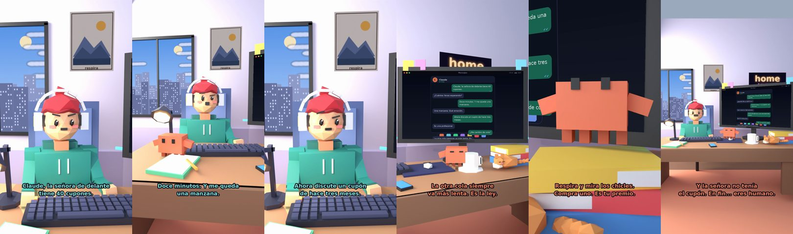

# Claude, la señora de delante tiene 40 cupones



**Archivo de guion:** `guiones/casual_26_cola_del_super.json` · **Ambiente:** `dia_casa` · **Duración:** 36 s (216 frames de animación a 6 fps)

La cola del súper con la señora de los cupones, vivida como una carrera de resistencia.

**Gancho (primera frase):** «Claude, la señora de delante tiene 40 cupones.»

## Cómo se genera el vídeo
```bash
python3 -I motor/montar_video.py guiones/casual_26_cola_del_super.json salidas/casual_26_cola_del_super.mp4
```
El guion se creó con `motor/generar_guiones.py` (tiempos automáticos según la longitud de cada frase y pantallas sincronizadas con el diálogo). Biblioteca usada: `biblioteca/dia_casa/`.

## Guion plano a plano

| # | Tiempo | Quién | Texto | Plano | Emoción / pose / estado | Pantalla del monitor |
|---|---|---|---|---|---|---|
| 1 | 0.0–3.9 | Humano | Claude, la señora de delante / tiene 40 cupones. | `humano` | preocupado | mensajes (36.0 s) |
| 2 | 3.9–6.4 | Claude | ¿Cuántos llevas esperando? | `monitor` | mira_izq |  |
| 3 | 6.4–9.7 | Humano | Doce minutos. Y me queda / una manzana. | `dos` | bobo |  |
| 4 | 9.7–12.1 | Claude | Una manzana. Qué emoción. | `claude_ojos` | feliz |  |
| 5 | 12.1–15.7 | Humano | Ahora discute un cupón / de hace tres meses. | `humano` | confundido |  |
| 6 | 15.7–17.6 | Claude | Es una profesional. | `cenital` | mira_der |  |
| 7 | 17.6–19.6 | Humano | ¿Me cambio de cola? | `dos` | preocupado |  |
| 8 | 19.6–23.5 | Claude | La otra cola siempre / va más lenta. Es la ley. | `monitor` | feliz |  |
| 9 | 23.5–25.2 | Humano | ¿Qué hago? | `humano` | confundido |  |
| 10 | 25.2–29.7 | Claude | Respira y mira los chicles. / Compra uno. Es tu premio. | `claude_ojos` | mira_arriba, empuje de cámara |  |
| 11 | 29.7–31.5 | Humano | ...Ya me toca. | `dos` | ilusionado |  |
| 12 | 31.5–36.0 | Claude | Y la señora no tenía / el cupón. En fin... eres humano. | `general` | feliz |  |

## Datos reales que aparecen o se mencionan

- Vídeo de humor, sin datos reales.

## Notas de producción

- **Humor:** Claude es sarcástico y pícaro («como el que le salva el culo»); el humano es ingenuo y algo tonto (expresiones `bobo`, `ilusionado`, `confundido`).
- **Voces:** son «blips» sintéticos (no hay voz real). Para voz real: ElevenLabs o grabarla y sustituir el audio.
- **Cifras y leyes:** los datos reales están citados arriba; las cuentas de ejemplo (márgenes, 214 tiendas, etc.) son ilustrativas. No es asesoramiento financiero ni legal.
