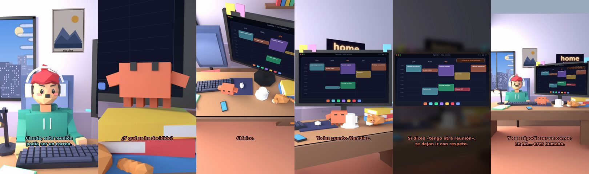

# Claude, esta reunión podía ser un correo



**Archivo de guion:** `guiones/casual_27_reunion_correo.json` · **Ambiente:** `dia_casa` · **Duración:** 38 s (228 frames de animación a 6 fps)

La reunión eterna que podía ser un correo, con la agenda y un Claude que cuenta las veces que dicen «sinergias».

**Gancho (primera frase):** «Claude, esta reunión podía ser un correo.»

## Cómo se genera el vídeo
```bash
python3 -I motor/montar_video.py guiones/casual_27_reunion_correo.json salidas/casual_27_reunion_correo.mp4
```
El guion se creó con `motor/generar_guiones.py` (tiempos automáticos según la longitud de cada frase y pantallas sincronizadas con el diálogo). Biblioteca usada: `biblioteca/dia_casa/`.

## Guion plano a plano

| # | Tiempo | Quién | Texto | Plano | Emoción / pose / estado | Pantalla del monitor |
|---|---|---|---|---|---|---|
| 1 | 0.0–4.2 | Humano | Claude, esta reunión / podía ser un correo. | `humano` | preocupado | calendario (32.05 s) |
| 2 | 4.2–6.3 | Claude | ¿Cuánto lleváis? | `monitor` | mira_izq |  |
| 3 | 6.3–8.5 | Humano | Una hora y cuarto. | `dos` | bobo |  |
| 4 | 8.5–11.0 | Claude | ¿Y qué se ha decidido? | `claude_ojos` | idle |  |
| 5 | 11.0–14.4 | Humano | Que hay que hacer otra reunión. | `humano` | confundido |  |
| 6 | 14.4–16.5 | Claude | Clásico. | `cenital` | mira_der |  |
| 7 | 16.5–20.1 | Humano | Han dicho «sinergias» nueve veces. | `dos` | preocupado |  |
| 8 | 20.1–22.9 | Claude | Yo las cuento. Van diez. | `monitor` | feliz |  |
| 9 | 22.9–25.0 | Humano | ¿Puedo irme? | `humano` | ilusionado |  |
| 10 | 25.0–30.4 | Claude | Si dices «tengo otra reunión», / te dejan ir con respeto. | `pantalla_completa` | idle |  |
| 11 | 30.4–32.8 | Humano | ¡Tengo otra reunión! | `dos` | ilusionado |  |
| 12 | 32.8–38.0 | Claude | Y esa sí podía ser un correo. / En fin... eres humano. | `general` | feliz |  |

## Datos reales que aparecen o se mencionan

- Vídeo de humor, sin datos reales.

## Notas de producción

- **Humor:** Claude es sarcástico y pícaro («como el que le salva el culo»); el humano es ingenuo y algo tonto (expresiones `bobo`, `ilusionado`, `confundido`).
- **Voces:** son «blips» sintéticos (no hay voz real). Para voz real: ElevenLabs o grabarla y sustituir el audio.
- **Cifras y leyes:** los datos reales están citados arriba; las cuentas de ejemplo (márgenes, 214 tiendas, etc.) son ilustrativas. No es asesoramiento financiero ni legal.
