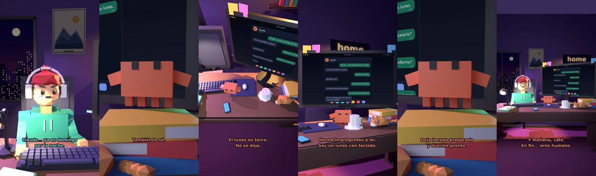

# Claude, ya es domingo por la noche



**Archivo de guion:** `guiones/casual_28_domingo_noche.json` · **Ambiente:** `noche_casa` · **Duración:** 36 s (216 frames de animación a 6 fps)

La tristeza del domingo por la noche: mañana es lunes. Claude ofrece consuelo práctico.

**Gancho (primera frase):** «Claude... ya es domingo por la noche.»

## Cómo se genera el vídeo
```bash
python3 -I motor/montar_video.py guiones/casual_28_domingo_noche.json salidas/casual_28_domingo_noche.mp4
```
El guion se creó con `motor/generar_guiones.py` (tiempos automáticos según la longitud de cada frase y pantallas sincronizadas con el diálogo). Biblioteca usada: `biblioteca/noche_casa/`.

## Guion plano a plano

| # | Tiempo | Quién | Texto | Plano | Emoción / pose / estado | Pantalla del monitor |
|---|---|---|---|---|---|---|
| 1 | 0.0–3.8 | Humano | Claude... ya es domingo / por la noche. | `humano` | preocupado | mensajes (36.0 s) |
| 2 | 3.8–6.7 | Claude | Lo sé. Yo también / lo siento. | `monitor` | mira_izq |  |
| 3 | 6.7–8.8 | Humano | Mañana es lunes. | `dos` | bobo |  |
| 4 | 8.8–10.9 | Claude | También lo sé. | `claude_ojos` | idle |  |
| 5 | 10.9–13.2 | Humano | ¿Podemos cancelarlo? | `humano` | confundido |  |
| 6 | 13.2–16.4 | Claude | El lunes es terco. / No se deja. | `cenital` | mira_der |  |
| 7 | 16.4–19.1 | Humano | ¿Y si me hago el enfermo? | `dos` | bobo |  |
| 8 | 19.1–24.1 | Claude | No me lo preguntes a mí. / Soy un lunes con teclado. | `monitor` | feliz |  |
| 9 | 24.1–26.1 | Humano | ¿Qué hago? | `humano` | preocupado |  |
| 10 | 26.1–30.1 | Claude | Deja la ropa preparada / y duerme pronto. | `claude_ojos` | idle, empuje de cámara |  |
| 11 | 30.1–32.1 | Humano | ...Qué aburrido. | `dos` | feliz |  |
| 12 | 32.1–36.0 | Claude | Y mañana, café. / En fin... eres humano. | `general` | feliz |  |

## Datos reales que aparecen o se mencionan

- Vídeo de humor, sin datos reales.

## Notas de producción

- **Humor:** Claude es sarcástico y pícaro («como el que le salva el culo»); el humano es ingenuo y algo tonto (expresiones `bobo`, `ilusionado`, `confundido`).
- **Voces:** son «blips» sintéticos (no hay voz real). Para voz real: ElevenLabs o grabarla y sustituir el audio.
- **Cifras y leyes:** los datos reales están citados arriba; las cuentas de ejemplo (márgenes, 214 tiendas, etc.) son ilustrativas. No es asesoramiento financiero ni legal.
