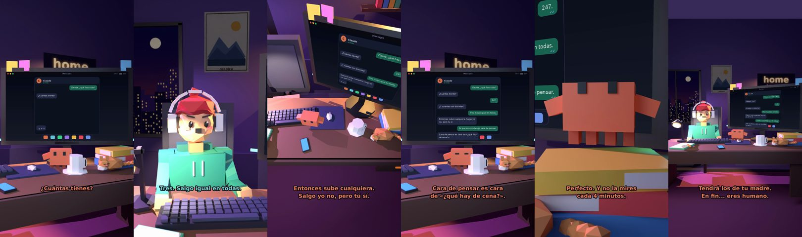

# Claude, ¿qué foto subo?



**Archivo de guion:** `guiones/casual_31_que_foto_subo.json` · **Ambiente:** `noche_casa` · **Duración:** 36 s (216 frames de animación a 6 fps)

Elegir foto para las redes entre 247 casi idénticas. Claude ayuda con criterio nulo y mucho cariño.

**Gancho (primera frase):** «Claude, ¿qué foto subo?»

## Cómo se genera el vídeo
```bash
python3 -I motor/montar_video.py guiones/casual_31_que_foto_subo.json salidas/casual_31_que_foto_subo.mp4
```
El guion se creó con `motor/generar_guiones.py` (tiempos automáticos según la longitud de cada frase y pantallas sincronizadas con el diálogo). Biblioteca usada: `biblioteca/noche_casa/`.

## Guion plano a plano

| # | Tiempo | Quién | Texto | Plano | Emoción / pose / estado | Pantalla del monitor |
|---|---|---|---|---|---|---|
| 1 | 0.0–2.4 | Humano | Claude, ¿qué foto subo? | `humano` | confundido | mensajes (36.0 s) |
| 2 | 2.4–4.4 | Claude | ¿Cuántas tienes? | `monitor` | mira_izq |  |
| 3 | 4.4–6.3 | Humano | 247. | `dos` | bobo |  |
| 4 | 6.3–8.9 | Claude | ¿Y cuántas son distintas? | `claude_ojos` | feliz |  |
| 5 | 8.9–11.6 | Humano | Tres. Salgo igual en todas. | `humano` | preocupado |  |
| 6 | 11.6–16.2 | Claude | Entonces sube cualquiera. / Salgo yo no, pero tú sí. | `cenital` | mira_der |  |
| 7 | 16.2–19.6 | Humano | Es que en esta tengo cara / de pensar. | `dos` | ilusionado |  |
| 8 | 19.6–23.9 | Claude | Cara de pensar es cara / de «¿qué hay de cena?». | `monitor` | feliz |  |
| 9 | 23.9–25.8 | Humano | Subo esa. | `humano` | ilusionado |  |
| 10 | 25.8–29.5 | Claude | Perfecto. Y no la mires / cada 4 minutos. | `claude_ojos` | idle, empuje de cámara |  |
| 11 | 29.5–31.8 | Humano | ¿Y si no tiene likes? | `dos` | preocupado |  |
| 12 | 31.8–36.0 | Claude | Tendrá los de tu madre. / En fin... eres humano. | `general` | feliz |  |

## Datos reales que aparecen o se mencionan

- Vídeo de humor, sin datos reales.

## Notas de producción

- **Humor:** Claude es sarcástico y pícaro («como el que le salva el culo»); el humano es ingenuo y algo tonto (expresiones `bobo`, `ilusionado`, `confundido`).
- **Voces:** son «blips» sintéticos (no hay voz real). Para voz real: ElevenLabs o grabarla y sustituir el audio.
- **Cifras y leyes:** los datos reales están citados arriba; las cuentas de ejemplo (márgenes, 214 tiendas, etc.) son ilustrativas. No es asesoramiento financiero ni legal.
