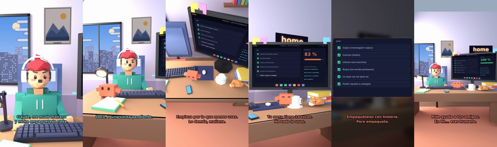

# Claude, me mudo mañana y no he empaquetado nada



**Archivo de guion:** `guiones/casual_32_la_mudanza.json` · **Ambiente:** `dia_casa` · **Duración:** 38 s (228 frames de animación a 6 fps)

La mudanza que empieza la víspera: Claude hace de organizador de emergencia.

**Gancho (primera frase):** «Claude, me mudo mañana y no he empaquetado nada.»

## Cómo se genera el vídeo
```bash
python3 -I motor/montar_video.py guiones/casual_32_la_mudanza.json salidas/casual_32_la_mudanza.mp4
```
El guion se creó con `motor/generar_guiones.py` (tiempos automáticos según la longitud de cada frase y pantallas sincronizadas con el diálogo). Biblioteca usada: `biblioteca/dia_casa/`.

## Guion plano a plano

| # | Tiempo | Quién | Texto | Plano | Emoción / pose / estado | Pantalla del monitor |
|---|---|---|---|---|---|---|
| 1 | 0.0–4.6 | Humano | Claude, me mudo mañana / y no he empaquetado nada. | `humano` | preocupado | tareas (32.97 s) |
| 2 | 4.6–7.0 | Claude | ¿Cuántas horas tienes? | `monitor` | mira_izq |  |
| 3 | 7.0–10.1 | Humano | Doce. Y una siesta pendiente. | `dos` | bobo |  |
| 4 | 10.1–12.1 | Claude | Quita la siesta. | `claude_ojos` | idle |  |
| 5 | 12.1–14.1 | Humano | Me da pena. | `humano` | preocupado |  |
| 6 | 14.1–18.7 | Claude | Empieza por lo que menos usas. / Lo demás, mañana. | `cenital` | mira_der |  |
| 7 | 18.7–20.7 | Humano | Todo lo uso. | `dos` | confundido |  |
| 8 | 20.7–24.6 | Claude | Tu mesa tiene 14 tazas. / No todo lo usas. | `monitor` | feliz |  |
| 9 | 24.6–27.2 | Humano | Cada taza tiene historia. | `humano` | ilusionado |  |
| 10 | 27.2–31.3 | Claude | Empaquétalas con historia. / Pero empaqueta. | `pantalla_completa` | idle |  |
| 11 | 31.3–33.5 | Humano | ¿Y si lo dejo todo? | `dos` | bobo |  |
| 12 | 33.5–38.0 | Claude | Pide ayuda a tus amigos. / En fin... eres humano. | `general` | feliz |  |

## Datos reales que aparecen o se mencionan

- Vídeo de humor, sin datos reales.

## Notas de producción

- **Humor:** Claude es sarcástico y pícaro («como el que le salva el culo»); el humano es ingenuo y algo tonto (expresiones `bobo`, `ilusionado`, `confundido`).
- **Voces:** son «blips» sintéticos (no hay voz real). Para voz real: ElevenLabs o grabarla y sustituir el audio.
- **Cifras y leyes:** los datos reales están citados arriba; las cuentas de ejemplo (márgenes, 214 tiendas, etc.) son ilustrativas. No es asesoramiento financiero ni legal.
