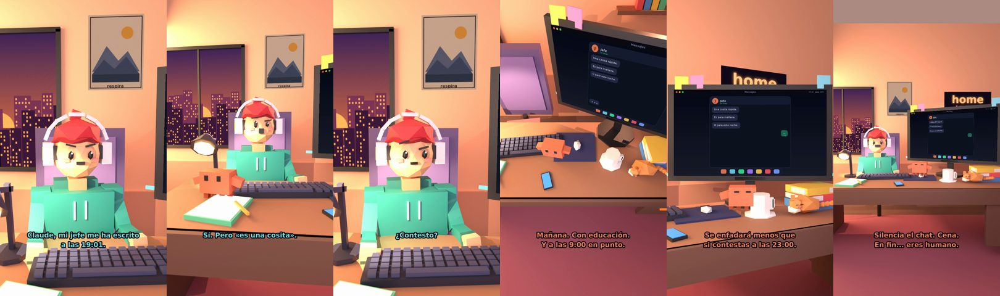

# Claude, mi jefe me ha escrito a las 19:01



**Archivo de guion:** `guiones/casual_33_jefe_19h.json` · **Ambiente:** `atardecer_casa` · **Duración:** 36 s (216 frames de animación a 6 fps)

El mensaje del jefe fuera de horario: Claude defiende el derecho a desconectar con elegancia pasivo-agresiva.

**Gancho (primera frase):** «Claude, mi jefe me ha escrito a las 19:01.»

## Cómo se genera el vídeo
```bash
python3 -I motor/montar_video.py guiones/casual_33_jefe_19h.json salidas/casual_33_jefe_19h.mp4
```
El guion se creó con `motor/generar_guiones.py` (tiempos automáticos según la longitud de cada frase y pantallas sincronizadas con el diálogo). Biblioteca usada: `biblioteca/atardecer_casa/`.

## Guion plano a plano

| # | Tiempo | Quién | Texto | Plano | Emoción / pose / estado | Pantalla del monitor |
|---|---|---|---|---|---|---|
| 1 | 0.0–4.5 | Humano | Claude, mi jefe me ha escrito / a las 19:01. | `humano` | preocupado | mensajes (36.0 s) |
| 2 | 4.5–7.6 | Claude | Salí a las 19:00. ¿Verdad? | `monitor` | mira_izq |  |
| 3 | 7.6–10.6 | Humano | Sí. Pero «es una cosita». | `dos` | bobo |  |
| 4 | 10.6–14.6 | Claude | Las cositas rápidas / duran tres horas. | `claude_ojos` | feliz |  |
| 5 | 14.6–16.9 | Humano | ¿Contesto? | `humano` | confundido |  |
| 6 | 16.9–21.6 | Claude | Mañana. Con educación. / Y a las 9:00 en punto. | `cenital` | mira_der |  |
| 7 | 21.6–23.9 | Humano | ¿Y si se enfada? | `dos` | preocupado |  |
| 8 | 23.9–28.9 | Claude | Se enfadará menos que / si contestas a las 23:00. | `monitor` | feliz |  |
| 9 | 28.9–31.1 | Humano | Tienes razón. | `humano` | ilusionado |  |
| 10 | 31.1–36.0 | Claude | Silencia el chat. Cena. / En fin... eres humano. | `general` | feliz |  |

## Datos reales que aparecen o se mencionan

- Vídeo de humor, sin datos reales.

## Notas de producción

- **Humor:** Claude es sarcástico y pícaro («como el que le salva el culo»); el humano es ingenuo y algo tonto (expresiones `bobo`, `ilusionado`, `confundido`).
- **Voces:** son «blips» sintéticos (no hay voz real). Para voz real: ElevenLabs o grabarla y sustituir el audio.
- **Cifras y leyes:** los datos reales están citados arriba; las cuentas de ejemplo (márgenes, 214 tiendas, etc.) son ilustrativas. No es asesoramiento financiero ni legal.
