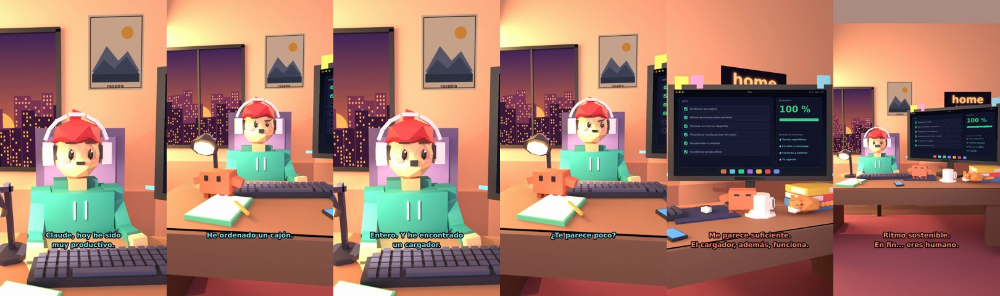

# Claude, hoy he sido muy productivo



**Archivo de guion:** `guiones/casual_34_hoy_productivo.json` · **Ambiente:** `atardecer_casa` · **Duración:** 34 s (204 frames de animación a 6 fps)

La productividad en sus mínimos: ordenar un cajón y sentirse un héroe.

**Gancho (primera frase):** «Claude, hoy he sido muy productivo.»

## Cómo se genera el vídeo
```bash
python3 -I motor/montar_video.py guiones/casual_34_hoy_productivo.json salidas/casual_34_hoy_productivo.mp4
```
El guion se creó con `motor/generar_guiones.py` (tiempos automáticos según la longitud de cada frase y pantallas sincronizadas con el diálogo). Biblioteca usada: `biblioteca/atardecer_casa/`.

## Guion plano a plano

| # | Tiempo | Quién | Texto | Plano | Emoción / pose / estado | Pantalla del monitor |
|---|---|---|---|---|---|---|
| 1 | 0.0–4.1 | Humano | Claude, hoy he sido / muy productivo. | `humano` | ilusionado | tareas (35.79 s) |
| 2 | 4.1–6.4 | Claude | Cuéntame. | `monitor` | mira_izq |  |
| 3 | 6.4–9.2 | Humano | He ordenado un cajón. | `dos` | bobo |  |
| 4 | 9.2–11.6 | Claude | Un cajón. | `claude_ojos` | idle |  |
| 5 | 11.6–15.7 | Humano | Entero. Y he encontrado / un cargador. | `humano` | ilusionado |  |
| 6 | 15.7–18.1 | Claude | Es un hito. | `cenital` | mira_der |  |
| 7 | 18.1–20.4 | Humano | ¿Te parece poco? | `dos` | confundido |  |
| 8 | 20.4–26.2 | Claude | Me parece suficiente. / El cargador, además, funciona. | `monitor` | feliz |  |
| 9 | 26.2–29.4 | Humano | Mañana, el segundo cajón. | `humano` | ilusionado |  |
| 10 | 29.4–34.0 | Claude | Ritmo sostenible. / En fin... eres humano. | `general` | feliz |  |

## Datos reales que aparecen o se mencionan

- Vídeo de humor, sin datos reales.

## Notas de producción

- **Humor:** Claude es sarcástico y pícaro («como el que le salva el culo»); el humano es ingenuo y algo tonto (expresiones `bobo`, `ilusionado`, `confundido`).
- **Voces:** son «blips» sintéticos (no hay voz real). Para voz real: ElevenLabs o grabarla y sustituir el audio.
- **Cifras y leyes:** los datos reales están citados arriba; las cuentas de ejemplo (márgenes, 214 tiendas, etc.) son ilustrativas. No es asesoramiento financiero ni legal.
