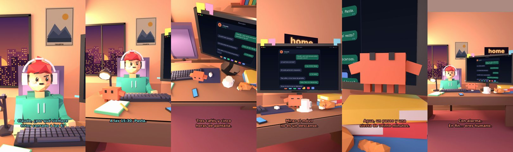

# Claude, ¿por qué siempre estoy cansado a las 6?



**Archivo de guion:** `guiones/casual_35_cansado_a_las_6.json` · **Ambiente:** `atardecer_casa` · **Duración:** 36 s (216 frames de animación a 6 fps)

El bajón de la tarde y todas las excusas posibles. Claude receta agua, un paseo y una siesta con límite.

**Gancho (primera frase):** «Claude, ¿por qué siempre estoy cansado a las 6?»

## Cómo se genera el vídeo
```bash
python3 -I motor/montar_video.py guiones/casual_35_cansado_a_las_6.json salidas/casual_35_cansado_a_las_6.mp4
```
El guion se creó con `motor/generar_guiones.py` (tiempos automáticos según la longitud de cada frase y pantallas sincronizadas con el diálogo). Biblioteca usada: `biblioteca/atardecer_casa/`.

## Guion plano a plano

| # | Tiempo | Quién | Texto | Plano | Emoción / pose / estado | Pantalla del monitor |
|---|---|---|---|---|---|---|
| 1 | 0.0–4.5 | Humano | Claude, ¿por qué siempre / estoy cansado a las 6? | `humano` | confundido | mensajes (36.0 s) |
| 2 | 4.5–6.8 | Claude | ¿A qué hora comiste? | `monitor` | mira_izq |  |
| 3 | 6.8–9.0 | Humano | A las 15:30. Pasta. | `dos` | bobo |  |
| 4 | 9.0–12.3 | Claude | Ahí está parte de la respuesta. | `claude_ojos` | feliz |  |
| 5 | 12.3–14.3 | Humano | ¿Y el resto? | `humano` | confundido |  |
| 6 | 14.3–17.9 | Claude | Tres cafés y cinco / horas de pantalla. | `cenital` | mira_der |  |
| 7 | 17.9–20.8 | Humano | Siete. Pero con descansos. | `dos` | preocupado |  |
| 8 | 20.8–24.1 | Claude | Mirar el móvil / no es un descanso. | `monitor` | feliz |  |
| 9 | 24.1–26.1 | Humano | ¿Qué hago? | `humano` | preocupado |  |
| 10 | 26.1–30.6 | Claude | Agua, un paseo y una / siesta de veinte minutos. | `claude_ojos` | idle, empuje de cámara |  |
| 11 | 30.6–32.6 | Humano | ¿Solo veinte? | `dos` | bobo |  |
| 12 | 32.6–36.0 | Claude | Con alarma. / En fin... eres humano. | `general` | feliz |  |

## Datos reales que aparecen o se mencionan

- Vídeo de humor, sin datos reales.

## Notas de producción

- **Humor:** Claude es sarcástico y pícaro («como el que le salva el culo»); el humano es ingenuo y algo tonto (expresiones `bobo`, `ilusionado`, `confundido`).
- **Voces:** son «blips» sintéticos (no hay voz real). Para voz real: ElevenLabs o grabarla y sustituir el audio.
- **Cifras y leyes:** los datos reales están citados arriba; las cuentas de ejemplo (márgenes, 214 tiendas, etc.) son ilustrativas. No es asesoramiento financiero ni legal.
