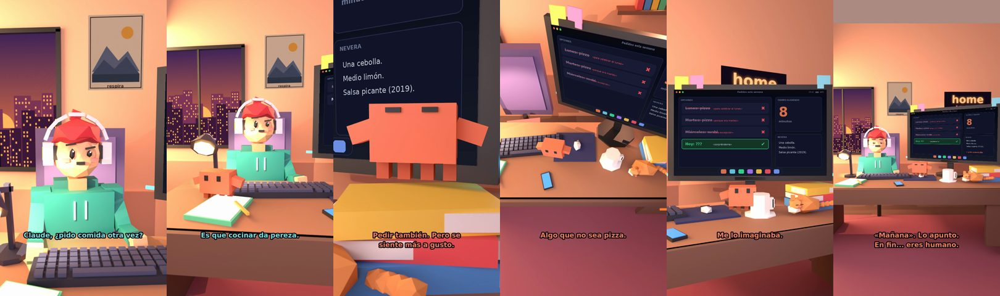

# Claude, ¿pido comida otra vez?



**Archivo de guion:** `guiones/casual_36_pido_comida.json` · **Ambiente:** `atardecer_casa` · **Duración:** 36 s (216 frames de animación a 6 fps)

La comida a domicilio por décima vez esta semana. Claude no juzga, solo cuenta.

**Gancho (primera frase):** «Claude, ¿pido comida otra vez?»

## Cómo se genera el vídeo
```bash
python3 -I motor/montar_video.py guiones/casual_36_pido_comida.json salidas/casual_36_pido_comida.mp4
```
El guion se creó con `motor/generar_guiones.py` (tiempos automáticos según la longitud de cada frase y pantallas sincronizadas con el diálogo). Biblioteca usada: `biblioteca/atardecer_casa/`.

## Guion plano a plano

| # | Tiempo | Quién | Texto | Plano | Emoción / pose / estado | Pantalla del monitor |
|---|---|---|---|---|---|---|
| 1 | 0.0–4.0 | Humano | Claude, ¿pido comida otra vez? | `humano` | bobo | menu (37.89 s) |
| 2 | 4.0–7.8 | Claude | Es la quinta vez / esta semana. | `monitor` | mira_izq |  |
| 3 | 7.8–11.2 | Humano | Es que cocinar da pereza. | `dos` | bobo |  |
| 4 | 11.2–16.4 | Claude | Pedir también. Pero se / siente más a gusto. | `claude_ojos` | feliz |  |
| 5 | 16.4–19.3 | Humano | ¿Qué me recomiendas? | `humano` | confundido |  |
| 6 | 19.3–22.4 | Claude | Algo que no sea pizza. | `cenital` | mira_der |  |
| 7 | 22.4–25.0 | Humano | Pizza. | `dos` | ilusionado |  |
| 8 | 25.0–27.6 | Claude | Me lo imaginaba. | `monitor` | mira_arriba |  |
| 9 | 27.6–30.7 | Humano | Mañana cocino. Seguro. | `humano` | feliz |  |
| 10 | 30.7–36.0 | Claude | «Mañana». Lo apunto. / En fin... eres humano. | `general` | feliz |  |

## Datos reales que aparecen o se mencionan

- Vídeo de humor, sin datos reales.

## Notas de producción

- **Humor:** Claude es sarcástico y pícaro («como el que le salva el culo»); el humano es ingenuo y algo tonto (expresiones `bobo`, `ilusionado`, `confundido`).
- **Voces:** son «blips» sintéticos (no hay voz real). Para voz real: ElevenLabs o grabarla y sustituir el audio.
- **Cifras y leyes:** los datos reales están citados arriba; las cuentas de ejemplo (márgenes, 214 tiendas, etc.) son ilustrativas. No es asesoramiento financiero ni legal.
