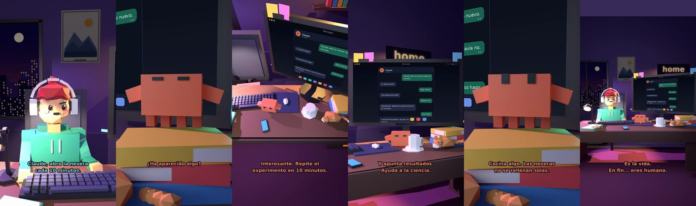

# Claude, abro la nevera cada 10 minutos



**Archivo de guion:** `guiones/casual_37_la_nevera.json` · **Ambiente:** `noche_casa` · **Duración:** 34 s (204 frames de animación a 6 fps)

Abrir la nevera esperando que haya aparecido algo nuevo. Claude lo trata como un experimento científico.

**Gancho (primera frase):** «Claude, abro la nevera cada 10 minutos.»

## Cómo se genera el vídeo
```bash
python3 -I motor/montar_video.py guiones/casual_37_la_nevera.json salidas/casual_37_la_nevera.mp4
```
El guion se creó con `motor/generar_guiones.py` (tiempos automáticos según la longitud de cada frase y pantallas sincronizadas con el diálogo). Biblioteca usada: `biblioteca/noche_casa/`.

## Guion plano a plano

| # | Tiempo | Quién | Texto | Plano | Emoción / pose / estado | Pantalla del monitor |
|---|---|---|---|---|---|---|
| 1 | 0.0–3.8 | Humano | Claude, abro la nevera / cada 10 minutos. | `humano` | confundido | mensajes (34.0 s) |
| 2 | 3.8–5.7 | Claude | ¿Y qué buscas? | `monitor` | mira_izq |  |
| 3 | 5.7–7.7 | Humano | Algo nuevo. | `dos` | bobo |  |
| 4 | 7.7–9.8 | Claude | ¿Ha aparecido algo? | `claude_ojos` | feliz |  |
| 5 | 9.8–11.8 | Humano | Todavía no. | `humano` | preocupado |  |
| 6 | 11.8–16.4 | Claude | Interesante. Repite el / experimento en 10 minutos. | `cenital` | mira_der |  |
| 7 | 16.4–18.4 | Humano | Eso hago. | `dos` | ilusionado |  |
| 8 | 18.4–22.2 | Claude | Y apunta resultados. / Ayuda a la ciencia. | `monitor` | feliz |  |
| 9 | 22.2–24.4 | Humano | ¿Y si tengo hambre? | `humano` | bobo |  |
| 10 | 24.4–28.7 | Claude | Cocina algo. Las neveras / no se rellenan solas. | `claude_ojos` | idle, empuje de cámara |  |
| 11 | 28.7–30.7 | Humano | Qué injusto. | `dos` | preocupado |  |
| 12 | 30.7–34.0 | Claude | Es la vida. / En fin... eres humano. | `general` | feliz |  |

## Datos reales que aparecen o se mencionan

- Vídeo de humor, sin datos reales.

## Notas de producción

- **Humor:** Claude es sarcástico y pícaro («como el que le salva el culo»); el humano es ingenuo y algo tonto (expresiones `bobo`, `ilusionado`, `confundido`).
- **Voces:** son «blips» sintéticos (no hay voz real). Para voz real: ElevenLabs o grabarla y sustituir el audio.
- **Cifras y leyes:** los datos reales están citados arriba; las cuentas de ejemplo (márgenes, 214 tiendas, etc.) son ilustrativas. No es asesoramiento financiero ni legal.
