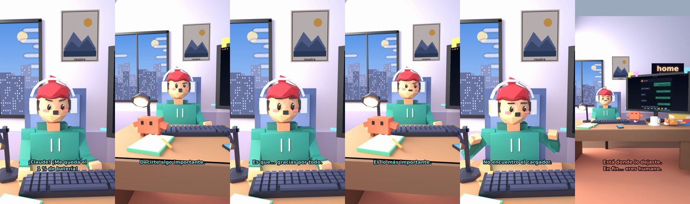

# Claude, me queda el 1 % de batería



**Archivo de guion:** `guiones/casual_38_un_por_ciento.json` · **Ambiente:** `dia_casa` · **Duración:** 32 s (192 frames de animación a 6 fps)

El 1 % de batería y la urgencia absoluta de decir algo importante.

**Gancho (primera frase):** «¡Claude! ¡Me queda el 1 % de batería!»

## Cómo se genera el vídeo
```bash
python3 -I motor/montar_video.py guiones/casual_38_un_por_ciento.json salidas/casual_38_un_por_ciento.mp4
```
El guion se creó con `motor/generar_guiones.py` (tiempos automáticos según la longitud de cada frase y pantallas sincronizadas con el diálogo). Biblioteca usada: `biblioteca/dia_casa/`.

## Guion plano a plano

| # | Tiempo | Quién | Texto | Plano | Emoción / pose / estado | Pantalla del monitor |
|---|---|---|---|---|---|---|
| 1 | 0.0–4.2 | Humano | ¡Claude! ¡Me queda el / 1 % de batería! | `humano` | preocupado | mensajes (32.0 s) |
| 2 | 4.2–6.5 | Claude | ¿Qué necesitas? | `monitor` | mira_izq |  |
| 3 | 6.5–9.5 | Humano | Decirte algo importante. | `dos` | bobo |  |
| 4 | 9.5–11.8 | Claude | Rápido. | `claude_ojos` | idle |  |
| 5 | 11.8–15.1 | Humano | Es que... gracias por todo. | `humano` | ilusionado |  |
| 6 | 15.1–17.4 | Claude | ¿Eso era? | `cenital` | mira_der |  |
| 7 | 17.4–20.1 | Humano | Es lo más importante. | `dos` | confundido |  |
| 8 | 20.1–23.9 | Claude | Pues muy bien. / Pero enchúfalo ya. | `monitor` | feliz |  |
| 9 | 23.9–27.0 | Humano | No encuentro el cargador. | `humano` | preocupado, pose hombros |  |
| 10 | 27.0–32.0 | Claude | Está donde lo dejaste. / En fin... eres humano. | `general` | feliz |  |

## Datos reales que aparecen o se mencionan

- Vídeo de humor, sin datos reales.

## Notas de producción

- **Humor:** Claude es sarcástico y pícaro («como el que le salva el culo»); el humano es ingenuo y algo tonto (expresiones `bobo`, `ilusionado`, `confundido`).
- **Voces:** son «blips» sintéticos (no hay voz real). Para voz real: ElevenLabs o grabarla y sustituir el audio.
- **Cifras y leyes:** los datos reales están citados arriba; las cuentas de ejemplo (márgenes, 214 tiendas, etc.) son ilustrativas. No es asesoramiento financiero ni legal.
