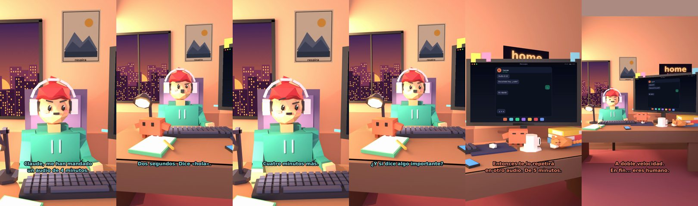

# Claude, me han mandado un audio de 4 minutos



**Archivo de guion:** `guiones/casual_39_audio_de_4_minutos.json` · **Ambiente:** `atardecer_casa` · **Duración:** 36 s (216 frames de animación a 6 fps)

El audio eterno del amigo: Claude lo resume en una frase y se queda corto.

**Gancho (primera frase):** «Claude, me han mandado un audio de 4 minutos.»

## Cómo se genera el vídeo
```bash
python3 -I motor/montar_video.py guiones/casual_39_audio_de_4_minutos.json salidas/casual_39_audio_de_4_minutos.mp4
```
El guion se creó con `motor/generar_guiones.py` (tiempos automáticos según la longitud de cada frase y pantallas sincronizadas con el diálogo). Biblioteca usada: `biblioteca/atardecer_casa/`.

## Guion plano a plano

| # | Tiempo | Quién | Texto | Plano | Emoción / pose / estado | Pantalla del monitor |
|---|---|---|---|---|---|---|
| 1 | 0.0–5.1 | Humano | Claude, me han mandado / un audio de 4 minutos. | `humano` | preocupado | mensajes (36.0 s) |
| 2 | 5.1–7.5 | Claude | ¿Lo has escuchado? | `monitor` | mira_izq |  |
| 3 | 7.5–10.8 | Humano | Dos segundos. Dice «hola». | `dos` | bobo |  |
| 4 | 10.8–13.1 | Claude | ¿Y el resto? | `claude_ojos` | idle |  |
| 5 | 13.1–15.6 | Humano | Cuatro minutos más. | `humano` | confundido |  |
| 6 | 15.6–19.9 | Claude | Ponlo a velocidad doble. / Es un truco. | `cenital` | mira_der |  |
| 7 | 19.9–23.2 | Humano | ¿Y si dice algo importante? | `dos` | preocupado |  |
| 8 | 23.2–29.0 | Claude | Entonces te lo repetirá / en otro audio. De 5 minutos. | `monitor` | feliz |  |
| 9 | 29.0–31.3 | Humano | Voy a escucharlo. | `humano` | feliz |  |
| 10 | 31.3–36.0 | Claude | A doble velocidad. / En fin... eres humano. | `general` | feliz |  |

## Datos reales que aparecen o se mencionan

- Vídeo de humor, sin datos reales.

## Notas de producción

- **Humor:** Claude es sarcástico y pícaro («como el que le salva el culo»); el humano es ingenuo y algo tonto (expresiones `bobo`, `ilusionado`, `confundido`).
- **Voces:** son «blips» sintéticos (no hay voz real). Para voz real: ElevenLabs o grabarla y sustituir el audio.
- **Cifras y leyes:** los datos reales están citados arriba; las cuentas de ejemplo (márgenes, 214 tiendas, etc.) son ilustrativas. No es asesoramiento financiero ni legal.
