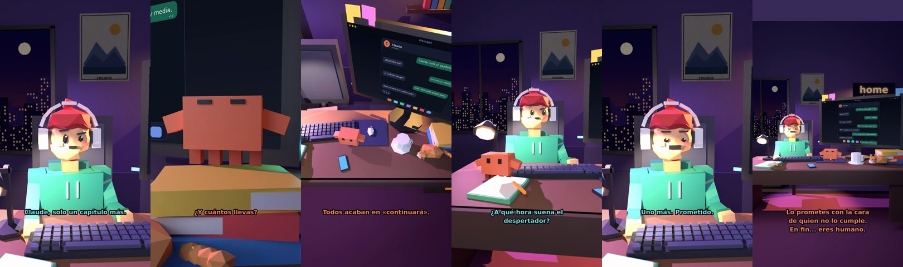

# Claude, solo un capítulo más



**Archivo de guion:** `guiones/casual_40_un_capitulo_mas.json` · **Ambiente:** `noche_casa` · **Duración:** 34 s (204 frames de animación a 6 fps)

La maratón de series a las 2 de la madrugada: «solo uno más» y el despertador a las 7.

**Gancho (primera frase):** «Claude, solo un capítulo más.»

## Cómo se genera el vídeo
```bash
python3 -I motor/montar_video.py guiones/casual_40_un_capitulo_mas.json salidas/casual_40_un_capitulo_mas.mp4
```
El guion se creó con `motor/generar_guiones.py` (tiempos automáticos según la longitud de cada frase y pantallas sincronizadas con el diálogo). Biblioteca usada: `biblioteca/noche_casa/`.

## Guion plano a plano

| # | Tiempo | Quién | Texto | Plano | Emoción / pose / estado | Pantalla del monitor |
|---|---|---|---|---|---|---|
| 1 | 0.0–3.5 | Humano | Claude, solo un capítulo más. | `humano` | bobo | mensajes (34.0 s) |
| 2 | 3.5–5.9 | Claude | ¿Qué hora es? | `monitor` | mira_izq |  |
| 3 | 5.9–8.2 | Humano | La una y media. | `dos` | bobo |  |
| 4 | 8.2–10.6 | Claude | ¿Y cuántos llevas? | `claude_ojos` | feliz |  |
| 5 | 10.6–13.9 | Humano | Seis. Pero este acaba bien. | `humano` | ilusionado |  |
| 6 | 13.9–17.5 | Claude | Todos acaban en «continuará». | `cenital` | mira_der |  |
| 7 | 17.5–21.3 | Humano | ¿A qué hora suena el / despertador? | `dos` | confundido |  |
| 8 | 21.3–24.1 | Claude | A las 7:00. Tú sabrás. | `monitor` | feliz |  |
| 9 | 24.1–26.7 | Humano | Uno más. Prometido. | `humano` | feliz |  |
| 10 | 26.7–34.0 | Claude | Lo prometes con la cara / de quien no lo cumple. / En fin... eres humano. | `general` | feliz |  |

## Datos reales que aparecen o se mencionan

- Vídeo de humor, sin datos reales.

## Notas de producción

- **Humor:** Claude es sarcástico y pícaro («como el que le salva el culo»); el humano es ingenuo y algo tonto (expresiones `bobo`, `ilusionado`, `confundido`).
- **Voces:** son «blips» sintéticos (no hay voz real). Para voz real: ElevenLabs o grabarla y sustituir el audio.
- **Cifras y leyes:** los datos reales están citados arriba; las cuentas de ejemplo (márgenes, 214 tiendas, etc.) son ilustrativas. No es asesoramiento financiero ni legal.
