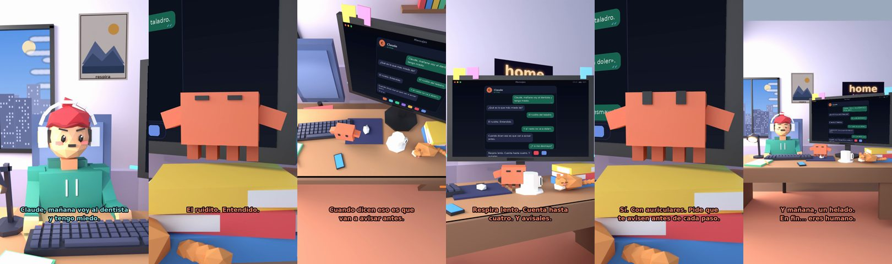

# Claude, mañana voy al dentista y tengo miedo



**Archivo de guion:** `guiones/casual_42_el_dentista.json` · **Ambiente:** `dia_casa` · **Duración:** 36 s (216 frames de animación a 6 fps)

El miedo al dentista con humor: Claude acompaña con datos prácticos de respiración y cero dramatismo.

**Gancho (primera frase):** «Claude, mañana voy al dentista y tengo miedo.»

## Cómo se genera el vídeo
```bash
python3 -I motor/montar_video.py guiones/casual_42_el_dentista.json salidas/casual_42_el_dentista.mp4
```
El guion se creó con `motor/generar_guiones.py` (tiempos automáticos según la longitud de cada frase y pantallas sincronizadas con el diálogo). Biblioteca usada: `biblioteca/dia_casa/`.

## Guion plano a plano

| # | Tiempo | Quién | Texto | Plano | Emoción / pose / estado | Pantalla del monitor |
|---|---|---|---|---|---|---|
| 1 | 0.0–3.9 | Humano | Claude, mañana voy al dentista / y tengo miedo. | `humano` | preocupado | mensajes (36.0 s) |
| 2 | 3.9–6.6 | Claude | ¿Qué es lo que más miedo da? | `monitor` | mira_izq |  |
| 3 | 6.6–8.9 | Humano | El ruidito del taladro. | `dos` | bobo |  |
| 4 | 8.9–11.1 | Claude | El ruidito. Entendido. | `claude_ojos` | feliz |  |
| 5 | 11.1–13.6 | Humano | Y el «esto no va a doler». | `humano` | preocupado |  |
| 6 | 13.6–17.4 | Claude | Cuando dicen eso es que / van a avisar antes. | `cenital` | mira_der |  |
| 7 | 17.4–19.2 | Humano | ¿Y si me desmayo? | `dos` | preocupado |  |
| 8 | 19.2–23.3 | Claude | Respira lento. Cuenta hasta / cuatro. Y avísales. | `monitor` | feliz |  |
| 9 | 23.3–25.4 | Humano | ¿Puedo llevar música? | `humano` | ilusionado |  |
| 10 | 25.4–30.4 | Claude | Sí. Con auriculares. Pide que / te avisen antes de cada paso. | `claude_ojos` | idle, empuje de cámara |  |
| 11 | 30.4–32.2 | Humano | Voy a ir. | `dos` | feliz |  |
| 12 | 32.2–36.0 | Claude | Y mañana, un helado. / En fin... eres humano. | `general` | feliz |  |

## Datos reales que aparecen o se mencionan

- Vídeo de humor, sin datos reales.

## Notas de producción

- **Humor:** Claude es sarcástico y pícaro («como el que le salva el culo»); el humano es ingenuo y algo tonto (expresiones `bobo`, `ilusionado`, `confundido`).
- **Voces:** son «blips» sintéticos (no hay voz real). Para voz real: ElevenLabs o grabarla y sustituir el audio.
- **Cifras y leyes:** los datos reales están citados arriba; las cuentas de ejemplo (márgenes, 214 tiendas, etc.) son ilustrativas. No es asesoramiento financiero ni legal.
