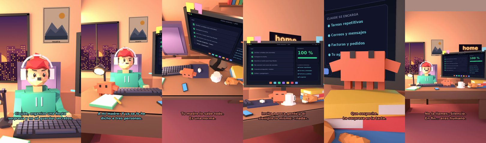

# Claude, organizo una fiesta sorpresa y no sé guardar secretos



**Archivo de guion:** `guiones/casual_43_fiesta_sorpresa.json` · **Ambiente:** `atardecer_casa` · **Duración:** 38 s (228 frames de animación a 6 fps)

La fiesta sorpresa que se cuenta sola: Claude diseña un plan para que el humano aguante en silencio.

**Gancho (primera frase):** «Claude, organizo una fiesta sorpresa y no sé guardar secretos.»

## Cómo se genera el vídeo
```bash
python3 -I motor/montar_video.py guiones/casual_43_fiesta_sorpresa.json salidas/casual_43_fiesta_sorpresa.mp4
```
El guion se creó con `motor/generar_guiones.py` (tiempos automáticos según la longitud de cada frase y pantallas sincronizadas con el diálogo). Biblioteca usada: `biblioteca/atardecer_casa/`.

## Guion plano a plano

| # | Tiempo | Quién | Texto | Plano | Emoción / pose / estado | Pantalla del monitor |
|---|---|---|---|---|---|---|
| 1 | 0.0–5.4 | Humano | Claude, organizo una fiesta / sorpresa y no sé guardar secretos. | `humano` | preocupado | tareas (31.91 s) |
| 2 | 5.4–7.2 | Claude | ¿A quién? | `monitor` | mira_izq |  |
| 3 | 7.2–11.4 | Humano | A mi madre. Y ya se lo he / dicho a tres personas. | `dos` | bobo |  |
| 4 | 11.4–13.6 | Claude | Tres. Y ella lo sabe. | `claude_ojos` | feliz |  |
| 5 | 13.6–15.5 | Humano | ¿Cómo lo sabes? | `humano` | confundido |  |
| 6 | 15.5–18.8 | Claude | Tu madre lo sabe todo. / Es una norma. | `cenital` | mira_der |  |
| 7 | 18.8–20.6 | Humano | ¿Y qué hago? | `dos` | preocupado |  |
| 8 | 20.6–25.0 | Claude | Invita a poca gente y di / siempre lo mismo: «nada». | `monitor` | feliz |  |
| 9 | 25.0–26.9 | Humano | ¿Y si sospecha? | `humano` | preocupado |  |
| 10 | 26.9–30.3 | Claude | Que sospeche. / La sorpresa es la tarta. | `claude_ojos` | idle, empuje de cámara |  |
| 11 | 30.3–33.9 | Humano | Voy a llamarla... para no decirle nada. | `dos` | ilusionado |  |
| 12 | 33.9–38.0 | Claude | No la llames. Silencio. / En fin... eres humano. | `general` | feliz |  |

## Datos reales que aparecen o se mencionan

- Vídeo de humor, sin datos reales.

## Notas de producción

- **Humor:** Claude es sarcástico y pícaro («como el que le salva el culo»); el humano es ingenuo y algo tonto (expresiones `bobo`, `ilusionado`, `confundido`).
- **Voces:** son «blips» sintéticos (no hay voz real). Para voz real: ElevenLabs o grabarla y sustituir el audio.
- **Cifras y leyes:** los datos reales están citados arriba; las cuentas de ejemplo (márgenes, 214 tiendas, etc.) son ilustrativas. No es asesoramiento financiero ni legal.
