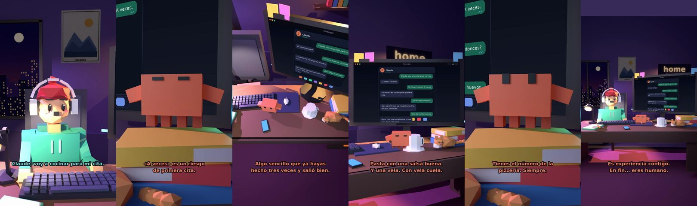

# Claude, voy a cocinar para mi cita



**Archivo de guion:** `guiones/casual_44_cocinar_para_la_cita.json` · **Ambiente:** `noche_casa` · **Duración:** 38 s (228 frames de animación a 6 fps)

Cocinar para impresionar sin saber cocinar: Claude propone un plan realista (y pide pizza de reserva).

**Gancho (primera frase):** «Claude, voy a cocinar para mi cita.»

## Cómo se genera el vídeo
```bash
python3 -I motor/montar_video.py guiones/casual_44_cocinar_para_la_cita.json salidas/casual_44_cocinar_para_la_cita.mp4
```
El guion se creó con `motor/generar_guiones.py` (tiempos automáticos según la longitud de cada frase y pantallas sincronizadas con el diálogo). Biblioteca usada: `biblioteca/noche_casa/`.

## Guion plano a plano

| # | Tiempo | Quién | Texto | Plano | Emoción / pose / estado | Pantalla del monitor |
|---|---|---|---|---|---|---|
| 1 | 0.0–3.4 | Humano | Claude, voy a cocinar para mi cita. | `humano` | ilusionado | mensajes (38.0 s) |
| 2 | 3.4–5.3 | Claude | ¿Y sabes cocinar? | `monitor` | mira_izq |  |
| 3 | 5.3–7.9 | Humano | Sé hacer huevos. A veces. | `dos` | bobo |  |
| 4 | 7.9–11.6 | Claude | «A veces» es un riesgo / de primera cita. | `claude_ojos` | feliz |  |
| 5 | 11.6–13.7 | Humano | ¿Qué hago entonces? | `humano` | confundido |  |
| 6 | 13.7–18.8 | Claude | Algo sencillo que ya hayas / hecho tres veces y salió bien. | `cenital` | mira_der |  |
| 7 | 18.8–21.1 | Humano | Solo he hecho huevos. | `dos` | preocupado |  |
| 8 | 21.1–26.0 | Claude | Pasta con una salsa buena. / Y una vela. Con vela cuela. | `monitor` | feliz |  |
| 9 | 26.0–28.0 | Humano | ¿Y si se me quema? | `humano` | preocupado |  |
| 10 | 28.0–31.8 | Claude | Tienes el número de la / pizzería. Siempre. | `claude_ojos` | idle, empuje de cámara |  |
| 11 | 31.8–33.8 | Humano | Qué listo eres. | `dos` | ilusionado |  |
| 12 | 33.8–38.0 | Claude | Es experiencia contigo. / En fin... eres humano. | `general` | feliz |  |

## Datos reales que aparecen o se mencionan

- Vídeo de humor, sin datos reales.

## Notas de producción

- **Humor:** Claude es sarcástico y pícaro («como el que le salva el culo»); el humano es ingenuo y algo tonto (expresiones `bobo`, `ilusionado`, `confundido`).
- **Voces:** son «blips» sintéticos (no hay voz real). Para voz real: ElevenLabs o grabarla y sustituir el audio.
- **Cifras y leyes:** los datos reales están citados arriba; las cuentas de ejemplo (márgenes, 214 tiendas, etc.) son ilustrativas. No es asesoramiento financiero ni legal.
