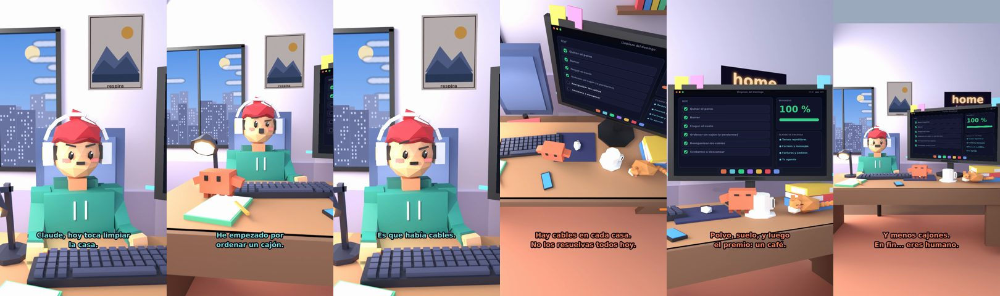

# Claude, hoy toca limpiar la casa



**Archivo de guion:** `guiones/casual_45_domingo_de_limpieza.json` · **Ambiente:** `dia_casa` · **Duración:** 34 s (204 frames de animación a 6 fps)

El domingo de limpieza: empezar por un rincón y acabar organizando los cajones.

**Gancho (primera frase):** «Claude, hoy toca limpiar la casa.»

## Cómo se genera el vídeo
```bash
python3 -I motor/montar_video.py guiones/casual_45_domingo_de_limpieza.json salidas/casual_45_domingo_de_limpieza.mp4
```
El guion se creó con `motor/generar_guiones.py` (tiempos automáticos según la longitud de cada frase y pantallas sincronizadas con el diálogo). Biblioteca usada: `biblioteca/dia_casa/`.

## Guion plano a plano

| # | Tiempo | Quién | Texto | Plano | Emoción / pose / estado | Pantalla del monitor |
|---|---|---|---|---|---|---|
| 1 | 0.0–3.5 | Humano | Claude, hoy toca limpiar / la casa. | `humano` | preocupado | tareas (35.79 s) |
| 2 | 3.5–6.2 | Claude | Empieza por un rincón. | `monitor` | mira_izq |  |
| 3 | 6.2–9.7 | Humano | He empezado por / ordenar un cajón. | `dos` | bobo |  |
| 4 | 9.7–13.4 | Claude | Eso no es un rincón. / Es una excusa. | `claude_ojos` | feliz |  |
| 5 | 13.4–15.8 | Humano | Es que había cables. | `humano` | confundido |  |
| 6 | 15.8–21.1 | Claude | Hay cables en cada casa. / No los resuelvas todos hoy. | `cenital` | mira_der |  |
| 7 | 21.1–23.4 | Humano | ¿Y por dónde sigo? | `dos` | confundido |  |
| 8 | 23.4–27.7 | Claude | Polvo, suelo, y luego / el premio: un café. | `monitor` | feliz |  |
| 9 | 27.7–29.9 | Humano | ¡Me gusta el plan! | `humano` | ilusionado |  |
| 10 | 29.9–34.0 | Claude | Y menos cajones. / En fin... eres humano. | `general` | feliz |  |

## Datos reales que aparecen o se mencionan

- Vídeo de humor, sin datos reales.

## Notas de producción

- **Humor:** Claude es sarcástico y pícaro («como el que le salva el culo»); el humano es ingenuo y algo tonto (expresiones `bobo`, `ilusionado`, `confundido`).
- **Voces:** son «blips» sintéticos (no hay voz real). Para voz real: ElevenLabs o grabarla y sustituir el audio.
- **Cifras y leyes:** los datos reales están citados arriba; las cuentas de ejemplo (márgenes, 214 tiendas, etc.) son ilustrativas. No es asesoramiento financiero ni legal.
