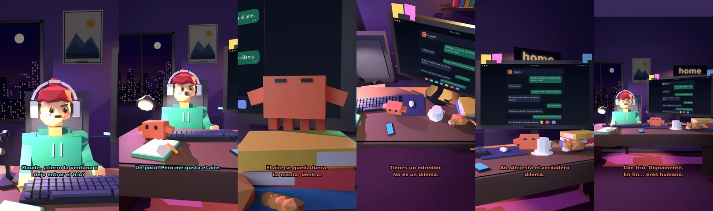

# Claude, ¿cierro la ventana o dejo entrar el frío?



**Archivo de guion:** `guiones/casual_46_la_ventana.json` · **Ambiente:** `noche_casa` · **Duración:** 34 s (204 frames de animación a 6 fps)

La gran decisión doméstica de la noche: la ventana abierta y el edredón.

**Gancho (primera frase):** «Claude, ¿cierro la ventana o dejo entrar el frío?»

## Cómo se genera el vídeo
```bash
python3 -I motor/montar_video.py guiones/casual_46_la_ventana.json salidas/casual_46_la_ventana.mp4
```
El guion se creó con `motor/generar_guiones.py` (tiempos automáticos según la longitud de cada frase y pantallas sincronizadas con el diálogo). Biblioteca usada: `biblioteca/noche_casa/`.

## Guion plano a plano

| # | Tiempo | Quién | Texto | Plano | Emoción / pose / estado | Pantalla del monitor |
|---|---|---|---|---|---|---|
| 1 | 0.0–4.9 | Humano | Claude, ¿cierro la ventana o / dejo entrar el frío? | `humano` | confundido | mensajes (34.0 s) |
| 2 | 4.9–7.0 | Claude | ¿Tienes frío? | `monitor` | mira_izq |  |
| 3 | 7.0–10.4 | Humano | Un poco. Pero me gusta el aire. | `dos` | bobo |  |
| 4 | 10.4–14.5 | Claude | El aire se queda fuera. / La manta, dentro. | `claude_ojos` | feliz |  |
| 5 | 14.5–16.6 | Humano | Es un dilema. | `humano` | preocupado |  |
| 6 | 16.6–20.3 | Claude | Tienes un edredón. / No es un dilema. | `cenital` | mira_der |  |
| 7 | 20.3–23.4 | Humano | Pero tendría que levantarme. | `dos` | confundido |  |
| 8 | 23.4–26.8 | Claude | Ah. Ahí está el verdadero / dilema. | `monitor` | feliz |  |
| 9 | 26.8–29.6 | Humano | Dejo la ventana abierta. | `humano` | feliz |  |
| 10 | 29.6–34.0 | Claude | Con frío. Dignamente. / En fin... eres humano. | `general` | feliz |  |

## Datos reales que aparecen o se mencionan

- Vídeo de humor, sin datos reales.

## Notas de producción

- **Humor:** Claude es sarcástico y pícaro («como el que le salva el culo»); el humano es ingenuo y algo tonto (expresiones `bobo`, `ilusionado`, `confundido`).
- **Voces:** son «blips» sintéticos (no hay voz real). Para voz real: ElevenLabs o grabarla y sustituir el audio.
- **Cifras y leyes:** los datos reales están citados arriba; las cuentas de ejemplo (márgenes, 214 tiendas, etc.) son ilustrativas. No es asesoramiento financiero ni legal.
