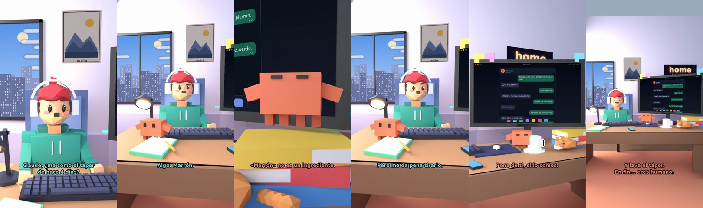

# Claude, ¿me como el táper de hace 4 días?



**Archivo de guion:** `guiones/casual_47_el_tupper.json` · **Ambiente:** `dia_casa` · **Duración:** 32 s (192 frames de animación a 6 fps)

El táper olvidado en la nevera: Claude, con su prudencia habitual, dice que no.

**Gancho (primera frase):** «Claude, ¿me como el táper de hace 4 días?»

## Cómo se genera el vídeo
```bash
python3 -I motor/montar_video.py guiones/casual_47_el_tupper.json salidas/casual_47_el_tupper.mp4
```
El guion se creó con `motor/generar_guiones.py` (tiempos automáticos según la longitud de cada frase y pantallas sincronizadas con el diálogo). Biblioteca usada: `biblioteca/dia_casa/`.

## Guion plano a plano

| # | Tiempo | Quién | Texto | Plano | Emoción / pose / estado | Pantalla del monitor |
|---|---|---|---|---|---|---|
| 1 | 0.0–4.8 | Humano | Claude, ¿me como el táper / de hace 4 días? | `humano` | ilusionado | mensajes (32.0 s) |
| 2 | 4.8–7.3 | Claude | ¿Qué hay dentro? | `monitor` | mira_izq |  |
| 3 | 7.3–9.7 | Humano | Algo. Marrón. | `dos` | bobo |  |
| 4 | 9.7–13.5 | Claude | «Marrón» no es un ingrediente. | `claude_ojos` | feliz |  |
| 5 | 13.5–16.2 | Humano | Huele... a recuerdo. | `humano` | confundido |  |
| 6 | 16.2–18.6 | Claude | No lo comas. | `cenital` | mira_der |  |
| 7 | 18.6–21.8 | Humano | Pero me da pena tirarlo. | `dos` | preocupado |  |
| 8 | 21.8–24.9 | Claude | Pena de ti, si lo comes. | `monitor` | feliz |  |
| 9 | 24.9–27.4 | Humano | Vale. Lo tiro. | `humano` | feliz |  |
| 10 | 27.4–32.0 | Claude | Y lava el táper. / En fin... eres humano. | `general` | feliz |  |

## Datos reales que aparecen o se mencionan

- Vídeo de humor, sin datos reales.

## Notas de producción

- **Humor:** Claude es sarcástico y pícaro («como el que le salva el culo»); el humano es ingenuo y algo tonto (expresiones `bobo`, `ilusionado`, `confundido`).
- **Voces:** son «blips» sintéticos (no hay voz real). Para voz real: ElevenLabs o grabarla y sustituir el audio.
- **Cifras y leyes:** los datos reales están citados arriba; las cuentas de ejemplo (márgenes, 214 tiendas, etc.) son ilustrativas. No es asesoramiento financiero ni legal.
