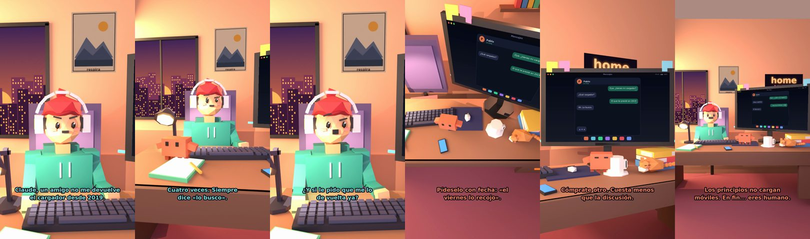

# Claude, un amigo no me devuelve el cargador desde 2019



**Archivo de guion:** `guiones/casual_48_el_cargador.json` · **Ambiente:** `atardecer_casa` · **Duración:** 34 s (204 frames de animación a 6 fps)

El cargador prestado que nunca vuelve: cómo pedirlo con elegancia (y por qué no vale la pena).

**Gancho (primera frase):** «Claude, un amigo no me devuelve el cargador desde 2019.»

## Cómo se genera el vídeo
```bash
python3 -I motor/montar_video.py guiones/casual_48_el_cargador.json salidas/casual_48_el_cargador.mp4
```
El guion se creó con `motor/generar_guiones.py` (tiempos automáticos según la longitud de cada frase y pantallas sincronizadas con el diálogo). Biblioteca usada: `biblioteca/atardecer_casa/`.

## Guion plano a plano

| # | Tiempo | Quién | Texto | Plano | Emoción / pose / estado | Pantalla del monitor |
|---|---|---|---|---|---|---|
| 1 | 0.0–4.8 | Humano | Claude, un amigo no me devuelve / el cargador desde 2019. | `humano` | preocupado | mensajes (34.0 s) |
| 2 | 4.8–6.7 | Claude | ¿Se lo has pedido? | `monitor` | mira_izq |  |
| 3 | 6.7–10.1 | Humano | Cuatro veces. Siempre / dice «lo busco». | `dos` | bobo |  |
| 4 | 10.1–13.6 | Claude | «Lo busco» es un idioma. / Significa «no». | `claude_ojos` | feliz |  |
| 5 | 13.6–17.0 | Humano | ¿Y si le pido que me lo / de vuelta ya? | `humano` | confundido |  |
| 6 | 17.0–20.8 | Claude | Pídeselo con fecha: «el / viernes lo recojo». | `cenital` | mira_der |  |
| 7 | 20.8–22.7 | Humano | ¿Y si no lo tiene? | `dos` | preocupado |  |
| 8 | 22.7–26.6 | Claude | Cómprate otro. Cuesta menos / que la discusión. | `monitor` | feliz |  |
| 9 | 26.6–29.2 | Humano | Es cuestión de principios. | `humano` | ilusionado |  |
| 10 | 29.2–34.0 | Claude | Los principios no cargan / móviles. En fin... eres humano. | `general` | feliz |  |

## Datos reales que aparecen o se mencionan

- Vídeo de humor, sin datos reales.

## Notas de producción

- **Humor:** Claude es sarcástico y pícaro («como el que le salva el culo»); el humano es ingenuo y algo tonto (expresiones `bobo`, `ilusionado`, `confundido`).
- **Voces:** son «blips» sintéticos (no hay voz real). Para voz real: ElevenLabs o grabarla y sustituir el audio.
- **Cifras y leyes:** los datos reales están citados arriba; las cuentas de ejemplo (márgenes, 214 tiendas, etc.) son ilustrativas. No es asesoramiento financiero ni legal.
