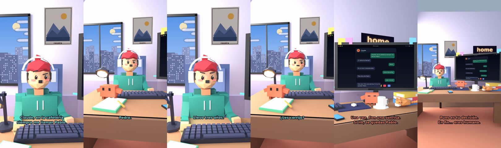

# Claude, en la cafetería siempre me llaman Pablo



**Archivo de guion:** `guiones/casual_49_nombre_en_la_cafeteria.json` · **Ambiente:** `dia_casa` · **Duración:** 32 s (192 frames de animación a 6 fps)

El nombre equivocado en el vaso de café: una vida entera siendo Pablo.

**Gancho (primera frase):** «Claude, en la cafetería siempre me llaman Pablo.»

## Cómo se genera el vídeo
```bash
python3 -I motor/montar_video.py guiones/casual_49_nombre_en_la_cafeteria.json salidas/casual_49_nombre_en_la_cafeteria.mp4
```
El guion se creó con `motor/generar_guiones.py` (tiempos automáticos según la longitud de cada frase y pantallas sincronizadas con el diálogo). Biblioteca usada: `biblioteca/dia_casa/`.

## Guion plano a plano

| # | Tiempo | Quién | Texto | Plano | Emoción / pose / estado | Pantalla del monitor |
|---|---|---|---|---|---|---|
| 1 | 0.0–5.1 | Humano | Claude, en la cafetería / siempre me llaman Pablo. | `humano` | confundido | mensajes (32.0 s) |
| 2 | 5.1–7.5 | Claude | ¿Y cómo te llamas? | `monitor` | mira_izq |  |
| 3 | 7.5–9.7 | Humano | Pedro. | `dos` | bobo |  |
| 4 | 9.7–12.7 | Claude | Es un error comprensible. | `claude_ojos` | feliz |  |
| 5 | 12.7–15.0 | Humano | Llevo tres años. | `humano` | preocupado |  |
| 6 | 15.0–17.4 | Claude | Tres años de Pablo. | `cenital` | mira_der |  |
| 7 | 17.4–19.7 | Humano | ¿Les corrijo? | `dos` | confundido |  |
| 8 | 19.7–24.9 | Claude | Una vez. Con una sonrisa. / Si no, te quedas Pablo. | `monitor` | feliz |  |
| 9 | 24.9–27.3 | Humano | Me gusta ser Pablo. | `humano` | bobo |  |
| 10 | 27.3–32.0 | Claude | Pues es tu decisión. / En fin... eres humano. | `general` | feliz |  |

## Datos reales que aparecen o se mencionan

- Vídeo de humor, sin datos reales.

## Notas de producción

- **Humor:** Claude es sarcástico y pícaro («como el que le salva el culo»); el humano es ingenuo y algo tonto (expresiones `bobo`, `ilusionado`, `confundido`).
- **Voces:** son «blips» sintéticos (no hay voz real). Para voz real: ElevenLabs o grabarla y sustituir el audio.
- **Cifras y leyes:** los datos reales están citados arriba; las cuentas de ejemplo (márgenes, 214 tiendas, etc.) son ilustrativas. No es asesoramiento financiero ni legal.
