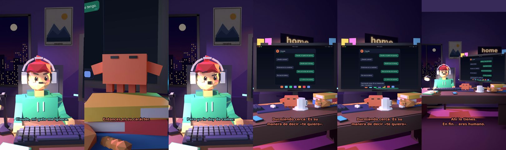

# Claude, mi gato me ignora



**Archivo de guion:** `guiones/casual_51_mi_gato_me_ignora.json` · **Ambiente:** `noche_casa` · **Duración:** 34 s (204 frames de animación a 6 fps)

La eterna historia de amor no correspondido con un gato. (El gato está durmiendo en el escritorio, como siempre.)

**Gancho (primera frase):** «Claude, mi gato me ignora.»

## Cómo se genera el vídeo
```bash
python3 -I motor/montar_video.py guiones/casual_51_mi_gato_me_ignora.json salidas/casual_51_mi_gato_me_ignora.mp4
```
El guion se creó con `motor/generar_guiones.py` (tiempos automáticos según la longitud de cada frase y pantallas sincronizadas con el diálogo). Biblioteca usada: `biblioteca/noche_casa/`.

## Guion plano a plano

| # | Tiempo | Quién | Texto | Plano | Emoción / pose / estado | Pantalla del monitor |
|---|---|---|---|---|---|---|
| 1 | 0.0–3.4 | Humano | Claude, mi gato me ignora. | `humano` | preocupado | mensajes (34.0 s) |
| 2 | 3.4–5.8 | Claude | ¿Desde cuándo? | `monitor` | mira_izq |  |
| 3 | 5.8–8.4 | Humano | Desde que lo tengo. | `dos` | bobo |  |
| 4 | 8.4–11.6 | Claude | Entonces es su carácter. | `claude_ojos` | feliz |  |
| 5 | 11.6–14.7 | Humano | Pero yo le doy de comer. | `humano` | confundido |  |
| 6 | 14.7–17.2 | Claude | Por eso te tolera. | `cenital` | mira_der |  |
| 7 | 17.2–19.8 | Humano | ¿Y cómo me quiere? | `dos` | ilusionado |  |
| 8 | 19.8–25.6 | Claude | Durmiendo cerca. Es su / manera de decir «te quiero». | `monitor` | feliz |  |
| 9 | 25.6–29.6 | Humano | Está durmiendo en mi escritorio. | `humano` | ilusionado |  |
| 10 | 29.6–34.0 | Claude | Ahí lo tienes. / En fin... eres humano. | `general` | feliz |  |

## Datos reales que aparecen o se mencionan

- Vídeo de humor, sin datos reales.

## Notas de producción

- **Humor:** Claude es sarcástico y pícaro («como el que le salva el culo»); el humano es ingenuo y algo tonto (expresiones `bobo`, `ilusionado`, `confundido`).
- **Voces:** son «blips» sintéticos (no hay voz real). Para voz real: ElevenLabs o grabarla y sustituir el audio.
- **Cifras y leyes:** los datos reales están citados arriba; las cuentas de ejemplo (márgenes, 214 tiendas, etc.) son ilustrativas. No es asesoramiento financiero ni legal.
