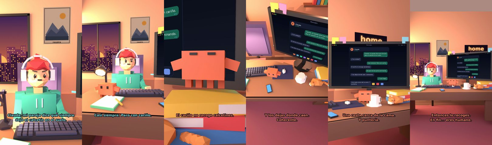

# Claude, mi pareja dice que siempre dejo el calcetín en el suelo



**Archivo de guion:** `guiones/casual_52_el_calcetin.json` · **Ambiente:** `atardecer_casa` · **Duración:** 36 s (216 frames de animación a 6 fps)

La eterna discusión del calcetín en el suelo. Claude hace de mediador con una propuesta salomónica.

**Gancho (primera frase):** «Claude, mi pareja dice que siempre dejo el calcetín en el suelo.»

## Cómo se genera el vídeo
```bash
python3 -I motor/montar_video.py guiones/casual_52_el_calcetin.json salidas/casual_52_el_calcetin.mp4
```
El guion se creó con `motor/generar_guiones.py` (tiempos automáticos según la longitud de cada frase y pantallas sincronizadas con el diálogo). Biblioteca usada: `biblioteca/atardecer_casa/`.

## Guion plano a plano

| # | Tiempo | Quién | Texto | Plano | Emoción / pose / estado | Pantalla del monitor |
|---|---|---|---|---|---|---|
| 1 | 0.0–6.5 | Humano | Claude, mi pareja dice que siempre / dejo el calcetín en el suelo. | `humano` | preocupado | mensajes (36.0 s) |
| 2 | 6.5–8.8 | Claude | ¿Y es verdad? | `monitor` | mira_izq |  |
| 3 | 8.8–12.2 | Humano | Casi siempre. Pero con cariño. | `dos` | bobo |  |
| 4 | 12.2–15.7 | Claude | El cariño no recoge calcetines. | `claude_ojos` | feliz |  |
| 5 | 15.7–19.1 | Humano | Es que me los quito caminando. | `humano` | confundido |  |
| 6 | 19.1–22.9 | Claude | Y los dejas donde caen. / Coherente. | `cenital` | mira_der |  |
| 7 | 22.9–25.1 | Humano | ¿Y qué hago? | `dos` | preocupado |  |
| 8 | 25.1–29.2 | Claude | Una cesta cerca de la cama. / Y puntería. | `monitor` | feliz |  |
| 9 | 29.2–31.4 | Humano | ¿Y si fallo? | `humano` | bobo |  |
| 10 | 31.4–36.0 | Claude | Entonces lo recoges. / En fin... eres humano. | `general` | feliz |  |

## Datos reales que aparecen o se mencionan

- Vídeo de humor, sin datos reales.

## Notas de producción

- **Humor:** Claude es sarcástico y pícaro («como el que le salva el culo»); el humano es ingenuo y algo tonto (expresiones `bobo`, `ilusionado`, `confundido`).
- **Voces:** son «blips» sintéticos (no hay voz real). Para voz real: ElevenLabs o grabarla y sustituir el audio.
- **Cifras y leyes:** los datos reales están citados arriba; las cuentas de ejemplo (márgenes, 214 tiendas, etc.) son ilustrativas. No es asesoramiento financiero ni legal.
