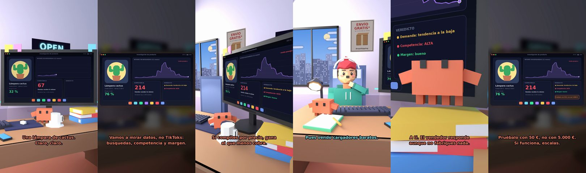

# El producto ganador



**Archivo de guion:** `guiones/drop_02_producto_ganador.json` · **Ambiente:** `dia_tienda` · **Duración:** 45 s (270 frames de animación a 6 fps)

El tonto ha visto en TikTok «el producto ganador» (una lámpara de cactus). Claude lo analiza con datos: 214 tiendas vendiendo lo mismo, moda pasajera… y le avisa de que la electrónica necesita marcado CE y que el vendedor responde. Veredicto: pruébalo con 50 €, no con 5.000 €.

**Gancho (primera frase):** «¡Tengo el producto ganador! ¡Una lámpara de cactus!»

## Cómo se genera el vídeo
```bash
python3 -I motor/montar_video.py guiones/drop_02_producto_ganador.json salidas/drop_02_producto_ganador.mp4
```
El guion se creó con `motor/generar_guiones.py` (tiempos automáticos según la longitud de cada frase y pantallas sincronizadas con el diálogo). Biblioteca usada: `biblioteca/dia_tienda/`.

## Guion plano a plano

| # | Tiempo | Quién | Texto | Plano | Emoción / pose / estado | Pantalla del monitor |
|---|---|---|---|---|---|---|
| 1 | 0.0–3.3 | Humano | ¡Tengo el producto ganador! / ¡Una lámpara de cactus! | `general` | ilusionado | producto (16.72 s) |
| 2 | 3.3–5.8 | Claude | Una lámpara de cactus. / Claro, claro. | `monitor` | mira_izq |  |
| 3 | 5.8–7.9 | Humano | Lo vi en TikTok. ¡Será viral! | `dos` | ilusionado, pose mira |  |
| 4 | 7.9–12.1 | Claude | Vamos a mirar datos, no TikToks: / búsquedas, competencia y margen. | `pantalla_completa` | idle |  |
| 5 | 12.1–13.5 | Humano | Yo sé lo que digo. | `humano` | bobo |  |
| 6 | 13.5–16.7 | Claude | Yo sé lo que veo: / 214 tiendas vendiendo lo mismo. | `claude_ojos` | idle, empuje de cámara |  |
| 7 | 16.7–18.1 | Humano | ¿Y eso es malo? | `dos` | confundido |  |
| 8 | 18.1–21.3 | Claude | Si compites por precio, gana / el que menos cobra. | `monitor_lateral` | idle |  |
| 9 | 21.3–22.6 | Humano | ¿Y la tendencia? | `humano` | preocupado |  |
| 10 | 22.6–25.6 | Claude | Pico en verano y luego nada. / Se llama «moda». | `cenital` | mira_der |  |
| 11 | 25.6–27.8 | Humano | Pues vendo cargadores baratos. | `dos` | bobo, pose pensar |  |
| 12 | 27.8–31.6 | Claude | Electrónica en la UE: marcado CE. / Sin él, multa y retirada. | `monitor` | feliz |  |
| 13 | 31.6–33.0 | Humano | ¿Multa? ¿A mí? | `humano` | preocupado |  |
| 14 | 33.0–36.4 | Claude | A ti. El vendedor responde / aunque no fabriques nada. | `claude_ojos` | mira_izq |  |
| 15 | 36.4–37.9 | Humano | ¿Entonces qué hago? | `dos` | confundido |  |
| 16 | 37.9–41.5 | Claude | Pruébalo con 50 €, no con 5.000 €. / Si funciona, escalas. | `pantalla_completa` | idle | producto (2.0 s) |
| 17 | 41.5–42.9 | Humano | ¡Pruebo con 50 €! | `humano` | feliz |  |
| 18 | 42.9–45.0 | Claude | Qué madurez. / Estoy emocionado. | `general` | feliz |  |

## Datos reales que aparecen o se mencionan

- Los aparatos eléctricos y electrónicos que se venden en la UE deben llevar marcado CE. Lo coloca el fabricante, pero quien importa/vende el producto desde fuera de la UE asume obligaciones propias (documentación de conformidad, etc.). Consulta siempre la normativa aplicable a tu producto.
  - Fuente: [Marcado CE (Tu Europa, Comisión Europea)](https://europa.eu/youreurope/business/product-requirements/labels-markings/ce-marking/index_es.htm)
  - Fuente: [Importaciones de fuera de la UE y marcado CE (Euronorm)](https://www.euronorm.net/content/ce-marking/category/import-and-export/imports-from-outside-the-eu-eea.php)
- Los datos de la pantalla «Investigación de producto» (214 tiendas, tendencia, márgenes) son un ejemplo ilustrativo.

## Notas de producción

- **Humor:** Claude es sarcástico y pícaro («como el que le salva el culo»); el humano es ingenuo y algo tonto (expresiones `bobo`, `ilusionado`, `confundido`).
- **Voces:** son «blips» sintéticos (no hay voz real). Para voz real: ElevenLabs o grabarla y sustituir el audio.
- **Cifras y leyes:** los datos reales están citados arriba; las cuentas de ejemplo (márgenes, 214 tiendas, etc.) son ilustrativas. No es asesoramiento financiero ni legal.
