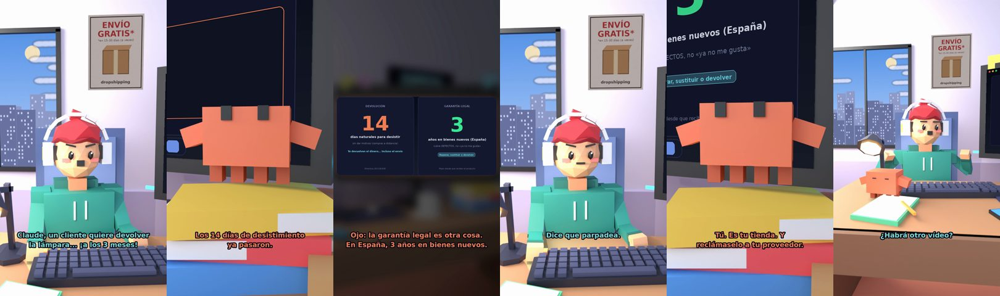

# Un cliente quiere devolver la lámpara… ¡a los 3 meses!



**Archivo de guion:** `guiones/drop_04_devoluciones.json` · **Ambiente:** `dia_tienda` · **Duración:** 45 s (270 frames de animación a 6 fps)

Devolución fuera de plazo: Claude separa el desistimiento (14 días) de la garantía legal (3 años en España para bienes nuevos) y le enseña qué cubre cada uno.

**Gancho (primera frase):** «Claude, un cliente quiere devolver la lámpara... ¡a los 3 meses!»

## Cómo se genera el vídeo
```bash
python3 -I motor/montar_video.py guiones/drop_04_devoluciones.json salidas/drop_04_devoluciones.mp4
```
El guion se creó con `motor/generar_guiones.py` (tiempos automáticos según la longitud de cada frase y pantallas sincronizadas con el diálogo). Biblioteca usada: `biblioteca/dia_tienda/`.

## Guion plano a plano

| # | Tiempo | Quién | Texto | Plano | Emoción / pose / estado | Pantalla del monitor |
|---|---|---|---|---|---|---|
| 1 | 0.0–4.5 | Humano | Claude, un cliente quiere devolver / la lámpara... ¡a los 3 meses! | `humano` | preocupado | cliente (20.83 s) |
| 2 | 4.5–6.0 | Claude | ¿La ha usado? | `monitor` | mira_izq |  |
| 3 | 6.0–8.7 | Humano | Cada noche. Dice que / ya no le gusta. | `dos` | bobo |  |
| 4 | 8.7–11.7 | Claude | Los 14 días de desistimiento / ya pasaron. | `claude_ojos` | idle |  |
| 5 | 11.7–13.7 | Humano | ¡Entonces no la devuelvo! | `humano` | ilusionado |  |
| 6 | 13.7–18.8 | Claude | Ojo: la garantía legal es otra cosa. / En España, 3 años en bienes nuevos. | `pantalla_completa` | idle | ley (5.6 s) |
| 7 | 18.8–20.3 | Humano | ¿Y qué cubre? | `dos` | confundido |  |
| 8 | 20.3–24.8 | Claude | Defectos, no «ya no me gusta». / Si está rota, hay que arreglarla. | `cenital` | mira_der |  |
| 9 | 24.8–26.4 | Humano | Dice que parpadea. | `humano` | preocupado |  |
| 10 | 26.4–29.2 | Claude | Eso es un defecto. / Repárala o cámbiala. | `monitor` | feliz |  |
| 11 | 29.2–31.2 | Humano | ¿Y quién paga el envío? | `dos` | confundido |  |
| 12 | 31.2–34.6 | Claude | Tú. Es tu tienda. Y / reclámaselo a tu proveedor. | `claude_ojos` | mira_izq, empuje de cámara |  |
| 13 | 34.6–36.6 | Humano | Mi proveedor no contesta. | `humano` | preocupado, pose hombros |  |
| 14 | 36.6–40.5 | Claude | Por eso hay que elegirlos bien. / Pero eso es otro vídeo. | `monitor` | idle |  |
| 15 | 40.5–42.1 | Humano | ¿Habrá otro vídeo? | `dos` | feliz |  |
| 16 | 42.1–45.0 | Claude | Si no te rindes. / En fin... eres humano. | `general` | feliz |  |

## Datos reales que aparecen o se mencionan

- Desistimiento: 14 días naturales en compras a distancia (UE). Garantía legal en España: 3 años en bienes nuevos desde 2022 (2 años antes); cubre falta de conformidad/defectos, no el simple arrepentimiento. Son derechos distintos.
  - Fuente: [Plazo de 14 días para devolver compras online en la UE (Consumer.es)](https://www.consumer.es/tecnologia/el-plazo-de-devolucion-para-las-compras-por-internet-en-la-ue-sera-de-14-dias.html)
  - Fuente: [España amplía la garantía legal mínima de dos a tres años (Centro Europeo del Consumidor)](https://portal-cec.consumo.gob.es/es/comunicacion/noticias/2022/espana-amplia-la-garantia-legal-minima-de-dos-tres-anos)
  - Fuente: [Ampliación de la garantía de productos a tres años (Legálitas)](https://www.legalitas.com/actualidad/ley-consumidor-derechos-garantias)

## Notas de producción

- **Humor:** Claude es sarcástico y pícaro («como el que le salva el culo»); el humano es ingenuo y algo tonto (expresiones `bobo`, `ilusionado`, `confundido`).
- **Voces:** son «blips» sintéticos (no hay voz real). Para voz real: ElevenLabs o grabarla y sustituir el audio.
- **Cifras y leyes:** los datos reales están citados arriba; las cuentas de ejemplo (márgenes, 214 tiendas, etc.) son ilustrativas. No es asesoramiento financiero ni legal.
