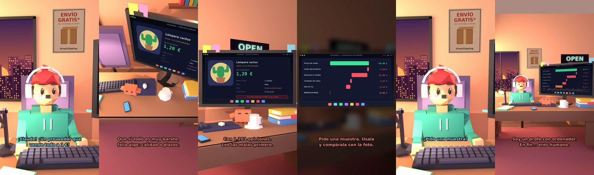

# Un proveedor que vende todo a 1 €



**Archivo de guion:** `guiones/drop_05_proveedor_barato.json` · **Ambiente:** `atardecer_tienda` · **Duración:** 45 s (270 frames de animación a 6 fps)

El tonto encuentra un proveedor «demasiado barato». Claude le enseña a desconfiar: leer las opiniones malas, pedir muestra y revisar plazos y marcado CE.

**Gancho (primera frase):** «¡Claude! ¡Un proveedor que vende todo a 1 €!»

## Cómo se genera el vídeo
```bash
python3 -I motor/montar_video.py guiones/drop_05_proveedor_barato.json salidas/drop_05_proveedor_barato.mp4
```
El guion se creó con `motor/generar_guiones.py` (tiempos automáticos según la longitud de cada frase y pantallas sincronizadas con el diálogo). Biblioteca usada: `biblioteca/atardecer_tienda/`.

## Guion plano a plano

| # | Tiempo | Quién | Texto | Plano | Emoción / pose / estado | Pantalla del monitor |
|---|---|---|---|---|---|---|
| 1 | 0.0–3.7 | Humano | ¡Claude! ¡Un proveedor que / vende todo a 1 €! | `humano` | ilusionado | proveedor (21.92 s) |
| 2 | 3.7–5.4 | Claude | ¿Y el envío? | `monitor` | mira_izq |  |
| 3 | 5.4–7.2 | Humano | Gratis. | `dos` | bobo |  |
| 4 | 7.2–8.9 | Claude | Gratis. Ya. | `claude_ojos` | mira_izq, empuje de cámara |  |
| 5 | 8.9–10.7 | Humano | ¿Qué pasa? | `humano` | confundido |  |
| 6 | 10.7–15.2 | Claude | Que si todo es muy barato, / falla algo: calidad o plazos. | `cenital` | mira_der |  |
| 7 | 15.2–17.2 | Humano | Tiene 4,1 estrellas. | `dos` | preocupado |  |
| 8 | 17.2–20.8 | Claude | Con 1.203 opiniones. / Lee las malas primero. | `monitor` | feliz |  |
| 9 | 20.8–23.2 | Humano | ¿Las malas? Qué mal rollo. | `humano` | bobo |  |
| 10 | 23.2–27.2 | Claude | Pide una muestra. Úsala / y compárala con la foto. | `pantalla_completa` | idle | margen (4.99 s) |
| 11 | 27.2–29.6 | Humano | ¿Y si no es como la foto? | `dos` | confundido |  |
| 12 | 29.6–33.5 | Claude | Te has ahorrado 200 pedidos / y 200 reclamaciones. | `claude_ojos` | feliz |  |
| 13 | 33.5–35.4 | Humano | ¡Pido una muestra! | `humano` | ilusionado |  |
| 14 | 35.4–39.1 | Claude | Y si es electrónico, que / lleve el marcado CE. | `monitor` | mira_arriba |  |
| 15 | 39.1–40.9 | Humano | ¡Eres un profe! | `dos` | feliz |  |
| 16 | 40.9–45.0 | Claude | Soy un profe con ordenador. / En fin... eres humano. | `general` | feliz |  |

## Datos reales que aparecen o se mencionan

- Si es electrónica o eléctrica, debe llevar marcado CE para venderse en la UE (ver vídeo drop_02).
  - Fuente: [Marcado CE (Tu Europa, Comisión Europea)](https://europa.eu/youreurope/business/product-requirements/labels-markings/ce-marking/index_es.htm)
  - Fuente: [Importaciones de fuera de la UE y marcado CE (Euronorm)](https://www.euronorm.net/content/ce-marking/category/import-and-export/imports-from-outside-the-eu-eea.php)
- Cifras de la ficha del proveedor (1,20 €, 4,1 estrellas, 1.203 opiniones) son ilustrativas.

## Notas de producción

- **Humor:** Claude es sarcástico y pícaro («como el que le salva el culo»); el humano es ingenuo y algo tonto (expresiones `bobo`, `ilusionado`, `confundido`).
- **Voces:** son «blips» sintéticos (no hay voz real). Para voz real: ElevenLabs o grabarla y sustituir el audio.
- **Cifras y leyes:** los datos reales están citados arriba; las cuentas de ejemplo (márgenes, 214 tiendas, etc.) son ilustrativas. No es asesoramiento financiero ni legal.
