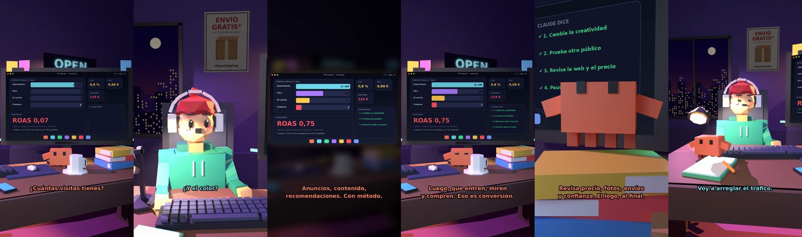

# Claude, mi tienda no vende. ¿Cambio el logo?



**Archivo de guion:** `guiones/drop_06_cambio_el_logo.json` · **Ambiente:** `noche_tienda` · **Duración:** 44 s (264 frames de animación a 6 fps)

El tonto cree que el problema de su tienda es el logo. Claude le enseña a mirar el embudo: tráfico, conversión y precio. Humor y método.

**Gancho (primera frase):** «Claude, mi tienda no vende. ¿Cambio el logo?»

## Cómo se genera el vídeo
```bash
python3 -I motor/montar_video.py guiones/drop_06_cambio_el_logo.json salidas/drop_06_cambio_el_logo.mp4
```
El guion se creó con `motor/generar_guiones.py` (tiempos automáticos según la longitud de cada frase y pantallas sincronizadas con el diálogo). Biblioteca usada: `biblioteca/noche_tienda/`.

## Guion plano a plano

| # | Tiempo | Quién | Texto | Plano | Emoción / pose / estado | Pantalla del monitor |
|---|---|---|---|---|---|---|
| 1 | 0.0–3.5 | Humano | Claude, mi tienda no vende. / ¿Cambio el logo? | `humano` | preocupado | anuncios (23.56 s) |
| 2 | 3.5–5.7 | Claude | ¿Cuántas visitas tienes? | `monitor` | mira_izq |  |
| 3 | 5.7–7.5 | Humano | Doce. Seis soy yo. | `dos` | bobo |  |
| 4 | 7.5–10.4 | Claude | Entonces el logo no es / el problema. | `claude_ojos` | feliz |  |
| 5 | 10.4–12.1 | Humano | ¿Y el color? | `humano` | ilusionado |  |
| 6 | 12.1–15.6 | Claude | Tampoco. Primero, tráfico: / gente que te vea. | `cenital` | mira_der |  |
| 7 | 15.6–17.3 | Humano | ¿Cómo la consigo? | `dos` | confundido |  |
| 8 | 17.3–21.2 | Claude | Anuncios, contenido, / recomendaciones. Con método. | `pantalla_completa` | idle |  |
| 9 | 21.2–22.9 | Humano | ¿Y luego? | `humano` | confundido |  |
| 10 | 22.9–27.2 | Claude | Luego, que entren, miren / y compren. Eso es conversión. | `monitor` | feliz |  |
| 11 | 27.2–28.8 | Humano | ¿Y si no compran? | `dos` | preocupado |  |
| 12 | 28.8–33.5 | Claude | Revisa precio, fotos, envíos / y confianza. El logo, al final. | `claude_ojos` | idle, empuje de cámara |  |
| 13 | 33.5–35.2 | Humano | Qué lío. | `humano` | preocupado |  |
| 14 | 35.2–38.1 | Claude | Un lío con orden. / Se llama negocio. | `monitor` | mira_arriba |  |
| 15 | 38.1–40.5 | Humano | Voy a arreglar el tráfico. | `dos` | feliz |  |
| 16 | 40.5–44.0 | Claude | Y el logo, el último. / En fin... eres humano. | `general` | feliz |  |

## Datos reales que aparecen o se mencionan

- Vídeo de humor, sin datos reales.

## Notas de producción

- **Humor:** Claude es sarcástico y pícaro («como el que le salva el culo»); el humano es ingenuo y algo tonto (expresiones `bobo`, `ilusionado`, `confundido`).
- **Voces:** son «blips» sintéticos (no hay voz real). Para voz real: ElevenLabs o grabarla y sustituir el audio.
- **Cifras y leyes:** los datos reales están citados arriba; las cuentas de ejemplo (márgenes, 214 tiendas, etc.) son ilustrativas. No es asesoramiento financiero ni legal.
