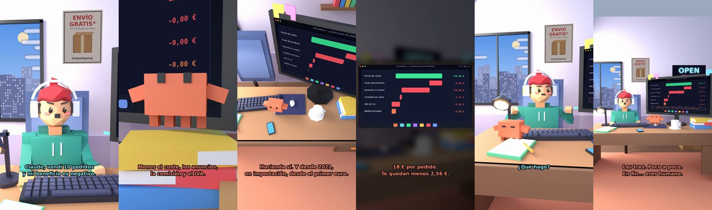

# Claude, vendí 10 y mi beneficio es negativo



**Archivo de guion:** `guiones/drop_08_beneficio_negativo.json` · **Ambiente:** `dia_tienda` · **Duración:** 44 s (264 frames de animación a 6 fps)

El tonto vendió 10 pedidos y su beneficio es negativo. Claude revisa los gastos ocultos: anuncios, comisiones, IVA y devoluciones.

**Gancho (primera frase):** «Claude, vendí 10 pedidos y mi beneficio es negativo.»

## Cómo se genera el vídeo
```bash
python3 -I motor/montar_video.py guiones/drop_08_beneficio_negativo.json salidas/drop_08_beneficio_negativo.mp4
```
El guion se creó con `motor/generar_guiones.py` (tiempos automáticos según la longitud de cada frase y pantallas sincronizadas con el diálogo). Biblioteca usada: `biblioteca/dia_tienda/`.

## Guion plano a plano

| # | Tiempo | Quién | Texto | Plano | Emoción / pose / estado | Pantalla del monitor |
|---|---|---|---|---|---|---|
| 1 | 0.0–4.2 | Humano | Claude, vendí 10 pedidos / y mi beneficio es negativo. | `humano` | preocupado | margen (32.11 s) |
| 2 | 4.2–6.3 | Claude | Enséñame los números. | `monitor` | mira_izq |  |
| 3 | 6.3–8.8 | Humano | Vendí a 29,90. Eso es mucho. | `dos` | bobo |  |
| 4 | 8.8–13.0 | Claude | Menos el coste, los anuncios, / la comisión y el IVA. | `claude_ojos` | idle |  |
| 5 | 13.0–15.5 | Humano | ¿El IVA? ¡Eso no lo cuento! | `humano` | confundido |  |
| 6 | 15.5–20.6 | Claude | Hacienda sí. Y desde 2021, / en importación, desde el primer euro. | `cenital` | mira_der |  |
| 7 | 20.6–22.3 | Humano | ¿Y los anuncios? | `dos` | preocupado |  |
| 8 | 22.3–25.7 | Claude | 18 € por pedido. / Te quedan menos 2,56 €. | `pantalla_completa` | idle |  |
| 9 | 25.7–28.4 | Humano | ¡Pierdo dinero con cada venta! | `humano` | preocupado, pose hombros |  |
| 10 | 28.4–32.0 | Claude | Y lo celebras con cada venta. / Muy coherente. | `monitor` | feliz |  |
| 11 | 32.0–33.8 | Humano | ¿Qué hago? | `dos` | confundido |  |
| 12 | 33.8–38.5 | Claude | Sube el precio, baja el coste / o baja el coste del anuncio. | `claude_ojos` | idle, empuje de cámara |  |
| 13 | 38.5–40.3 | Humano | ¿Cuál de las tres? | `humano` | bobo |  |
| 14 | 40.3–44.0 | Claude | Las tres. Poco a poco. / En fin... eres humano. | `general` | feliz |  |

## Datos reales que aparecen o se mencionan

- Cuenta ilustrativa por pedido: precio 29,90 € − coste 8,10 € − anuncio 12,00 € − comisión de cobro 1,17 € − IVA 5,19 € = 3,44 €. Si el anuncio sube a 18 €, el pedido deja −2,56 €. Cifras de ejemplo.
- IVA en importaciones: desde 1/7/2021 se paga IVA desde el primer euro.
  - Fuente: [Nuevas reglas de IVA para el comercio electrónico en la UE desde el 1/7/2021 (Organización Mundial de Aduanas)](https://www.wcoomd.org/es-es/media/newsroom/2021/june/the-european-union-introduces-new-value-added-tax-rules-for-e-commerce-from-1-july-202.aspx)
  - Fuente: [Fin de la exención de 22 € y ventanilla única de importación IOSS (Avalara)](https://www.avalara.com/vatlive/en/vat-news/eu-2021-ending--22-import-vat-exemption--new-ioss-return.html)

## Notas de producción

- **Humor:** Claude es sarcástico y pícaro («como el que le salva el culo»); el humano es ingenuo y algo tonto (expresiones `bobo`, `ilusionado`, `confundido`).
- **Voces:** son «blips» sintéticos (no hay voz real). Para voz real: ElevenLabs o grabarla y sustituir el audio.
- **Cifras y leyes:** los datos reales están citados arriba; las cuentas de ejemplo (márgenes, 214 tiendas, etc.) son ilustrativas. No es asesoramiento financiero ni legal.
