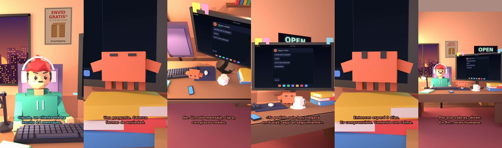

# Claude, un cliente me ha escrito 14 mensajes



**Archivo de guion:** `guiones/drop_09_cliente_14_mensajes.json` · **Ambiente:** `atardecer_tienda` · **Duración:** 40 s (240 frames de animación a 6 fps)

La atención al cliente al límite: 14 mensajes seguidos. Claude propone una respuesta única, clara y con calma.

**Gancho (primera frase):** «Claude, un cliente me ha escrito 14 mensajes.»

## Cómo se genera el vídeo
```bash
python3 -I motor/montar_video.py guiones/drop_09_cliente_14_mensajes.json salidas/drop_09_cliente_14_mensajes.mp4
```
El guion se creó con `motor/generar_guiones.py` (tiempos automáticos según la longitud de cada frase y pantallas sincronizadas con el diálogo). Biblioteca usada: `biblioteca/atardecer_tienda/`.

## Guion plano a plano

| # | Tiempo | Quién | Texto | Plano | Emoción / pose / estado | Pantalla del monitor |
|---|---|---|---|---|---|---|
| 1 | 0.0–4.1 | Humano | Claude, un cliente me ha / escrito 14 mensajes. | `humano` | preocupado | mensajes (33.95 s) |
| 2 | 4.1–6.0 | Claude | ¿Y qué pregunta? | `monitor` | mira_izq |  |
| 3 | 6.0–8.1 | Humano | Lo mismo. 14 veces. | `dos` | bobo |  |
| 4 | 8.1–11.9 | Claude | Una pregunta. Catorce / formas de ansiedad. | `claude_ojos` | feliz |  |
| 5 | 11.9–14.3 | Humano | ¿Contesto uno por uno? | `humano` | confundido |  |
| 6 | 14.3–18.5 | Claude | No. Un solo mensaje, claro, / con plazos reales. | `cenital` | mira_der |  |
| 7 | 18.5–20.4 | Humano | ¿Y qué pongo? | `dos` | confundido |  |
| 8 | 20.4–25.8 | Claude | «Tu pedido sale hoy, llegará / en X días; aquí el seguimiento». | `monitor` | feliz |  |
| 9 | 25.8–28.6 | Humano | ¿Y si me sigue escribiendo? | `humano` | preocupado |  |
| 10 | 28.6–34.0 | Claude | Entonces esperó 3 días. / Es comprensible. Contesta con calma. | `claude_ojos` | idle, empuje de cámara |  |
| 11 | 34.0–35.9 | Humano | Qué paciencia. | `dos` | ilusionado |  |
| 12 | 35.9–40.0 | Claude | Por eso cobras, dicen. / En fin... eres humano. | `general` | feliz |  |

## Datos reales que aparecen o se mencionan

- Vídeo de humor con consejos generales de atención al cliente (respuesta clara, plazos reales y seguimiento).

## Notas de producción

- **Humor:** Claude es sarcástico y pícaro («como el que le salva el culo»); el humano es ingenuo y algo tonto (expresiones `bobo`, `ilusionado`, `confundido`).
- **Voces:** son «blips» sintéticos (no hay voz real). Para voz real: ElevenLabs o grabarla y sustituir el audio.
- **Cifras y leyes:** los datos reales están citados arriba; las cuentas de ejemplo (márgenes, 214 tiendas, etc.) son ilustrativas. No es asesoramiento financiero ni legal.
