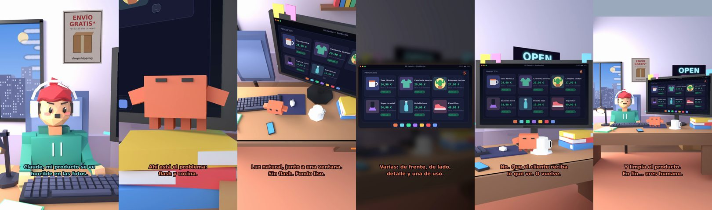

# Claude, mi producto se ve horrible en las fotos



**Archivo de guion:** `guiones/drop_10_fotos_del_producto.json` · **Ambiente:** `dia_tienda` · **Duración:** 38 s (228 frames de animación a 6 fps)

La fotografía de producto sin presupuesto: luz natural, fondo limpio, varios ángulos y una foto de uso. Sencillo y útil.

**Gancho (primera frase):** «Claude, mi producto se ve horrible en las fotos.»

## Cómo se genera el vídeo
```bash
python3 -I motor/montar_video.py guiones/drop_10_fotos_del_producto.json salidas/drop_10_fotos_del_producto.mp4
```
El guion se creó con `motor/generar_guiones.py` (tiempos automáticos según la longitud de cada frase y pantallas sincronizadas con el diálogo). Biblioteca usada: `biblioteca/dia_tienda/`.

## Guion plano a plano

| # | Tiempo | Quién | Texto | Plano | Emoción / pose / estado | Pantalla del monitor |
|---|---|---|---|---|---|---|
| 1 | 0.0–4.3 | Humano | Claude, mi producto se ve / horrible en las fotos. | `humano` | preocupado | catalogo (28.39 s) |
| 2 | 4.3–6.2 | Claude | ¿Cómo las haces? | `monitor` | mira_izq |  |
| 3 | 6.2–8.9 | Humano | Con el flash. En la cocina. | `dos` | bobo |  |
| 4 | 8.9–12.4 | Claude | Ahí está el problema: / flash y cocina. | `claude_ojos` | feliz |  |
| 5 | 12.4–14.3 | Humano | ¿Qué cambio? | `humano` | confundido |  |
| 6 | 14.3–19.2 | Claude | Luz natural, junto a una ventana. / Sin flash. Fondo liso. | `cenital` | mira_der |  |
| 7 | 19.2–21.1 | Humano | ¿Cuántas fotos? | `dos` | bobo |  |
| 8 | 21.1–25.6 | Claude | Varias: de frente, de lado, / detalle y una de uso. | `pantalla_completa` | idle |  |
| 9 | 25.6–27.9 | Humano | ¿Y si le añado filtros? | `humano` | ilusionado |  |
| 10 | 27.9–32.1 | Claude | No. Que el cliente reciba / lo que ve. O vuelve. | `monitor` | feliz |  |
| 11 | 32.1–34.0 | Humano | Entendido. | `dos` | feliz |  |
| 12 | 34.0–38.0 | Claude | Y limpia el producto. / En fin... eres humano. | `general` | feliz |  |

## Datos reales que aparecen o se mencionan

- Consejos generales de fotografía de producto: luz natural suave, fondo neutro, varios ángulos, una foto de escala/uso y no editar de forma engañosa.

## Notas de producción

- **Humor:** Claude es sarcástico y pícaro («como el que le salva el culo»); el humano es ingenuo y algo tonto (expresiones `bobo`, `ilusionado`, `confundido`).
- **Voces:** son «blips» sintéticos (no hay voz real). Para voz real: ElevenLabs o grabarla y sustituir el audio.
- **Cifras y leyes:** los datos reales están citados arriba; las cuentas de ejemplo (márgenes, 214 tiendas, etc.) son ilustrativas. No es asesoramiento financiero ni legal.
