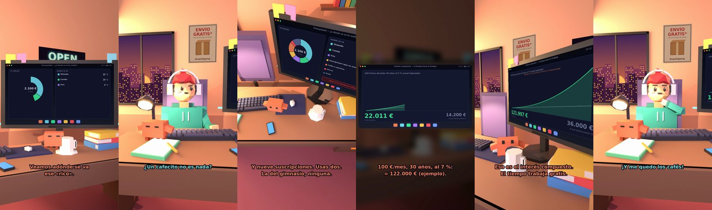

# ¿A dónde se va tu sueldo?



**Archivo de guion:** `guiones/extra_01_presupuesto.json` · **Ambiente:** `atardecer_tienda` · **Duración:** 45 s (270 frames de animación a 6 fps)

El tonto cobra 2.100 € y se siente rico. Claude le enseña a dónde se van: cafés, nueve suscripciones (usa dos), ahorro del 4 %. Y le enseña el interés compuesto con una cuenta de ejemplo.

**Gancho (primera frase):** «¡Cobro 2.100 € al mes! ¡Soy rico!»

## Cómo se genera el vídeo
```bash
python3 -I motor/montar_video.py guiones/extra_01_presupuesto.json salidas/extra_01_presupuesto.mp4
```
El guion se creó con `motor/generar_guiones.py` (tiempos automáticos según la longitud de cada frase y pantallas sincronizadas con el diálogo). Biblioteca usada: `biblioteca/atardecer_tienda/`.

## Guion plano a plano

| # | Tiempo | Quién | Texto | Plano | Emoción / pose / estado | Pantalla del monitor |
|---|---|---|---|---|---|---|
| 1 | 0.0–2.3 | Humano | ¡Cobro 2.100 € al mes! / ¡Soy rico! | `general` | ilusionado | presupuesto (11.45 s) |
| 2 | 2.3–4.5 | Claude | Veamos adónde se va / ese «rico». | `monitor` | feliz |  |
| 3 | 4.5–6.2 | Humano | Pues... a ningún sitio. | `humano` | bobo |  |
| 4 | 6.2–9.7 | Claude | Cafés y caprichos: 14 %. / Ahorro: 4 %. Qué equilibrio. | `pantalla_completa` | idle |  |
| 5 | 9.7–11.5 | Humano | ¿Un cafecito no es nada? | `dos` | confundido |  |
| 6 | 11.5–14.7 | Claude | Un café al día son 1.460 € / al año. Ya me dirás. | `claude_ojos` | mira_izq, empuje de cámara |  |
| 7 | 14.7–16.1 | Humano | ¿¡1.460 €!? | `humano` | preocupado |  |
| 8 | 16.1–19.9 | Claude | Y nueve suscripciones. Usas dos. / La del gimnasio, ninguna. | `cenital` | mira_der |  |
| 9 | 19.9–21.8 | Humano | Me hace ilusión pagarlas. | `dos` | bobo, pose pensar |  |
| 10 | 21.8–24.1 | Claude | A ellos también les hace ilusión. | `monitor` | feliz |  |
| 11 | 24.1–25.9 | Humano | ¿Ahorrar sirve de algo? | `humano` | confundido | interes (5.63 s) |
| 12 | 25.9–29.2 | Claude | 100 €/mes, 30 años, al 7 %: / ≈ 122.000 € (ejemplo). | `pantalla_completa` | idle |  |
| 13 | 29.2–31.1 | Humano | ¡Yo solo he puesto 36.000! | `dos` | ilusionado |  |
| 14 | 31.1–34.7 | Claude | Eso es el interés compuesto. / El tiempo trabaja gratis. | `monitor_lateral` | idle |  |
| 15 | 34.7–36.2 | Humano | ¡Ahorraré 100 € ya! | `humano` | ilusionado |  |
| 16 | 36.2–40.2 | Claude | Empieza cancelando 7 suscripciones. / Yo las cancelo. Tú, mira. | `general` | feliz |  |
| 17 | 40.2–41.9 | Humano | ¡Y me quedo los cafés! | `dos` | feliz |  |
| 18 | 41.9–45.0 | Claude | No se puede tener todo. / Pero se puede intentar. | `claude_ojos` | mira_izq, empuje de cámara |  |

## Datos reales que aparecen o se mencionan

- Orientación popular: regla 50/30/20 (≈50 % necesidades, 30 % deseos, 20 % ahorro/deuda). Es una guía flexible, no una norma.
  - Fuente: [La regla 50/30/20 (Bankinter)](https://www.bankinter.com/blog/finanzas-personales/regla-50-20-30)
  - Fuente: [Qué es la regla 50/30/20 (Semana)](https://www.semana.com/ahorro-e-inversion/articulo/que-es-la-regla-503020-para-manejar-mejor-su-dinero/80205/)
- Cuenta del ejemplo del interés compuesto: 100 €/mes durante 30 años a un 7 % anual constante ≈ 122.000 € (aportado: 36.000 €). Es una ilustración matemática: la rentabilidad real varía y no está garantizada.
- Un café de 4 € cada día son 1.460 € al año (4 × 365).

## Notas de producción

- **Humor:** Claude es sarcástico y pícaro («como el que le salva el culo»); el humano es ingenuo y algo tonto (expresiones `bobo`, `ilusionado`, `confundido`).
- **Voces:** son «blips» sintéticos (no hay voz real). Para voz real: ElevenLabs o grabarla y sustituir el audio.
- **Cifras y leyes:** los datos reales están citados arriba; las cuentas de ejemplo (márgenes, 214 tiendas, etc.) son ilustrativas. No es asesoramiento financiero ni legal.
