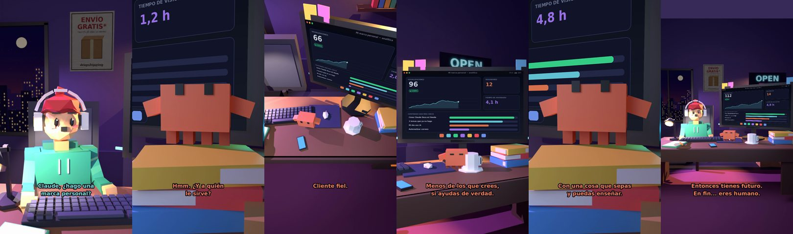

# Claude, ¿hago una marca personal?



**Archivo de guion:** `guiones/extra_06_marca_personal.json` · **Ambiente:** `noche_tienda` · **Duración:** 38 s (228 frames de animación a 6 fps)

Todos quieren una marca personal. Claude pregunta lo básico: ¿qué ofreces, a quién y por qué te van a creer?

**Gancho (primera frase):** «Claude, ¿hago una marca personal?»

## Cómo se genera el vídeo
```bash
python3 -I motor/montar_video.py guiones/extra_06_marca_personal.json salidas/extra_06_marca_personal.mp4
```
El guion se creó con `motor/generar_guiones.py` (tiempos automáticos según la longitud de cada frase y pantallas sincronizadas con el diálogo). Biblioteca usada: `biblioteca/noche_tienda/`.

## Guion plano a plano

| # | Tiempo | Quién | Texto | Plano | Emoción / pose / estado | Pantalla del monitor |
|---|---|---|---|---|---|---|
| 1 | 0.0–3.7 | Humano | Claude, ¿hago una / marca personal? | `humano` | ilusionado | analitica (34.23 s) |
| 2 | 3.7–5.9 | Claude | ¿Qué ofreces? | `monitor` | mira_izq |  |
| 3 | 5.9–8.6 | Humano | Mi cara. Y mi estilo. | `dos` | bobo |  |
| 4 | 8.6–11.5 | Claude | Hmm. ¿Y a quién / le sirve? | `claude_ojos` | idle |  |
| 5 | 11.5–13.7 | Humano | A mi madre. | `humano` | ilusionado |  |
| 6 | 13.7–16.0 | Claude | Cliente fiel. | `cenital` | mira_der |  |
| 7 | 16.0–19.3 | Humano | ¿Cuántos seguidores / necesito? | `dos` | confundido |  |
| 8 | 19.3–24.0 | Claude | Menos de los que crees, / si ayudas de verdad. | `monitor` | feliz |  |
| 9 | 24.0–26.4 | Humano | ¿Y con qué empiezo? | `humano` | preocupado |  |
| 10 | 26.4–30.8 | Claude | Con una cosa que sepas / y puedas enseñar. | `claude_ojos` | mira_arriba |  |
| 11 | 30.8–33.1 | Humano | Sé... dormir. | `dos` | bobo |  |
| 12 | 33.1–38.0 | Claude | Entonces tienes futuro. / En fin... eres humano. | `general` | feliz |  |

## Datos reales que aparecen o se mencionan

- Vídeo de humor, sin datos reales.

## Notas de producción

- **Humor:** Claude es sarcástico y pícaro («como el que le salva el culo»); el humano es ingenuo y algo tonto (expresiones `bobo`, `ilusionado`, `confundido`).
- **Voces:** son «blips» sintéticos (no hay voz real). Para voz real: ElevenLabs o grabarla y sustituir el audio.
- **Cifras y leyes:** los datos reales están citados arriba; las cuentas de ejemplo (márgenes, 214 tiendas, etc.) son ilustrativas. No es asesoramiento financiero ni legal.
