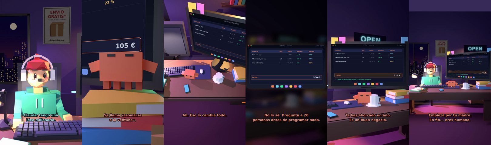

# Claude, tengo una idea millonaria



**Archivo de guion:** `guiones/extra_07_idea_millonaria.json` · **Ambiente:** `noche_tienda` · **Duración:** 38 s (228 frames de animación a 6 fps)

La idea «millonaria» que ya existe diez veces. Claude propone validar antes de gastar.

**Gancho (primera frase):** «Claude, tengo una idea millonaria.»

## Cómo se genera el vídeo
```bash
python3 -I motor/montar_video.py guiones/extra_07_idea_millonaria.json salidas/extra_07_idea_millonaria.mp4
```
El guion se creó con `motor/generar_guiones.py` (tiempos automáticos según la longitud de cada frase y pantallas sincronizadas con el diálogo). Biblioteca usada: `biblioteca/noche_tienda/`.

## Guion plano a plano

| # | Tiempo | Quién | Texto | Plano | Emoción / pose / estado | Pantalla del monitor |
|---|---|---|---|---|---|---|
| 1 | 0.0–3.4 | Humano | Claude, tengo una / idea millonaria. | `humano` | ilusionado | hoja (28.11 s) |
| 2 | 3.4–5.4 | Claude | Cuéntamela. | `monitor` | mira_izq |  |
| 3 | 5.4–8.9 | Humano | Una app para... / saber si hace frío. | `dos` | ilusionado |  |
| 4 | 8.9–12.3 | Claude | Se llama «asomarse / a la ventana». | `claude_ojos` | feliz |  |
| 5 | 12.3–14.9 | Humano | Pero con notificaciones. | `humano` | bobo |  |
| 6 | 14.9–17.4 | Claude | Ah. Eso lo cambia todo. | `cenital` | mira_der |  |
| 7 | 17.4–19.9 | Humano | ¿Crees que funcionará? | `dos` | preocupado |  |
| 8 | 19.9–25.3 | Claude | No lo sé. Pregunta a 20 / personas antes de programar nada. | `pantalla_completa` | idle |  |
| 9 | 25.3–27.5 | Humano | ¿Y si dicen que no? | `humano` | confundido |  |
| 10 | 27.5–31.7 | Claude | Te has ahorrado un año. / Es un buen negocio. | `monitor` | feliz |  |
| 11 | 31.7–33.7 | Humano | Voy a preguntar. | `dos` | feliz |  |
| 12 | 33.7–38.0 | Claude | Empieza por tu madre. / En fin... eres humano. | `general` | feliz |  |

## Datos reales que aparecen o se mencionan

- Vídeo de humor, sin datos reales.

## Notas de producción

- **Humor:** Claude es sarcástico y pícaro («como el que le salva el culo»); el humano es ingenuo y algo tonto (expresiones `bobo`, `ilusionado`, `confundido`).
- **Voces:** son «blips» sintéticos (no hay voz real). Para voz real: ElevenLabs o grabarla y sustituir el audio.
- **Cifras y leyes:** los datos reales están citados arriba; las cuentas de ejemplo (márgenes, 214 tiendas, etc.) son ilustrativas. No es asesoramiento financiero ni legal.
