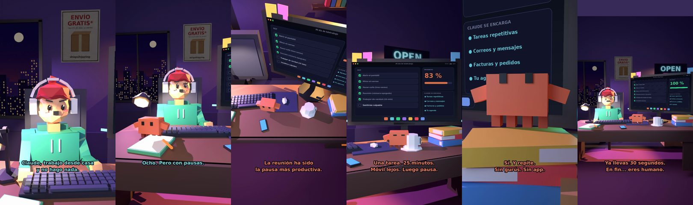

# Claude, trabajo desde casa y no hago nada



**Archivo de guion:** `guiones/extra_08_trabajar_desde_casa.json` · **Ambiente:** `noche_tienda` · **Duración:** 38 s (228 frames de animación a 6 fps)

El teletrabajo y la productividad fantasma: Claude propone un plan sencillo sin gurús.

**Gancho (primera frase):** «Claude, trabajo desde casa y no hago nada.»

## Cómo se genera el vídeo
```bash
python3 -I motor/montar_video.py guiones/extra_08_trabajar_desde_casa.json salidas/extra_08_trabajar_desde_casa.mp4
```
El guion se creó con `motor/generar_guiones.py` (tiempos automáticos según la longitud de cada frase y pantallas sincronizadas con el diálogo). Biblioteca usada: `biblioteca/noche_tienda/`.

## Guion plano a plano

| # | Tiempo | Quién | Texto | Plano | Emoción / pose / estado | Pantalla del monitor |
|---|---|---|---|---|---|---|
| 1 | 0.0–4.2 | Humano | Claude, trabajo desde casa / y no hago nada. | `humano` | preocupado | tareas (33.03 s) |
| 2 | 4.2–7.0 | Claude | ¿Cuántas horas trabajas? | `monitor` | mira_izq |  |
| 3 | 7.0–9.5 | Humano | Ocho. Pero con pausas. | `dos` | bobo |  |
| 4 | 9.5–11.6 | Claude | ¿Cuántas pausas? | `claude_ojos` | idle |  |
| 5 | 11.6–14.1 | Humano | Siete. Y una reunión. | `humano` | confundido |  |
| 6 | 14.1–18.4 | Claude | La reunión ha sido / la pausa más productiva. | `cenital` | mira_der |  |
| 7 | 18.4–21.0 | Humano | Me cuesta concentrarme. | `dos` | preocupado |  |
| 8 | 21.0–25.8 | Claude | Una tarea. 25 minutos. / Móvil lejos. Luego pausa. | `monitor` | feliz |  |
| 9 | 25.8–27.9 | Humano | ¿Así de simple? | `humano` | confundido |  |
| 10 | 27.9–31.4 | Claude | Sí. Y repite. / Sin gurús. Sin app. | `claude_ojos` | idle, empuje de cámara |  |
| 11 | 31.4–33.5 | Humano | Voy a probarlo. | `dos` | feliz |  |
| 12 | 33.5–38.0 | Claude | Ya llevas 30 segundos. / En fin... eres humano. | `general` | feliz |  |

## Datos reales que aparecen o se mencionan

- Vídeo de humor, sin datos reales.

## Notas de producción

- **Humor:** Claude es sarcástico y pícaro («como el que le salva el culo»); el humano es ingenuo y algo tonto (expresiones `bobo`, `ilusionado`, `confundido`).
- **Voces:** son «blips» sintéticos (no hay voz real). Para voz real: ElevenLabs o grabarla y sustituir el audio.
- **Cifras y leyes:** los datos reales están citados arriba; las cuentas de ejemplo (márgenes, 214 tiendas, etc.) son ilustrativas. No es asesoramiento financiero ni legal.
