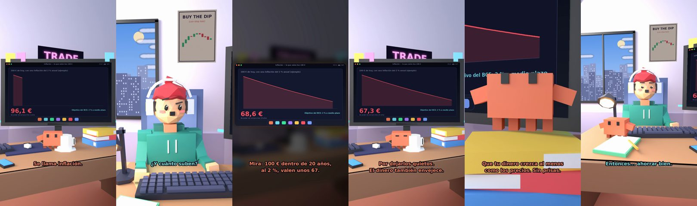

# Claude, ¿por qué todo está más caro?



**Archivo de guion:** `guiones/fin_01_que_es_la_inflacion.json` · **Ambiente:** `dia_trading` · **Duración:** 42 s (252 frames de animación a 6 fps)

La inflación explicada con un euro que compra cada vez menos: el objetivo del BCE (2 % a medio plazo) y qué significa para tus ahorros.

**Gancho (primera frase):** «Claude, ¿por qué todo está más caro?»

## Cómo se genera el vídeo
```bash
python3 -I motor/montar_video.py guiones/fin_01_que_es_la_inflacion.json salidas/fin_01_que_es_la_inflacion.mp4
```
El guion se creó con `motor/generar_guiones.py` (tiempos automáticos según la longitud de cada frase y pantallas sincronizadas con el diálogo). Biblioteca usada: `biblioteca/dia_trading/`.

## Guion plano a plano

| # | Tiempo | Quién | Texto | Plano | Emoción / pose / estado | Pantalla del monitor |
|---|---|---|---|---|---|---|
| 1 | 0.0–2.8 | Humano | Claude, ¿por qué todo está más caro? | `humano` | confundido | inflacion (21.01 s) |
| 2 | 2.8–4.4 | Claude | Se llama inflación. | `monitor` | mira_izq |  |
| 3 | 4.4–5.9 | Humano | ¿Es un virus? | `dos` | bobo |  |
| 4 | 5.9–9.4 | Claude | Casi. Los precios suben y / tu dinero compra menos. | `claude_ojos` | feliz |  |
| 5 | 9.4–10.9 | Humano | ¿Y cuánto suben? | `humano` | confundido |  |
| 6 | 10.9–13.9 | Claude | El BCE busca un 2 % anual / a medio plazo. | `cenital` | mira_der |  |
| 7 | 13.9–16.2 | Humano | ¿Solo un 2 %? Eso no es nada. | `dos` | bobo |  |
| 8 | 16.2–20.0 | Claude | Mira: 100 € dentro de 20 años, / al 2 %, valen unos 67. | `pantalla_completa` | idle |  |
| 9 | 20.0–22.3 | Humano | ¿¡Pierdo 33 € sin hacer nada!? | `humano` | preocupado |  |
| 10 | 22.3–25.8 | Claude | Por dejarlos quietos. / El dinero también envejece. | `monitor` | feliz |  |
| 11 | 25.8–27.4 | Humano | ¿Y qué hago? | `dos` | preocupado |  |
| 12 | 27.4–31.5 | Claude | Que tu dinero crezca al menos / como los precios. Sin prisas. | `claude_ojos` | idle, empuje de cámara |  |
| 13 | 31.5–33.8 | Humano | ¿Debajo del colchón no vale? | `humano` | bobo |  |
| 14 | 33.8–37.0 | Claude | Vale. Para perder valor / con mucha comodidad. | `monitor` | mira_arriba |  |
| 15 | 37.0–39.0 | Humano | Entonces... ahorrar bien. | `dos` | feliz |  |
| 16 | 39.0–42.0 | Claude | Eso. Ahorrar bien. / En fin... eres humano. | `general` | feliz |  |

## Datos reales que aparecen o se mencionan

- El BCE define la estabilidad de precios con una inflación del 2 % a medio plazo (objetivo simétrico desde 2021; no es un techo).
  - Fuente: [BCE — Estabilidad de precios: objetivo de inflación del 2 % a medio plazo](https://www.ecb.europa.eu/ecb-and-you/explainers/tell-me-more/html/stableprices.es.html)
- Cuenta del ejemplo: 100 € con una inflación constante del 2 % anual tienen, tras 20 años, un poder de compra de 100 / 1,02^20 ≈ 67,3 €. Ilustración matemática, no una previsión.

## Notas de producción

- **Humor:** Claude es sarcástico y pícaro («como el que le salva el culo»); el humano es ingenuo y algo tonto (expresiones `bobo`, `ilusionado`, `confundido`).
- **Voces:** son «blips» sintéticos (no hay voz real). Para voz real: ElevenLabs o grabarla y sustituir el audio.
- **Cifras y leyes:** los datos reales están citados arriba; las cuentas de ejemplo (márgenes, 214 tiendas, etc.) son ilustrativas. No es asesoramiento financiero ni legal.
