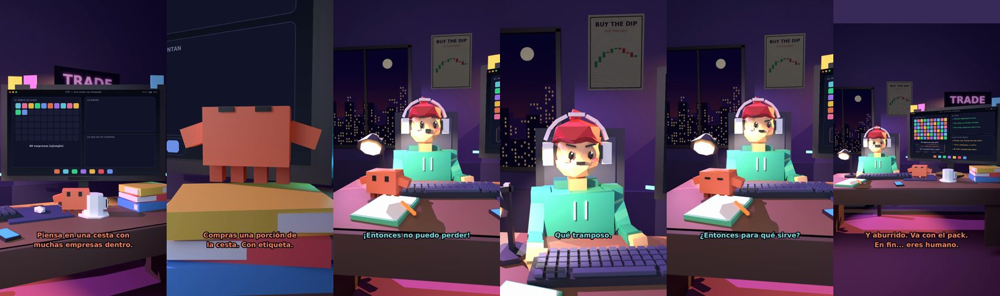

# Claude, ¿qué es un ETF?



**Archivo de guion:** `guiones/fin_02_que_es_un_etf.json` · **Ambiente:** `noche_trading` · **Duración:** 42 s (252 frames de animación a 6 fps)

Un ETF explicado como una cesta con etiqueta: replica un índice, se negocia en bolsa, tiene costes y puede caer. Con la guía de la CNMV como fuente.

**Gancho (primera frase):** «Claude, ¿qué es un ETF?»

## Cómo se genera el vídeo
```bash
python3 -I motor/montar_video.py guiones/fin_02_que_es_un_etf.json salidas/fin_02_que_es_un_etf.mp4
```
El guion se creó con `motor/generar_guiones.py` (tiempos automáticos según la longitud de cada frase y pantallas sincronizadas con el diálogo). Biblioteca usada: `biblioteca/noche_trading/`.

## Guion plano a plano

| # | Tiempo | Quién | Texto | Plano | Emoción / pose / estado | Pantalla del monitor |
|---|---|---|---|---|---|---|
| 1 | 0.0–2.0 | Humano | Claude, ¿qué es un ETF? | `humano` | confundido | etf (24.95 s) |
| 2 | 2.0–5.6 | Claude | Piensa en una cesta con / muchas empresas dentro. | `monitor` | mira_izq |  |
| 3 | 5.6–7.4 | Humano | ¿Y la compro entera? | `dos` | bobo |  |
| 4 | 7.4–10.9 | Claude | Compras una porción de / la cesta. Con etiqueta. | `claude_ojos` | feliz |  |
| 5 | 10.9–13.0 | Humano | ¿Y la etiqueta qué pone? | `humano` | confundido |  |
| 6 | 13.0–16.9 | Claude | El índice que copia. / Por ejemplo, las 500 mayores. | `cenital` | mira_der |  |
| 7 | 16.9–19.1 | Humano | ¡Entonces no puedo perder! | `dos` | ilusionado |  |
| 8 | 19.1–23.7 | Claude | Sí puedes. Si el índice cae, / el ETF cae. Es riesgo de mercado. | `pantalla_completa` | idle |  |
| 9 | 23.7–25.3 | Humano | Qué tramposo. | `humano` | preocupado |  |
| 10 | 25.3–29.6 | Claude | Y tiene comisiones y costes / de comprar y vender en bolsa. | `monitor` | feliz |  |
| 11 | 29.6–31.8 | Humano | ¿Entonces para qué sirve? | `dos` | confundido |  |
| 12 | 31.8–36.5 | Claude | Para repartir el riesgo entre / muchas empresas, sin elegirlas tú. | `claude_ojos` | idle, empuje de cámara |  |
| 13 | 36.5–38.2 | Humano | Eso suena sensato. | `humano` | ilusionado |  |
| 14 | 38.2–42.0 | Claude | Y aburrido. Va con el pack. / En fin... eres humano. | `general` | feliz |  |

## Datos reales que aparecen o se mencionan

- Según la CNMV: muchos ETF buscan replicar un índice de referencia; se compran y venden en bolsa en tiempo real; asumen comisiones de gestión/depósito y costes de compraventa; los de renta variable están sujetos a riesgo de mercado (pueden caer); su valor liquidativo puede diferir del índice por comisiones, gastos y dividendos.
  - Fuente: [CNMV — Guía «Los fondos cotizados (ETF)»](https://www.cnmv.es/DocPortal/Publicaciones/Guias/Los_fondos_cotizados_ETF.pdf)
  - Fuente: [CNMV — Ficha «Fondos cotizados (ETF)»](https://www.cnmv.es/DocPortal/Publicaciones/Fichas/FondosCotizados(ETF).pdf)
- Contenido educativo, no asesoramiento financiero.

## Notas de producción

- **Humor:** Claude es sarcástico y pícaro («como el que le salva el culo»); el humano es ingenuo y algo tonto (expresiones `bobo`, `ilusionado`, `confundido`).
- **Voces:** son «blips» sintéticos (no hay voz real). Para voz real: ElevenLabs o grabarla y sustituir el audio.
- **Cifras y leyes:** los datos reales están citados arriba; las cuentas de ejemplo (márgenes, 214 tiendas, etc.) son ilustrativas. No es asesoramiento financiero ni legal.
